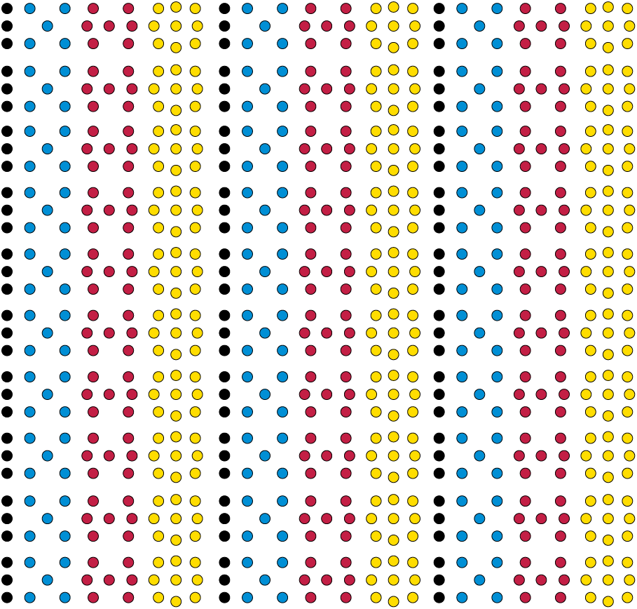
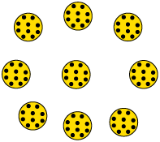
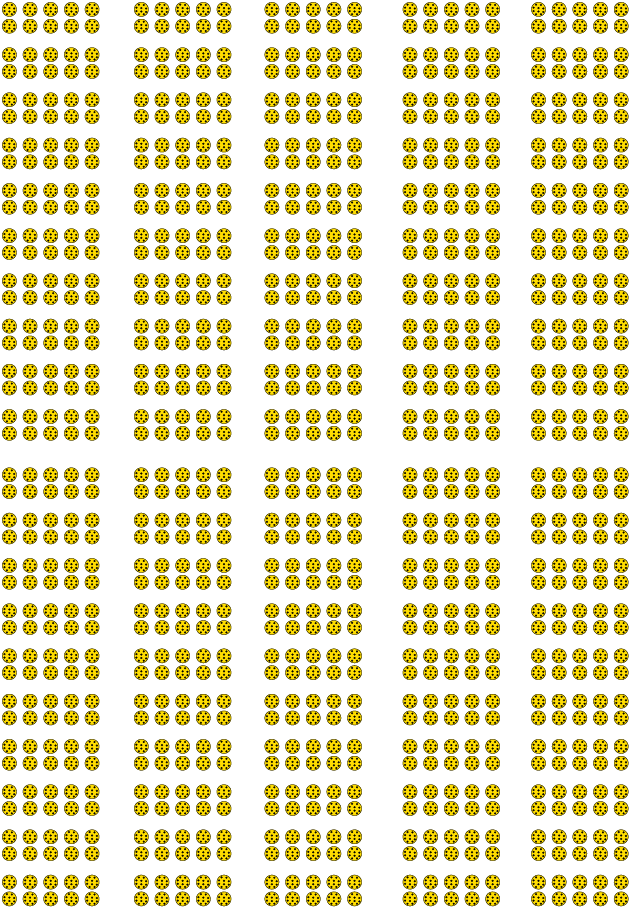
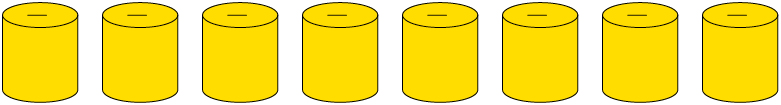
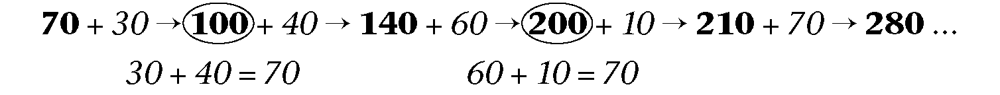

## Revision

**Do not use a calculator at all in section 1.1.**

### Build numbers up and break numbers down

2. Write each of the following sums as a single number:
   <Callout type="note" title="Note">
   The word **sum** is used to indicate two or more numbers that have to be added.
   </Callout>
   2. \( 4 000 + 800 + 60 + 5\)
   4. \( 8 000 + 300 + 7\)
   6. \( 40 000 + 9 000 + 200 + 3\)
   8. \( 800 000 + 70 000 + 3 000 + 900 + 2\)
      <Callout type="note" title="Note">
      The answer obtained when the numbers are added, is also called the **sum**. We say: 20 is the sum of 15 and 5.
      </Callout>
   10. \( 8 \text{ thousands} + 7 \text{ hundreds} + 8 \text{ units}\)
   12. \(4 \text{ hundred thousands} + 8 \text{ ten thousands} + 4 \text{ hundreds} + 9 \text{ tens}\)
4. What is the sum of \(8 000\) and \(24\)?
6. Write each of the numbers below as a sum of units, tens, hundreds, thousands, ten thousands and hundred thousands, like the numbers were given in question 1(e) and (f).
   <Callout type="note" title="Note">
   When a number is written as a sum of units, tens, hundreds, thousands etc., it is called the **expanded notation**.
   </Callout>
   2. \(8 706 =\)
   4. \(449 203 =\)
   6. \(83 490 = \)
   8. \(873 092 =\)
8. Arrange the numbers in question 3 from smallest to biggest.
10. Write the numbers in expanded notation (for example, \(791 = 700 + 90 + 1\)).
   2. \(493 020\)
   4. \(409 302\)
   6. \(490 032 \)
   8. \(400 932\)
12. Arrange the numbers in question 5 from biggest to smallest.
14. Write each sum as a single number.
   2. \(600 000 + 40 000 + 27 000 + 100 + 20 + 34\)
   4. \(320 000 + 40 000 + 8 000 + 670 + 10 + 5 \)
   6. \( 500 000 + 280 000 + 7 000 + 300 + 170 + 38\)
   8. \( 4 \text{ hundred thousands} + 18 \text{ ten thousands} + 4 \text{ hundreds} + 29 \text{ tens} + 5 \text{ units}\)
16. Write each sum as a single number.
   2. \(300 000 + 70 000 + 6 000 + 400 + 80 + 6\)
   4. \(400 000 + 20 000 + 2 000 + 500 + 10 + 3 \)
   6. \( 500 000 + 40 000 + 7 000 + 300 + 60 + 6\)
   8. \(800 000 + 90 000 + 7 000 + 800 + 90 + 8\)
   10. \(300 000 + 110 000 + 12 000 + 400 + 110 + 3\)
18. In each case, add the two numbers. Write the answer in expanded form and also as a single number.
   2. (a) The number in 8(a) and the number in 8(b)
   4. The number in 8(c) and the number in 8(b)
   6. The number in 8(c) and the number in 8(a)
   8. The number in 8(d) and the number in 8(a)
20. 2. Subtract the number in 8(b) from the number in 8(d).
   4. Are the numbers in 8(b) and 8(e) the same?
   6. Subtract the number in 8(a) from the number in 8(b).
22. Write each of the following products as a single number:
   <Callout type="note" title="Note">
   The word **product** is used to indicate two or more numbers that have to be multiplied.
   </Callout>
   2. \(2 \times 3\)
   4. \(2 \times 3 \times 5\)
   6. \(2 \times 3 \times 5 \times 7\)
   8. \(2 \times 3 \times 5 \times 7 \times 2\)
      <Callout type="note" title="Note">
      The answer obtained when numbers are multiplied, is also called the **product**. We say: 20 is the product of 2 and 10.
      </Callout>
   10. \(2 \times 3 \times 5 \times 7 \times 2 \times 2\)
24. 2. What is the product of 20 and 500?
   4. Write 1 000 as a product of 5 and another number.
   6. Write 1 000 as a product of 50 and another number.
   8. Write 1 000 as a product of 25 and another number.
   10. What is the product of 2 500 and 4?
   12. What is the product of 250 and 40?
26. In the table on the right, the number in each yellow cell is formed by adding the number in the red row above it to the number in the blue column to its left. Write the correct numbers in all the empty yellow cells.
   | \(+\) | 2 | 3 | 4 | 5 |
   | --- | --- | --- | --- | --- |
   | 10 |  |  |  |  |
   | 20 |  |  |  |  |
   | 30 |  |  | 34 |  |
   | 40 |  |  |  |  |
   | 50 |  |  |  |  |
   | 60 |  | 63 |  | 65 |
   | 70 |  |  |  |  |
28. The table below is formed in the same way as the table on the right. Fill in all the cells for which you know the answers immediately. Leave the other cells open for now.
   | \(+\) | 8 | 5 | 4 | 9 | 7 | 3 | 6 | 18 | 36 | 57 |
   | --- | --- | --- | --- | --- | --- | --- | --- | --- | --- | --- |
   | 7 |  |  |  |  |  |  |  |  |  | 64 |
   | 3 |  |  |  |  |  | 6 |  |  |  |  |
   | 9 |  |  |  |  |  |  |  |  |  |  |
   | 5 |  |  |  |  |  |  |  |  |  |  |
   | 8 |  |  |  |  |  |  |  |  |  |  |
   | 6 |  |  |  |  |  |  |  |  |  |  |
   | 4 |  |  |  |  |  |  |  |  |  |  |

### Multiples

2. In the arrangement below, the blue dots are in groups like this:
   
   The red dots are in groups like this:
   
   2. How would you go about finding the number of blue dots below, if you do not want to count them one by one?
   4. Implement your plan, to find out how many blue dots there are.
      

Suppose you want to know how many black dots there are in the arrangement on page 6. One way is to **count in groups** of three. When you do this, you may have to point with your finger or pencil to keep track.

The counting will go like this: *three*, *six*, *nine*, *twelve*, *fifteen*, *eighteen* . . .

Another way to find out how many black dots there are is to **analyse** the arrangement and **do some calculations**. In the arrangement, there are ten rows of threes from the top to the bottom, and three columns of threes from left to right, just as in the table alongside.

| 3 | 3 | 3 |
| --- | --- | --- |
| 3 | 3 | 3 |
| 3 | 3 | 3 |
| 3 | 3 | 3 |
| 3 | 3 | 3 |
| 3 | 3 | 3 |
| 3 | 3 | 3 |
| 3 | 3 | 3 |
| 3 | 3 | 3 |
| 3 | 3 | 3 |

One way to calculate the total number of black dots is to do \(3 \times 10 = 30\) for the dots in each column, and then \(30 + 30 + 30 = 90\). Another way is to add up in each row \((3 + 3 + 3 = 9)\) and then multiply by 10: \(10 \times 9 = 90\). A third way is to notice that there are \(3 \times 10 = 30\) groups of three, so the total is \(3 \times 30 = 90\).

2. When you determined the number of blue dots in question 1(b), did you count in fives, or did you analyse and calculate, or did you use some other method? Now use a different method to determine the number of blue dots and check whether you get the same answer as before. Describe the method that you now use.
4. The numbers that you get when you count in fives are called **multiples** of five. Draw circles around all the multiples of 5 in the table below.
   | 1 | 2 | 3 | 4 | 5 | 6 | 7 | 8 | 9 | 10 |
   | --- | --- | --- | --- | --- | --- | --- | --- | --- | --- |
   | 11 | 12 | 13 | 14 | 15 | 16 | 17 | 18 | 19 | 20 |
   | 21 | 22 | 23 | 24 | 25 | 26 | 27 | 28 | 29 | 30 |
   | 31 | 32 | 33 | 34 | 35 | 36 | 37 | 38 | 39 | 40 |
   | 41 | 42 | 43 | 44 | 45 | 46 | 47 | 48 | 49 | 50 |
   | 51 | 52 | 53 | 54 | 55 | 56 | 57 | 58 | 59 | 60 |
   | 61 | 62 | 63 | 64 | 65 | 66 | 67 | 68 | 69 | 70 |
   | 71 | 72 | 73 | 74 | 75 | 76 | 77 | 78 | 79 | 80 |
   | 81 | 82 | 83 | 84 | 85 | 86 | 87 | 88 | 89 | 90 |
   | 91 | 92 | 93 | 94 | 95 | 96 | 97 | 98 | 99 | 100 |
   | 101 | 102 | 103 | 104 | 105 | 106 | 107 | 108 | 109 | 110 |
   | 111 | 112 | 113 | 114 | 115 | 116 | 117 | 118 | 119 | 120 |
6. How many red dots are there in the arrangement on page 6? Describe the method that you use to find this out.
8. 2. Underline all the multiples of 7 in the table in question 3.
      <Callout type="note" title="Note">
      A number that is a multiple of 5, and also a multiple of 7, is called a **common multiple** of 5 and 7.
      </Callout>
   4. Which multiples of 5 in the table are also multiples of 7?
10. How many yellow dots are there in the arrangement on page 6? Describe the method that you use to find this out.
12. 2. Cross out all the multiples of 9 in the table in question 3.
   4. Which numbers in the table in question 3 are common multiples of 7 and 9?
14. 2. Look at the numbers in the yellow cells of the table below. How are these numbers formed from the numbers in the red row and the numbers in the blue column?
   4. Fill in all the cells for which you know the answers immediately. Leave the other cells open for now.
      | \(\times\) | 8 | 5 | 4 | 9 | 7 | 3 | 6 | 2 | 10 | 20 |
      | --- | --- | --- | --- | --- | --- | --- | --- | --- | --- | --- |
      | 7 |  |  |  |  |  |  |  |  |  |  |
      | 3 |  |  |  |  |  |  |  |  |  |  |
      | 9 |  |  |  |  |  |  |  |  | 90 |  |
      | 5 |  |  | 20 |  |  |  |  |  |  |  |
      | 8 |  |  |  |  |  |  |  |  |  |  |
      | 6 |  |  |  |  |  |  |  |  |  |  |
      | 4 |  |  |  |  |  |  |  |  |  |  |
      | 2 |  |  |  |  |  |  |  |  |  |  |
      | 10 |  | 50 |  |  |  |  |  |  |  |  |
      | 20 |  |  |  |  |  | 60 |  |  |  |  |
16. Write down the first thirteen multiples of each of the numbers in the column on the left. The multiples of 4 are already written in, as an example.
   | 1 | 2 | 3 | 4 | 5 | 6 | 7 | 8 | 9 | 10 | 11 | 12 | 13 |
   | --- | --- | --- | --- | --- | --- | --- | --- | --- | --- | --- | --- | --- |
   | 2 |  |  |  |  |  |  |  |  |  |  |  |  |
   | 3 |  |  |  |  |  |  |  |  |  |  |  |  |
   | 4 | 8 | 12 | 16 | 20 | 24 | 28 | 32 | 36 | 40 | 44 | 48 | 52 |
   | 5 |  |  |  |  |  |  |  |  |  |  |  |  |
   | 6 |  |  |  |  |  |  |  |  |  |  |  |  |
   | 7 |  |  |  |  |  |  |  |  |  |  |  |  |
   | 8 |  |  |  |  |  |  |  |  |  |  |  |  |
   | 9 |  |  |  |  |  |  |  |  |  |  |  |  |
   | 10 |  |  |  |  |  |  |  |  |  |  |  |  |
   | 11 |  |  |  |  |  |  |  |  |  |  |  |  |
   | 12 |  |  |  |  |  |  |  |  |  |  |  |  |
   | 13 |  |  |  |  |  |  |  |  |  |  |  |  |
18. Complete this table. For some cells, you may find your table of multiples above helpful.
   | \(\times\) | 6 | 5 | 7 | 9 | 4 | 5 | 3 | 8 | 10 | 50 |
   | --- | --- | --- | --- | --- | --- | --- | --- | --- | --- | --- |
   | 8 |  |  |  |  |  |  |  |  |  |  |
   | 6 |  |  |  |  |  |  |  |  |  |  |
   | 7 |  |  |  |  |  |  |  |  |  |  |
   | 9 |  |  |  |  |  |  |  |  |  |  |
   | 5 |  |  |  |  |  |  |  |  |  |  |
   | 3 |  |  |  |  |  |  |  |  |  |  |
   | 4 |  |  |  |  |  |  |  |  |  |  |
   | 2 |  |  |  |  |  |  |  |  |  |  |
20. Go back to the table in question 8(b). If you can easily fill in the numbers in some of the open spaces now, do it.
22. Suppose there are 10 small black spots on each of the yellow dots in the arrangement on page 6. How many small black spots would there be on all the yellow dots together, in the arrangement on page 6?
   

### Multiples of and

2. How many spotted yellow dots are there on page 11? Explain what you did to find out.
4. How many learners are there in your class?
   Suppose each learner in the class has a book like this. How many spotted yellow dots are there on the same page (that is, on page 11) of all these books together?
6. Each yellow dot has 10 small black spots, as you can see on this enlarged picture.
   
   2. How many small black spots are there on page 11?
   4. How many small black spots are there on page 11 in all the books in your class?
8. Here is a very big enlargement of one of the black spots on the yellow dots. There are 10 very small white spots on each small black spot. How many very small white spots are there on all the black spots on page 11 together?
   
10. 2. How many very small white spots are there on 10 pages like page 11?
   4. How many very small white spots are there on 100 pages like page 11?

<Callout type="note" title="Note">
10 tens are a **hundred**: \(10 \times 10 = 100\)

10 hundreds are a **thousand**:\( 10 \times 100 = 1 000\)

10 thousands are a **ten thousand**: \(10 \times 1 000 = 10 000\)

10 ten thousands are a **hundred thousand**: \(10 \times 10 000 = 100 000\)

10 hundred thousands are a **million**: \(10 \times 100 000 = 1 000 000\)
</Callout>

2. 2. Write \(7 000 + 600 + 80 + 4\) as a single number.
   4. Write 10 times the number in (a) in expanded notation and as a single number.
   6. Write 100 times the number in (a) in expanded notation and as a single number.
4. Write each of the following numbers in expanded notation:
   2. 746
   4. 7 460
   6. 74 600
   8. 746 000
   10. 7 460 000
6. 2. Write 10 000 as a product of 10 and one other number.
   4. Write 10 000 as a product of 100 and one other number.
   6. Write 100 000 as a product of 10 and one other number.
   8. Write 100 000 as a product of 1 000 and one other number.
   10. Write 1 000 000 as a product of 1 000 and one other number.
8. In the table below, fill in all the cells for which you know the answers immediately. Leave the other cells open for now.
   | \(\times\) | 10 | 20 | 30 | 40 | 50 | 60 | 70 | 80 | 90 | 100 |
   | --- | --- | --- | --- | --- | --- | --- | --- | --- | --- | --- |
   | 2 |  |  |  |  |  |  |  |  |  |  |
   | 3 |  |  |  |  |  |  |  |  |  |  |
   | 4 |  |  |  |  |  |  |  |  |  |  |
   | 5 |  |  |  |  |  |  |  |  |  |  |
   | 6 |  |  |  |  |  |  |  |  |  |  |
   | 7 |  |  |  |  |  |  |  |  |  |  |
   | 8 |  |  |  |  |  |  |  |  |  |  |
   | 9 |  |  |  |  |  |  |  |  |  |  |
   | 10 |  |  |  |  |  |  |  |  |  |  |
   | 11 |  |  |  |  |  |  |  |  |  |  |
   | 12 |  |  |  |  |  |  |  |  |  |  |
10. Fill in all the cells in the table for which you know the answers immediately. Leave the other cells open for now.
   | \(\times\) | 100 | 200 | 300 | 400 | 500 | 600 |
   | --- | --- | --- | --- | --- | --- | --- |
   | 2 |  |  |  |  |  |  |
   | 3 |  |  |  |  |  |  |
   | 4 |  |  |  |  |  |  |
   | 5 |  |  |  |  |  |  |
   | 6 |  |  |  |  |  |  |
   | 7 |  |  |  |  |  |  |
   | 8 |  |  |  |  |  |  |
   | 9 |  |  |  |  |  |  |
   | 10 |  |  |  |  |  |  |
   | 11 |  |  |  |  |  |  |
   | 12 |  |  |  |  |  |  |
12. How many multiples of 10 are smaller than 250? You may make an estimate, and then write the multiples down to check.
   2. Estimate:
   4. Check:
14. In each case first estimate, then check by writing all the multiples down and counting them.
   2. How many multiples of 100 are smaller than 2 500?
   4. How many multiples of 250 are smaller than 2 500?
   6. How many numbers smaller than 2 500 are multiples of both 100 and 250?
   8. How many numbers smaller than 2 500 are multiples of both 250 and 400?
16. In each of the tins below, there are three R10 notes, three R20 notes, three R100 notes and three R200 notes.
   
   Zain wants to know what the total value of all the R10 notes in all the tins is. He decides to find this out by counting in 30s, so he says: *thirty*, *sixty*, *ninety* . . . and so on while he points at one tin after another.
   2. Complete what Zain
                      started to do.
   4. Count in 300s to find out what the total value of all the R100 notes in all the tins is.
18. How much money is there in total in the eight
               yellow tins in question 13?
20. Join with two classmates and tell them how you worked to find the total amount of money.
   2. Investigate what is easiest for you, to count in twenties or in thirties or in fifties, up to 500.
   4. Many people find it easier to count in fifties than in thirties. Why do you think this is so?
22. What do you expect to be the most difficult, to count in forties or in seventies or in nineties? Investigate this and write a short report.

Here is some advice that can make it easier to count in certain counting units, for example in seventies.

It feels easier to count in fifties than in seventies because you get to multiples of 100 at every second step:

fifty, **hundred**, one hundred and fifty, **two hundred**, two hundred and fifty, **300**,

350, **400**, 450, **500** ... and so on.

When you count in seventies, this does not happen:

seventy, one hundred and forty, two hundred and ten, two hundred and eighty ...

It may help you to cross over the multiples of 100 in two steps each time, like this:

In this way, you make the multiples of 100 act as "stepping stones" for your counting.

2. 2. Count in forties up to 1 000. Try to use multiples of 100 as stepping stones. You can write the numbers below while you count.
   4. Write down the first twenty multiples of 80.
   6. Write down the first twenty multiples of 90.
   8. Write down the first ten multiples of 700.
4. Complete this table.
   | \(\times\) | 60 | 50 | 70 | 90 | 40 | 20 | 30 | 80 |
   | --- | --- | --- | --- | --- | --- | --- | --- | --- |
   | 8 |  |  |  |  |  |  |  |  |
   | 6 |  |  |  |  |  |  |  |  |
   | 7 |  |  |  |  |  |  |  |  |
   | 9 |  |  |  |  |  |  |  |  |
   | 5 |  |  |  |  |  |  |  |  |
   | 3 |  |  |  |  |  |  |  |  |
   | 4 |  |  |  |  |  |  |  |  |
   | 2 |  |  |  |  |  |  |  |  |
   | 70 |  |  |  |  |  |  |  |  |
   | 30 |  |  |  |  |  |  |  |  |
   | 60 |  |  |  |  |  |  |  |  |
   | 80 |  |  |  |  |  |  |  |  |
   | 40 |  |  |  |  |  |  |  |  |
   | 90 |  |  |  |  |  |  |  |  |
   | 50 |  |  |  |  |  |  |  |  |
   | 20 |  |  |  |  |  |  |  |  |

### Doubling and halving

2. Write the next eight numbers in each pattern:
   2. 1,
                      2, 4, 8, 16, 32
   4. 3 ,6, 12, 24
   6. 5, 10, 20, 40
   8. 5, 10, 15, 20
   10. 6, 12, 24, 48
4. Which pattern or patterns in question 1 are *not* formed by **repeated doubling**?
   The pattern 3, 6, 12, 24, 48 ... may be called the
               **repeated doubling pattern** that starts with 3.
6. Write the first nine terms of the repeated doubling patterns that start with the numbers in the left column of the table. The pattern for 13 has been completed as an example.
   | 2 |  |  |  |  |  |  |  |  |
   | --- | --- | --- | --- | --- | --- | --- | --- | --- |
   | 3 |  |  |  |  |  |  |  |  |
   | 4 |  |  |  |  |  |  |  |  |
   | 5 |  |  |  |  |  |  |  |  |
   | 6 |  |  |  |  |  |  |  |  |
   | 7 |  |  |  |  |  |  |  |  |
   | 8 |  |  |  |  |  |  |  |  |
   | 9 |  |  |  |  |  |  |  |  |
   | 10 |  |  |  |  |  |  |  |  |
   | 11 |  |  |  |  |  |  |  |  |
   | 12 |  |  |  |  |  |  |  |  |
   | 13 | 26 | 52 | 104 | 208 | 416 | 832 | 1 664 | 3 328 |
   | 14 |  |  |  |  |  |  |  |  |
   | 15 |  |  |  |  |  |  |  |  |
   | 16 |  |  |  |  |  |  |  |  |
   | 17 |  |  |  |  |  |  |  |  |
   | 18 |  |  |  |  |  |  |  |  |
   | 19 |  |  |  |  |  |  |  |  |

Doubling can be used to do multiplication.

For example, \(29 \times 8\) can be calculated as follows:

8 doubled is 16, so \(16 = 2 \times 8\) (step 1)

16 doubled is 32, so \(32 = 4 \times 8\) (step 2)

32 doubled is 64, so \(64 = 8 \times 8\) (step 3)

64 doubled is 128, so \(128 = 16 \times 8\) (step 4). Doubling again will go past \(29 \times 8\).

\(16 \times 8 + 8 \times 8 + 4 \times 8 = (16 + 8 + 4) \times 8 = 28 \times 8\).

So \(28 \times 8 = 128 + 64 + 32\) which is 224. So \(29 \times 8 = 224 + 8 = 232\).

2. Work as in the above example to calculate each of the following. Write only what you need to write.
   2. \(37 \times 21\)
   4. \( 17 \times 41\)
4. Continue each repeated halving pattern as far as you can:
   2. 1 024 ,512, 256 ,128
   4. 64 000, 32 000, 16 000, 8 000

Halving can also be used to do multiplication.

For example, \( 37 \times 28\) can be calculated as follows:

\(100 \times 28 = 2 800\). Half of that is \(50 \times 28\) which is half of 2 800, that is 1 400.

Half of \(50 \times 28\) is half of 1 400, so \(25 \times 28\) is 700.

\(10 \times 28 = 280\), so \(25 \times
        28 + 10 \times 28 = 980\), so \(35 \times 28 = 980\).

\(2 \times 28 = 2 \times 25 + 2 \times 3 = 56\), so \(37 \times 28\) is \(980 + 56 = 1 036\).

2. \(80 \times 78 = 6 240\). Use this information to work out each of the following:
   2. \(20 \times 78\)
   4. \(37 \times 78\)

If chickens cost R27 each, how many chickens can you buy with R2 400? A way to use halving to work this out is shown on the next page.

100 chickens cost (100 \(\times\) 27 = R2 700. That is more than R2 400. 50 chickens cost half as much, that is R1 350.

So I can buy 50 chickens and even more.

Half of 50 is 25 and half of R1 350 is R675.

So 75 chickens cost R1 350 + R675, which is R2 025. So there is R375 left.

10 chickens cost R270, so 85 chickens cost R2 025 + R270 = R2 295. There is R105 left.

3 chickens cost 3 \( \times\) R25 + 3 \(\times\) R2 = R81.

I can buy 88 chickens and that will cost R2 376.

|  | Total cost | Thinking |
| --- | --- | --- |
| 100 | R2 700 |  |
| 50 | R1 350 | half of R2 700 |
| 25 | R675 | half of R1 350 |
| 75 | R2 025 | 50 + 25 chickens |
| 10 | R270 | \(10 \times \text{R }27\) |
| 85 | R2 295 | 75 + 10 chickens |
| 3 | R81 | \(3 \times \text{R }27\) |
| 88 | R2 376 | 85 + 3 chickens |

2. Use halving as in the above example to work out how many books at R67 each a school can buy with R5 000.
   |  | Total cost | Thinking |
   | --- | --- | --- |

### Using multiplication to do division

2. R7 500 must be shared between 27 netball players. The money is in R10 notes, and no small change is available.
   2. How much money will be used to give each player R100?
   4. Do you think there is enough money to give each player R200?
   6. Do you think there is enough money to give each player R300?
   8. How much of the R7 500 will be left over, if each player is given R200?
   10. Is there enough money left to give each player R50 more, in other words a total of R250 each?
   12. What is the highest amount that can be given to each player, so that less than R270 is left over? Remember that you cannot split up the R10 notes.
4. Work like you did in question 1 to solve this problem:
   There is 4 580 m of string on a big roll. How many pieces of 17 m each can be cut from this roll?
   *Hint*: You may start by asking yourself how much string will be used if you cut off 100 pieces of 17 m each.
6. Work like you did in questions 1 and 2 to solve this problem:
   A shop owner has R1 800 available with which he can buy chickens from a farmer. The farmer wants R26 for each chicken. How many chickens can the shop owner buy?

What you actually did in questions 1, 2 and 3 was to calculate \(7 500 \div 27\), \(4 580 \div 17\) and \(1 800 \div 26\). You solved division problems. Yet most of the work was to do multiplication, and a little bit of subtraction.

When you had to calculate \(1 800 \div 26\) in question 3, you may have asked yourself:

*With what must I multiply 26, to get as close to 1 800 as possible?*

<Callout type="note" title="Note">
Division is called the **inverse** of multiplication.

Multiplication is called the **inverse** of division.

Multiplication and division are **inverse operations**.
</Callout>
