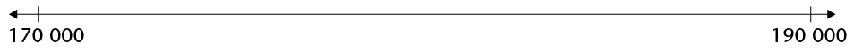
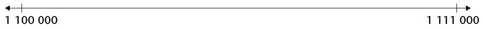

## Ordering and comparing whole numbers

### How far can you count, and how far is far?

2. How long will it take to count to a million? Let us say it takes one second to count each number. Find out how long is one million seconds. Work in your exercise book. Give your final answer in days, hours and seconds.
4. Write 234 500 320 in words.
6. In each case insert one of the symbols > or < to indicate which number is the smaller of the two.
   2. 876 243 ☐ 876 234
   4. 534 616 ☐ 543 016
   6. 701 02 1 ☐ 698 769
   8. 103 232 ☐ 99 878
8. In each case place the numbers on the number line as carefully as you can.
   2. 185 000; 178 000; 170 900; 180 500
      
   4. 1 110 000; 1 102 900; 1 100 500; 1 105 050
      

The first row in the table shows the average distances of the planets from the Sun. These distances are given in **millions of kilometres**.

<Callout type="note" title="Note">
The distances from the Sun are called average distances, because the planets are not always the same distance from the Sun. Their orbits are not circles.
</Callout>

**One million kilometres** is **1 000 000 km**.

| Planet | Mercury | Venus | Earth | Mars | Jupiter | Saturn | Uranus | Neptune |
| --- | --- | --- | --- | --- | --- | --- | --- | --- |
| Distance from the Sun | 58 million km | 108 million km | 150 million km | 228 million km | 778 million km | 1 427 million km | 2 870 million km | 4 497 million km |
| Equatorial diameter | 4 880 km | 12 102 km | 12 756 km | 6 794 km | 142 800 km | 120 000 km | 52 400 km | 49 500 km |

The information in the table is also given in the drawings on page 2. Study the top drawing to find out what equatorial diameter means.

2. Which planet is the second farthest planet from the Sun?
4. How does Mars' distance from the Sun compare to that of Venus? Give two possible answers.
6. Arrange the planets from the smallest to the biggest.

Sometimes we do not need to know the exact number or exact amount. We say a loaf of bread costs about R10, or a bag of mealie meal costs about R20. The loaf of bread may cost R8 or R12 but it is close to R10. The mealie meal may cost R18 or R21 but it is close to R20.

When you read in a newspaper that there were 15 000 spectators at a soccer game, you know that that is not the actual number. In the language of mathematics we call this process **rounding off** or **rounding**.

### Rounding to s , s , s and s

<Callout type="note" title="Note">
To round off to the **nearest 5**, we round numbers that end in 1 or 2, or 6 or 7 **down** to the closest multiple of 5. We round numbers that end in 3 or 4, or 8 or 9 **up** to the closest multiple of 5.
</Callout>

For example, 233 is rounded down to 230, 234 is rounded up to 235, 237 is rounded down to 235 and 238 is rounded up to 240.

2. Round the following numbers to the nearest 5 by checking the **unit value**:
   2. 612
   4. 87
   6. 454
   8. 1 328

<Callout type="note" title="Note">
To round off to the **nearest 10**, we round numbers that end in 1, 2, 3 or 4 **down** to the closest multiple of 10 (or decade). We round numbers that end in 5, 6, 7, 8 or 9 **up** to the closest multiple of 10.
</Callout>

For example, if you want to round off 534 to the nearest 10, you have to look at the units digit. The units digit is 4 and it is closer to 0 than to 10. The rounded off number will be 530.

2. Round the following numbers to the nearest 10 by checking the **unit value**:
   2. 12
   4. 87
   6. 454
   8. 1 325

<Callout type="note" title="Note">
When **rounding to the nearest 100**, we look at the last **two digits** of the number. If the number is less than 50 we **round down** to the lower 100. If the number is 50 or more we **round up** to the higher 100.
</Callout>

2. Complete the table.
   |  | Round to the nearest 5 | Round to the nearest 10 | Round to the nearest 100 |
   | --- | --- | --- | --- |
   | 681 |  |  |  |
   | 5 639 |  |  |  |
   | 5 361 |  |  |  |
   | 12 458 |  |  |  |

<Callout type="note" title="Note">
When **rounding to the nearest 1
            000**, we look at the hundreds. Is the hundreds value less than, equal to or
          greater than 500? If less than 500, round down (the thousands value stays the
          same), if equal to 500 round up, and if greater than 500 round up too.

When **rounding to the nearest 10
            000**, we look at the thousands. Is the thousands value less than, equal
          to or greater than 5 000 ?If less than 5 00,round down (the ten
          thousands value stays the same ),if equal to 5 00 or greater than 5 000
          round up
</Callout>

2. Complete the table.
   |  | Round to the nearest 1 000 | Round to the nearest 10 000 |
   | --- | --- | --- |
   | 142 389 |  |  |
   | 343 621 |  |  |
   | 356 552 |  |  |
   | 100 489 |  |  |
