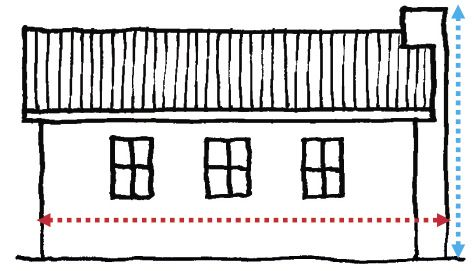

## Basic operations

### A method of addition

To add two numbers, the one may be written below the other.

For example, to calculate
        \(378 539 + 46 285 \) the one number may be written below the other
        so that the units are below the units, the tens below the tens, and so on.

378 539

46 285

Writing the numbers like this has the advantage that

- the units parts (9 and 5) of the two numbers are now in the same column,
- the tens parts (30 and 80) are in the same column,
- the hundreds parts (500 and 200) are in the same column, and so on.

This makes it possible to work with each kind of part separately.

| We only write this: | In your mind you can see this: |
| --- | --- |
| 378 539 | 300 000 | 70 000 | 8 000 | 500 | 30 | 9 |
| 46 285 |  | 40 000 | 6 000 | 200 | 80 | 5 |

The numbers in each column can be added to get a new set of numbers:

| 378 539 | 300 000 | 70 000 | 8 000 | 500 | 30 | 9 |
| --- | --- | --- | --- | --- | --- | --- |
| 46 285 |  | 40 000 | 6 000 | 200 | 80 | 5 |
| 14 |  |  |  |  |  | 14 |
| 110 |  |  |  |  | 110 |  |
| 700 |  |  |  | 700 |  |  |
| 14 000 |  |  | 14 000 |  |  |  |
| 110 000 |  | 110 000 |  |  |  |  |
| 300 000 | 300 000 |  |  |  |  |  |
| 424 824 | It is easy to add the new set of numbers to get the answer. |

Note that you can do the above steps in any order. Instead of starting with the units parts as shown above, you can start with the hundred thousands, or any other parts.

Starting with the units parts has an advantage though: it makes it possible to do more of the work mentally and to write less, as shown below:

| 378 539 |
| --- |
| 46 285 |
| 424 824 |

To achieve this, only the units digit 4 of the 14 is written in the first step. The 10 of the 14 is remembered and added to the 30 and 80 of the tens column, to get 120.

We say the 10 is **carried** from the units column to
        the tens column. The same is done when the tens parts are added to get 120: only
        the digit "2" is written (in the tens column, so it means 20), and the 100 is
        carried to the next step.

2. Calculate each of the following:
   2. \(237 847 + 87 776\)
   4. \(567 298 + 392 076\)
   6. \( 28 387 + 365 667\)

A municipal manager is working on the municipal budget
        for a year. He has to try to keep the total expenditure on new office equipment
        below R800 000. He still has to budget for new computers that are badly needed,
        but this is what he has written so far:

| 74 new office chairs | R   54 020 |
| --- | --- |
| 42 new computer screens | R 100 800 |
| 12 new printers | R 141 600 |
| 18 new tea trolleys | R   25 740 |
| 8 new carpets for senior staff offices | R 144 000 |
| 108 small plastic filing cabinets | R   52 380 |
| new table for the boardroom | R  48 000 |
| 18 new chairs for the boardroom | R   41 400 |
|  | R ______ |

2. How much has the municipal manager budgeted
               for printers and computer screens together?
4. How much, in
               total, has the municipal manager
               budgeted for chairs and tables?
6. Work out the
               total cost of all the items the
               municipal manager has budgeted for.
8. Calculate
   2. 23 809 + 2 009 + 23
   4. 320 293 + 16 923
                    + 349 + 200 323

### Methods of subtraction

There are many ways to
        subtract one number from another. For example, R835 234 - R687 885 can be
        calculated by "filling up" from R687 885 to R835 234:

\(687 885 +
        15 → 687 900 + 100→688 000 + 12 000 →700 000 +
        135 234→ 835 234\)

| 15 |
| --- |
| 100 |
| 12 000 |
| 135 234 |
| 147 349 |

The difference between R687 885 and R835 234 can now be calculated by adding up the numbers that had to be added to 687 885 to get 835 234.

So \(\text{R}835 234 - \text{R}687 885 = \text{R}147 349\).

Another easy way to subtract
        is to **round off and compensate**. For example, to calculate \(\text{R }3
        224 - \text{R }1
        885\), the R1 885 may be rounded up to R2 000. The calculation can proceed as
        follows:

- Rounding R1 885 up to R2 000
            can be done in two steps: \(1 885 + 15 = 1 900\), and \(1 900 + 100 = 2 000\).
            In total, 115 was added.
- 115 can now be added to
            3 224 too: \(3 224 + 115 = 3 339\).

Instead of calculating
        \( \text{R }3 224 - \text{R }1 885 \), which is a bit difficult, \( \text{R }3
        339 - \text{R } 2 000 \) may be
        calculated. This is easy: \( \text{R }3 339 - \text{R }2 000 = \text{R }1 339
        \).

This means that \(\text{R }3 224 -
        \text{R }1 885 = \text{R }1
        339\), because \(\text{R }3 224 - \text{R }1 885 = (\text{R }3 224 + \text{R
        }115) - (\text{R }1 885 + \text{R }115)\).

To do question 1, you may use any one of the above two methods, or any other method you may know and prefer. Do not use a calculator, because the purpose of this work is for you to come to understand how subtraction may be done. What you will learn here, will later help you to understand **algebra**.

2. Calculate each
               of the following:
   2. \(6 234 - 2
                      992\)
   4. \(76 214 - 34 867\)
   6. \( 134 372
                      - 45
                      828 \)
   8. \(623 341 - 236 768\)
4. Check
               each of your answers in question 1 by doing addition, or by doing subtraction
               with a different method than the method you have already used.

Another method of subtraction is to think of the numbers in **expanded notation**. For example, to calculate \(\text{R}835 234 - \text{R}687 885\), which was already done in a different way on the previous page, we could work like this:

| We may write this: | In your mind you can see this: |
| --- | --- |
| 835 234 | 800 000 | 30 000 | 5 000 | 200 | 30 | 4 |
| 687 885 | 600 000 | 80 000 | 7 000 | 800 | 80 | 5 |

Unfortunately, it is not possible to subtract in the columns now. However, the parts of the bigger number can be rearranged to make the subtraction in each column possible:

| 835 234 | 700 000 | 120 000 | 14 000 | 1100 | 120 | 14 |
| --- | --- | --- | --- | --- | --- | --- |
| 687 885 | 600 000 | 80 000 | 7 000 | 800 | 80 | 5 |
|  | 100 000 | 40 000 | 7 000 | 300 | 40 | 9 |
|  | The answer is now clearly visible; it is 147 349. |

The rearrangement, also called "borrowing", was done like this: 10 was taken from the 30 in the tens column, and added to the 4 in the units column. 100 was taken from the 200 in the hundreds column, and added to the 20 that remained in the tens column. 1 000 was taken from the 5 000 in the thousands column, and added to the 100 that remained in the hundreds column.

2. Describe the other rearrangements that were made in
               the above work.

It is not practical to write the expanded notation and the rearrangements each time you do a subtraction. However, with some practice you can learn to do it all in your mind without writing it down. Some people make small marks above the digits of the bigger number, or even change the digits, to keep track of the rearrangements they make in their minds.

| 835 234 |
| --- |
| 687 885 |
| 147 349 |

2. Calculate the difference between the two car prices in
               each case.
   2. R73 463 and R88 798
   4. R63 378 and R96 889
4. In each case, first estimate the answer to the nearest 100 000, then
               calculate.
   2. \(238 769 - 141 453\)
   4. \(856 333 - 439 878\)
6. In each case, first estimate the answer to the nearest 10 000, then
               calculate.
   2. \(88 023 - 45 664\)
   4. \(342 029 - 176 553\)
8. Look again at the municipal budget on page 35. How much
               money does the municipal manager have left to buy new computers?
10. Calculate.
   2. \(670 034 - 299 999\)
   4. \(670 034 - 300 000\)
   6. \(376 539 - 175 998\)
   8. \(376 541 - 176 000\)

### A method of multiplication

\(6 \times \text{R}3 258 \) can be
        calculated in parts, as shown below.

\(6 \times \text{R}3 000
        = \text{R}18 000\)

\(6 \times \text{R}200 = \text{R}1
        200\)

\(6 \times \text{R}50 =
        \text{R}300\)

\(6 \times \text{R}8 = \text{R}48\)

|  | 3 | 2 | 5 | 8 |
| --- | --- | --- | --- | --- |
|  |  |  | \(\times\) | 6 |
|  |  |  | 4 | 8 |
|  |  | 3 | 0 | 0 |
|  | 1 | 2 | 0 | 0 |
| 1 | 8 | 0 | 0 | 0 |
| 1 | 9 | 5 | 4 | 8 |

The four partial products can now be added to get the answer, which is R19 548. It is convenient to write the work in vertical columns for units, tens, hundreds and so on, as shown on the right above.

In fact, if you are willing to do some hard thinking you can produce the answer with even less writing. You can achieve this by working from right to left to calculate the partial products, and by "carrying" parts of the partial answers to the next column, as you can do when working from right to left in columns. It works like this:

|  | 3 | 2 | 5 | 8 |
| --- | --- | --- | --- | --- |
|  |  |  | \(\times\) | 6 |
| 1 | 9 | 5 | 4 | 8 |

When \( 6 \times 8 = 48\) is calculated,
        only the "8" is written down, in the units column. The "4" that represents 40 is
        not written. It is kept "on hold" in your mind.

When \(6 \times
        50 = 300 \) is calculated, the 40 from the previous step is added to 300 to get
        340. Again, only the "4" that represents 40 is written. The 300 is kept on hold
        or "carried" to add to the answer of the next step. The work continues like
        this.

2. Calculate each of the
               following. Do not use a calculator.
   2. \(8 \times 786\)
   4. \(9 \times 3 453\)
   6. \(60 \times 786
                      \)
   8. \(60 \times 7 860\)
4. You may use a calculator to check your answers
               for question 1. Repeat the work if your answers are not correct, so that you can
               learn where you make mistakes. Then put your calculator away again.
6. Use your answers for questions 1(a) and (c) to
               find out
               how much \(68 \times 786 \) is.

To calculate \(36 \times 378\),
        the work can be broken up in two parts, namely \(30 \times 378 \)and \(6 \times
        378\).

2. Calculate \(36 \times
               378\).

A complete write-up of
        calculating \(76 \times 2 348 \)in columns is shown below.

|  |  |  | 2 | 3 | 4 | 8 |
| --- | --- | --- | --- | --- | --- | --- |
|  |  |  |  | \( \times \) | 7 | 6 |
| A |  |  |  |  | 4 | 8 |
| B |  |  |  | 2 | 4 | 0 |
| C |  |  | 1 | 8 | 0 | 0 |
| D |  | 1 | 2 | 0 | 0 | 0 |
| E |  |  |  | 5 | 6 | 0 |
| F |  |  | 2 | 8 | 0 | 0 |
| G |  | 2 | 1 | 0 | 0 | 0 |
| H | 1 | 4 | 0 | 0 | 0 | 0 |
|  | 1 | 7 | 8 | 4 | 4 | 8 |

2. 2. Explain how the 240 in row B
                      was obtained.
   4. Explain how the 560 in row E was obtained.
   6. Explain how the 21 000 in row G was
                      obtained.
   A short write-up of calculating \(76 \times 2 348\) in
               columns is shown on the right.
   |  |  | 2 | 3 | 4 | 8 |
   | --- | --- | --- | --- | --- | --- |
   |  |  |  | \(\times\) | 7 | 6 |
   |  | 1 | 4 | 0 | 8 | 8 |
   | 1 | 6 | 4 | 3 | 6 | 0 |
   | 1 | 7 | 8 | 4 | 4 | 8 |
   You may try to do the calculations in question 6 in this way. If you find it difficult, you may first write some of them up completely, and then try again to write less when you multiply.
4. Calculate each of the
               following.
   2. \(53 \times 738
                      \)
   4. \(73 \times 3 457\)
6. Calculate.
   2. \(64 \times 3 478
                      \)
   4. \( 78 \times 1 298\)
   6. \(37 \times 3
                      428\)
   8. \(78 \times 7
                    285\)
8. Use a calculator to check your answers for
               question 7. Redo the questions that you had wrong, so that you can learn to work
               correctly.
10. Use your correct answers for question 7 to give
               the answers to the following, without doing any calculations:
   2. \( 101 244
                      \div 1 298\)
   4. \( 568 230 \div 7 285\)
12. Calculate, without using a
               calculator.
   2. \( 3 659 \times 38 \)
   4. \(27 \times 23 487 \)
   6. \( 486 \times 278\)
   8. \(2 135 \times 232\)

### A process called long division

2. You may use a calculator
               to do questions 1 to 6.
   You want
               to buy some live chickens at R37 each and you have
               R920 available.
               How many live
               chickens can you buy in total?
4. R880 is to be shared equally among 34
               learners?
               How many full
               rands can each learner get?
6. You want to buy live chickens at R47
               each. You have R1 280 available.How many live chickens can you buy?
8. 42 equal bags of rice weigh a total of 7 560 g.
               How much does one bag weigh?
10. The number 26 was multiplied by a secret
               number and the answer was 2 184. What was the secret number?
12. This is an accurate sketch of the back of a house. The red line on the sketch is 70 mm long and it shows the width of the house. The blue line on the sketch indicates the height of the chimney. **Do not measure the blue line now.**
   The width of the actual house is 5 600 mm, and the height of the chimney is 3 360 mm.
   
   2. How many times is the house bigger
                    than the sketch? Describe what you can do to find this out.
   4. Calculate how long the blue line on the sketch
                      should be.
   6. Now measure the blue line to check your answer
                      for (b).
   Division is used for different purposes:
   <Callout type="note" title="Note">
   In question 1 you knew that the amount is split into equal parts. You had to **find out how many parts there are** (how many chickens). This is called **grouping**.
   In question 2 you knew that the amount was split into 34 equal parts. You needed to **find out how big each part is** (how much money each learner will get). This is called **sharing**.
   </Callout>
14. 2. What does question 3 require,
                      sharing or grouping?
   4. What does question 4 require,
                      sharing or grouping?
   In question 6 division was done for a different purpose than sharing or grouping.
   **Put your calculator away now.** It is very important to be able to solve division problems by using your own mind. The activities that follow will help you to do this better than before. While you work on these activities, you will often have to **estimate** the product of two numbers. If you can estimate products well, division becomes easier to do. Hence, to start, do question 8, which will provide you with opportunities to practise your product estimation skills.
16. What do
             you think is closest to 4 080:
   2. \(10 \times 74 \) or \(
                      30 \times 74\) or \(50 \times 74\) or \(70 \times 74\) or \( 90 \times 74 \)?
   4. Calculate some of the products to check your
                      answer.
   6. What do you think is
                      closest to \(9 238: 30 \times 38 \) or \( 50 \times 38\) or \( 100 \times
                      38 \) or \(150 \times 38\) or \(200 \times 38\) or \(250 \times 38\) or \(300
                      \times 38\)
   8. Calculate some of the products to check your
                      answer.
   10. What do you think is closest to \(9 746: 10
                      \times 287\) or \(20 \times 287\)
                      or \(30 \times 287 \) or \(40 \times 287\) or \( 50 \times 287\) or \(60 \times
                      287 \) or \(70 \times 287\)?
   12. Calculate some of the products to check your
                      answer.
   14. By what multiple of 10 should you multiply 27 to
                      get as close to 6 487 as possible?
18. A principal wants to buy
               T-shirts for the 115 Grade 7 learners in the school. The T-shirts cost R67 each,
               and an amount of R8 500 is available. Do you think there is enough money to buy
               T-shirts for all the learners? Explain your answer.
20. 2. How much will 100 of the
                      T-shirts cost?
   4. How much money will be left if
                      100 T-shirts are bought?
   6. How much
                      money will be left if 20 more T-shirts are bought?

The principal wants to work out exactly how many T-shirts, at R67 each, she can buy with R8 500. Her thinking and writing are described below.

**Step 1**

| What she writes: |  | What she thinks: |
| --- | --- | --- |
| 67 | 8 500 |  | I want to find out how many chunks of 67 there are in 8 500. |

**Step 2**

| What she writes: |  | What she thinks: |
| --- | --- | --- |
|  | 100 |  | I think there are at least 100 chunks of 67 in 8 500. |
| 67 | 8 500 |  |  |
|  | 6 700 |  | \(100 \times 67 = 6 700\). I need to know how much is
                  left over. |
|  | 1 800 |  | I want to find out how many chunks of 67 there are in 1 800. |

**Step 3** (She has to rub out the one "0" of the 100 on top, to make space.)

| What she writes: |  | What she thinks: |
| --- | --- | --- |
|  | 120 |  | I think there are at least 20 chunks of 67 in 1 800. |
| 67 | 8 500 |  |  |
|  | 6 700 |  |  |
|  | 1 800 |  |  |
|  | 1 340 |  | \(20 \times 67 = 1 340\). I need to know how much is
                  left over. |
|  | 460 |  | I want to find out how many chunks of 67 there are in 460. |

**Step 4** (She rubs out another
          "0".)

| What she writes: |  | What she thinks: |
| --- | --- | --- |
|  | 125 |  | I think there are at least 5 chunks of 67 in 460. |
| 67 | 8 500 |  |  |
|  | 6 700 |  |  |
|  | 1 800 |  |  |
|  | 1 340 |  |  |
|  | 460 |  |  |
|  | 335 |  | \(5 \times 67 = 335\). I need to know how much is
                  left over. |
|  | 125 |  | I want to find out how many chunks of 67 there are in 125. |

**Step 5** (She rubs out the "5".)

| What she writes: |  | What she thinks: |
| --- | --- | --- |
|  | 126 |  | I think there is only one more chunk of 67 in 125. |
| 67 | 8 500 |  |  |  |
|  | 6 700 |  |  |  |
|  | 1 800 |  |  |  |
|  | 1 340 |  |  |  |
|  | 460 |  |  |  |
|  | 335 |  |  |  |
|  | 125 |  |  |  |
|  | 67 |  | I wonder how much money will be left over. |
|  | 58 |  | So, we can buy 126 T-shirts and R58 will remain. |

**Do not use a calculator in the questions that follow.** The purpose of this work is for you to develop a good understanding of how division can be done. Check all your answers by doing multiplication.

2. 2. Selina bought 85 chickens, all at the same price.She paid R3 995 in total.
                      What did each of the chickens cost? Your first step can be to work out how much
                      Selina would have paid if she paid R10 per
                      chicken, but you can start with a bigger step if you wish
   4. Anton has R4 850. He wants to buy some young goats. The
                      goats cost R78 each. How many goats can he buy?
4. Calculate the
               following without using a calculator:
   2. \( 7 234 \div 48
                      \)
   4. \( 3 267 \div 24\)
   6. \( 9 500 \div 364\)
   8. \( 8 347 \div
                      24\)
6. 2. A chocolate factory made
                      9 325 chocolates of a very special kind one day. The
                      chocolates were packed in small decorated boxes,with 24 chocolates per box.How
                      many cartons many boxes were filled?
   4. A farmer sells
                      eggs packed in cartons to
                      the local supermarkets. There are 36
                      eggs in one carton. One month, the
                      farmer sold 72 468 eggs to the
                      supermarkets.How many cartoons
                      is this?
