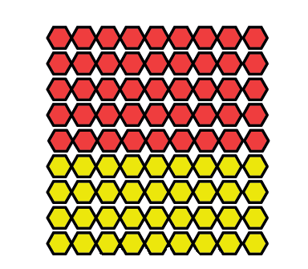
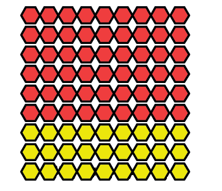
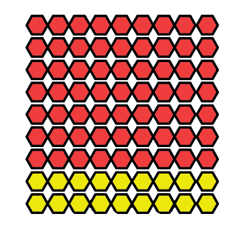

## Problem solving

### Rate and ratio

You may use a calculator for doing the work in this section.

2. The
               people in a village get their water from a nearby dam. On a certain day the dam
               contains 688 000 litres of water. The village people use about 85 000 litres of
               water each day. For how many days will the water in the dam last, if no rains
               fall?
   <Callout type="note" title="Note">
   Instead of saying "85 000 litres each day" or "8 cm each hour", people often say "**at a rate of** 85 000 litres **per day**" or "**at a rate of** 8 cm **per hour**".
   </Callout>
4. During a period of very heavy rain, the
               water level in a certain river increases at a rate of 8 cm each hour. If it
               continues like this, by how much will the water level increase in 24
               hours?
6. A woman is driving from Johannesburg to
               Durban. Her distance from Durban decreases at a rate of about 95 km per hour.
               How far does she travel, approximately, in 4 hours?
8. The number of unemployed people in a
               certain province increases at a rate of approximately 35 000 people per year. If
               there were 860 000 unemployed people in the year 2000, how many unemployed
               people will there be, approximately, in the year 2020?
10. In pattern A below, there are 5 red
               beads for every 4 yellow beads.
   Describe patterns B and C in the same way.
   
   Pattern A
   
   Pattern B
   
   Pattern C
   In a certain food factory, two
               machines are used to produce tins of baked beans. Machine A produces at a rate
               of 800 tins per hour, and machine B produces at a rate of 2 400 tins per hour.
12. 2. Complete the following
                      table, to show how many tins of beans will be produced at the two machines, in
                      different periods of time.
      | Number of hours | 1 | 2 | 3 | 5 | 8 |
      | --- | --- | --- | --- | --- | --- |
      | Number of tins at machine A | 800 | 1 600 | 2 400 | 4 000 |  |
      | Number of tins at machine B | 2 400 | 4 800 |  |  |  |
   4. How much faster is machine B than machine A?
   6. How many tins will be produced
                      at machine B in the time that it takes machine A to produce 30 tins?
   8. How many tins will be produced
                      at machine B in the time that it takes machine A to produce 200 tins?
   10. How many tins
                      will be produced at machine B in the time that it takes machine A to produce 1
                      tin?
   The patterns in question 5 can be described like this:
   <Callout type="note" title="Note">
   In pattern A, the **ratio** of yellow beads to red beads is 4 to 5. This is written as 4 : 5.
   </Callout>
   In pattern B, the ratio between yellow beads and red beads is 3 : 6, and in pattern C the ratio is 2 : 7. In question 6, machine A produces 1 tin for every 3 tins that machine B produces. This can be described by saying that the ratio between the production speeds of machines A and B is 1 : 3.
14. Two huge trucks
               are travelling very slowly on a highway. Truck A covers 20 km per hour, and
               truck B covers 30 km per hour. Both trucks keep these speeds all the
               time.
   2. What distance will truck B cover in the same time that truck A covers 10
                        km?
   4. In the table below, the distances that truck A
                      covers in certain periods of time are given. Complete the table, to show
                      the distances covered by truck B, in the same periods of time.
      | Distance covered by truck A | 10 km | 18 km | 50 km | 100 km | 30 km |
      | --- | --- | --- | --- | --- | --- |
      | Distance covered by truck B |  |  |  |  |  |
   6. What
                      distance will truck B cover in the same time that truck A covers 1 km?
   8. What is the ratio between the
                      speed at which truck A travels and the speed at which truck B travels?
16. R240 will be divided between David and
               Sally in the ratio 3 : 5. This means Sally gets R5 for every R3 David gets. How
               much will David and Sally each get in total?
18. How much will each person get, if R14
               400 is shared between two people in each of the following ways?
   2. In the ratio 1 : 3
   4. In the ratio 5 : 7

### Financial mathematics

A man borrows R12 000 from a bank for one year. He has to pay 15% interest to the bank. This means that, apart from paying the R12 000 back to the bank after a year, he has to pay 15 hundredths of R12 000 for the privilege of using the money that actually belongs to the bank.

<Callout type="note" title="Note">
15% is read as **15 per cent**, and it is just a different way to say **15 hundredths**.
</Callout>

One hundredth of R12 000 can be calculated by dividing R12 000 by 100. This amount can then be multiplied by 15 to get 15 hundredths of R12 000.

<Callout type="note" title="Note">
The money paid for using another person's house is called **rent**. The money paid for using another person's money is called **interest**.
</Callout>

**Do not use a calculator when you do the following questions.**

2. Calculate \(12 000 \div 100\), then multiply the answer by 15.
4. Calculate:
   2. 12% of R8
                      000
   4. 18% of R24 000
6. In each case below,
               calculate how much interest must be paid.
   2. An amount of R6 000 is
                      borrowed for 1 year at 9% interest.
   4. An amount of R21 000 is borrowed for 3 years at
                      11% interest per year.
   6. An amount of R45 000 is borrowed for 10 years at
                      12% interest per year.
   A car dealer buys a car for R60 000 and sells it for R75 000. The difference of R15 000 is called the **profit**. In this case, the profit is a quarter of R60 000, which is the same as 25 hundredths or 25%. This can be described by saying "the car dealer made a profit of 25%".
8. Calculate the amount of profit in each of the
               following cases. The information is about a car dealer who buys and sells used
               vehicles.
   2. A car is bought for R40
                      000 and sold for R52 000.
   4. A small truck is bought for R100 000 and sold at
                      a profit of 28%.
   6. A bakkie is bought for R120 000 and sold at a
                      profit of 30%.
   A shop owner bought a stove for R2 000 and sold it for R1 600. The shop owner did not make a profit, he sold the stove at a **loss** of R400.
10. 2. How much
                      is 1 hundredth of R2 000?
   4. How many hundredths of R2 000 is
                      R400?
   6. How much is 20% of R2 000?
   Notice that by doing question 5(b) you have worked out at what percentage loss the shop owner sold the stove.
12. The shop
               owner also sold a fridge that normally sells for R4 000 at a **discount** of
               20%. This means the customer paid 20% less than the normal price. Calculate the
               discount in rands and the amount that the customer paid for the fridge.
