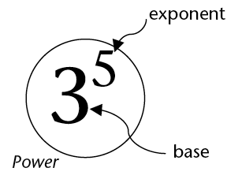

## The exponential notation

### Repeated multiplication with the same number

2. Express each number
               below as a product of prime factors. Example: \(250 = 2 \times 5 \times 5
               \times 5\)
   2. 35
   4. 70
   6. 140
   8. 280
   10. 81
   12. 625
   5 is a **repeated factor** of 250. It is repeated 3 times.
4. Which
               numbers in question 1 have repeated factors? In each case, state what number is
               repeated as a factor and how many times it is repeated.
   <Callout type="note" title="Note">
   A number that can be expressed as a product of one repeated factor is called a **power** of that number.
   </Callout>
   Examples:
   32 is a power of 2, because
               \(32 = 2 \times 2 \times 2 \times 2 \times 2\)
   100 000 is a power of 10,
               because \(10 \times 10 \times 10 \times 10 \times 10 =
               100 000\)
6. Express each number as a
               power of 2, 3, 5 or 10.
   2. 125
   4. 64
   6. 100
   8. 1
                      000
8. Calculate each of the
               following. You can use each answer to get the next
               answer.
   2. \( 2 \times
                      2 \times 2 \times 2\)
   4. \( 2 \times
                      2 \times 2 \times 2 \times 2\)
   6. \( 2 \times 2 \times 2 \times 2
                      \times 2 \times 2\)
   8. \( 2 \times 2
                      \times 2 \times 2 \times 2 \times 2 \times 2\)
   10. \( 2 \times 2 \times 2 \times 2 \times 2 \times 2
                      \times 2 \times 2\)
   12. \( 2 \times 2 \times 2 \times 2 \times 2 \times 2
                      \times 2 \times 2 \times 2\)
   14. \( 2 \times 2 \times 2 \times 2 \times 2 \times 2
                      \times 2 \times 2 \times 2 \times 2\)
   16. \( 2 \times 2 \times 2 \times 2 \times 2 \times 2
                      \times 2 \times 2 \times 2 \times 2 \times 2\)
   18. \( 2 \times 2 \times 2 \times 2 \times 2 \times 2
                      \times 2 \times 2 \times 2 \times 2 \times 2 \times 2\)
   20. \( 2 \times 2 \times 2 \times 2 \times 2 \times 2
                      \times 2 \times 2 \times 2 \times 2 \times 2 \times 2 \times 2\)
   Because the factor 2 is repeated 5 times, 32 is called
               the **fifth power of 2**, or
               **2 to the power 5**.
   Similarly, 125 is the third power of 5.
   125 can also be called "5 to the power 3" or "5 cubed".
10. The seventh power of 2 is shown in question
               4(d).What power of 2 is shown in each of the following parts of question 4?
   2. 4(j)
   4. 4(i)
   6. 4(h)
   8. 4(f)
12. What power of
               what number is shown in each case below?
   2. \( 15 \times 15 \times 15
                      \times 15 \times 15 \times 15 \times 15 \times 15\)
   4. \( 12 \times 12 \times 12 \times 12 \times 12
                      \times 12 \times 12 \times 12 \times 12 \times 12 \times 12 \times 12\)
   <Callout type="note" title="Note">
   Instead of writing "5 to the power 6" we may write \(5^6\).
                 This is called the exponential notation.
   \(5^6\) means \(5 \times 5 \times 5 \times 5 \times 5 \times 5\).
   \(5 \times 6\) means \(6 + 6
                 + 6 + 6 + 6\).
   </Callout>
14. Write each of the
               numbers in question 3 in exponential
               notation.
   2.
   4.
   6.
   8.
16. Write each of the
               numbers in question 4 in exponential notation.
   2.
   4.
   6.
   8.
   10.
   12.
   14.
   16.
   18.
   20.
18. In each case write the
               number in exponential notation.
   2. The
                      fifth power of 5
   4. The sixth power of 5
   6. The third power of 4
   8. 6 to the power 4
   10. 4 to the power 6
   12. 5 to the power 15
   
   <Callout type="note" title="Note">
   \(3^5\)
                 means \(3 \times 3 \times 3 \times 3 \times 3\).
   The repeating factor in a power is called the **base**.
   The number of repetitions is called the **exponent** or **index**.
   \(3^1\)
                 means 3. The base is 3 but there is no repetition.
   Any number raised to the power 1 equals the number itself.
   </Callout>
20. In each case below
               some information about a number is given. Each number can be expressed as a
               power. What is the number in each case?
   2. The base
                      is 5 and the index is 3.
   4. The base is 10 and the exponent
                      is 4.
   6. The base is 20 and the exponent
                      is 3.
22. Calculate each
               of the following:
   2. \( 5 \times
                      5 \times 5 \)
   4. \( 5 \times 5
                      \times 5 \times 5 \times 5\)
   6. \( 5 + 5 + 5\)
   8. \( 5 + 5 + 5 + 5 +
                      5\)
   10. \( 5 \times 3\)
   12. \(
                      5^3\)

### Powers of different numbers

2. Complete this table of powers of 2. (You have
               already calculated these powers in the previous section.)
   | Exponent | 1 | 2 | 3 | 4 | 5 | 6 | 7 | 8 | 9 |
   | --- | --- | --- | --- | --- | --- | --- | --- | --- | --- |
   | Power of 2 | 2 | 4 | 8 | 16 |  |  |  |  |  |
   | Exponent | 10 | 11 | 12 | 13 | 14 |
   | --- | --- | --- | --- | --- | --- |
   | Power of 2 |  |  |  |  |  |
4. 2. Calculate each of the
                      following:
      2. \(2^2- 2^1\)
      4. \(2^3 -2^2\)
      6. \(2^4
                             -2^3\)
      8. \(2^5-
                             2^4\)
      10. \(2^6-
                             2^5\)
      12. \(
                             2^7 -
                             2^6\)
      14. \(2^8 - 2^7\)
   4. Describe what you notice about the
                      differences between consecutive powers of 2.
   <Callout type="note" title="Note">
   Numbers that
                 follow on each other in a pattern are called **consecutive
                   numbers**.
   </Callout>
6. Suppose you calculate the differences
               between consecutive powers of 3. Do you think these differences will be the
               consecutive powers of 3 again?
8. Complete this table of
               powers of 3.
   | Exponent | 1 | 2 | 3 | 4 | 5 | 6 | 7 | 8 | 9 |
   | --- | --- | --- | --- | --- | --- | --- | --- | --- | --- |
   | Power of 3 | 3 | 9 |  |  |  |  |  |  |  |
   | Exponent | 10 | 11 | 12 | 13 | 14 |
   | --- | --- | --- | --- | --- | --- |
   | Power of 3 |  |  |  |  |  |
10. 2. Calculate each
                      of the following:
      2. \(3^2- 3^1\)
      4. \(3^3 -
                             3^2\)
      6. \(3^4
                             -3^3\)
      8. \(3^5-
                             3^4\)
      10. \(3^6-
                             3^5\)
      12. \(
                             3^7 -
                             3^6\)
      14. \(3^8 - 3^7\)
   4. How do these numbers differ from what you
                      expected when you answered question 3?
   6. Divide each of your answers in 5(a) by 2.
   8. If you observe anything interesting, describe
                      it.
12. In questions 1
               to 5 you have investigated the differences between consecutive powers of 2 and
               3. You have observed certain interesting things about these differences. You
               will now investigate, in the same way, the differences between consecutive
                 powers of 4.
   2. Before you investigate,
                      think a bit. What do you expect to find?
   4. Do your investigation, and write
                      a short report on what you find.
      | Exponent |  |  |  |  |  |  |  |  |
      | --- | --- | --- | --- | --- | --- | --- | --- | --- |
      | Power of 4 |  |  |  |  |  |  |  |  |
   6. Do what you did
                      in question 6, but now for powers of 10.
      | Exponent |  |  |  |  |  |  |  |
      | --- | --- | --- | --- | --- | --- | --- | --- |
      | Power of 10 |  |  |  |  |  |  |  |
