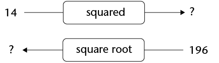
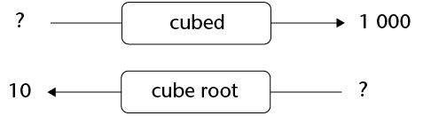

## The square root and the cube root

<Callout type="note" title="Note">
The inverse to finding the square of a number is to find its **square root**.

The question, What is the square root of 25?
          is the same as the question, What number, when
          squared, equals 25?
          The answer to the question is 5 because \(5 \times 5 = 25\).
</Callout>

### Determining what number was squared

2. What number,
               when squared, equals 9? Explain.
4. What is the square root of 49? Explain.
6. What number, when squared, equals 81?
               Explain.
8. What number, when squared, equals 225?
               Explain.
10. What is the square root of 121? Explain.
12. What number must be squared to get 169?
               Explain.
14. Complete the diagrams below.

<Callout type="note" title="Note">
The inverse operation to finding the cube of a number is to find its **cube root**.

The question, What number, when cubed, equals
          125? is the same as the question, What is the cube
          root of 125?

The answer to the question above is 5 because
          \(125 = 5 × 5 × 5\).
</Callout>

### Determining what number was cubed

2. What
               number, when cubed, equals 27? Explain.
4. What is the cube root of 343? Explain.
6. What number, when cubed, equals 8? Explain.
8. What is the cube root of 1 000? Explain.
10. What number, when cubed, equals 512?
               Explain.
12. What number produces the same answer when it is
               squared and when it is cubed?
14. Complete the diagrams below.

### Calculating square roots and cube roots

2. Complete
               the table. The first one has been done for you.
   |  | Number | Cube root | Check your answer |
   | --- | --- | --- | --- |
   | (a) | 8 | 2 | \(2 \times 2 \times 2 = 8\) |
   | (b) | 27 |  |  |
   | (c) | 64 |  |  |
   | (d) | 125 |  |  |
   | (e) | 216 |  |  |
   | (f) | 1 331 |  |  |
   | (g) | 1 000 |  |  |
   | (h) | 512 |  |  |
   | (i) | 8 000 |  |  |
4. Complete the table. The first one has
               been done for you.
   |  | Number | Square root | Check your answer |
   | --- | --- | --- | --- |
   | (a) | 9 | 3 | \(3 \times 3 = 9\) |
   | (b) | 1 600 |  |  |
   | (c) | 144 |  |  |
   | (d) | 196 |  |  |
   | (e) | 625 |  |  |
   | (f) | 900 |  |  |
   | (g) | 16 |  |  |
   | (h) | 400 |  |  |
   | (i) | 121 |  |  |
   <Callout type="note" title="Note">
   The symbol
                 \(\sqrt{25}\)can be used to indicate the square root of 25.
                 So we can write \(\sqrt{25}=5\). The symbol \(\sqrt[3]{125}\) can be used to
                 indicate the cube root of 125. So we can write \(\sqrt[3]{125}= 5\)
   </Callout>
6. What mathematical symbol can be used to indicate
               each of the following?
   2. The
                      square root of 169
   4. The cube root of 343
   6. The square root of 2 500
   8. The cube root of 729
   10. The cube of 25
   12. The square of 25
   By agreement amongst mathematicians, the
               symbol \(\sqrt{}\) means the square root of the number that is
               written inside the symbol. So we normally write \(\sqrt{4}\) instead of
               \(\sqrt[2]{4}\)
   For the cube root, however, the number 3
               outside of the root sign
               \(\sqrt[3]{}\) must be written in order to
               distinguish the cube root from the square root.
8. Find the values
               of each of the following. The first one has been done for you. Check your
               answers.
   |  |  | Value | Check your answer |
   | --- | --- | --- | --- |
   | (a) | \(\sqrt{64}\) | 8 | \(8 \times 8 = 64\) |
   | (b) | \(\sqrt{49}\) |  |  |
   | (c) | \(\sqrt{36}\) |  |  |
   | (d) | \(\sqrt{784}\) |  |  |
   | (e) | \(\sqrt{2 025}\) |  |  |
   | (f) | \(\sqrt{324}\) |  |  |
10. Find the values of each of the
               following. The first one has been done for you. Check your answers.
   |  |  | Value | Check your answer |
   | --- | --- | --- | --- |
   | (a) | \(\sqrt[3]{8}\) | 2 | \(2 \times 2 \times 2 = 8\) |
   | (b) | \(\sqrt[3]{64}\) |  |  |
   | (c) | \(\sqrt[3]{512}\) |  |  |
   | (d) | \(\sqrt[3]{1}\) |  |  |
   | (e) | \(\sqrt[3]{216}\) |  |  |
   | (f) | \(\sqrt[3]{125}\) |  |  |
