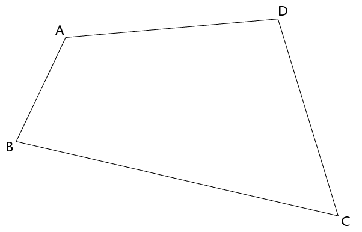
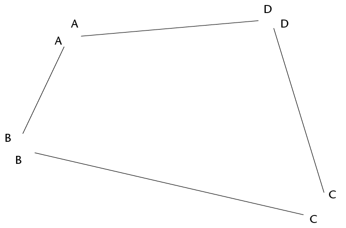
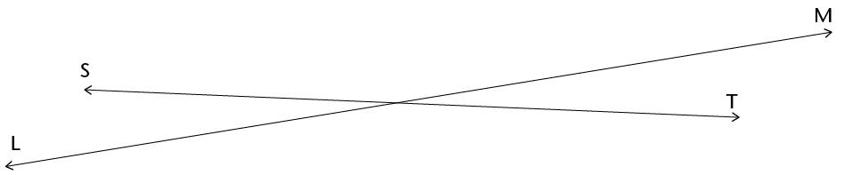
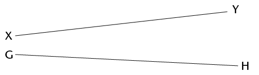
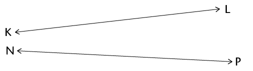
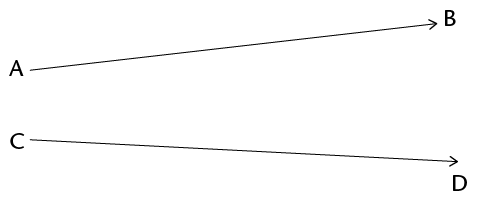
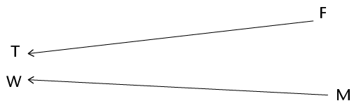
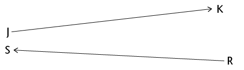

## Line segments, lines and rays

### Line segments

2. Measure each side of
               this quadrilateral. Write the measurements at each side.
   
   Each side of a quadrilateral is a **line segment**.
   
   <Callout type="note" title="Note">
   A **line segment** has a definite starting point and a definite endpoint. We can draw and measure line segments.
   </Callout>
4. Draw a line segment that is 12 cm long.

### Lines and rays

We can think of lines that have no ends, although we cannot draw them completely. We draw line segments to represent lines. When we draw a line segment to represent a line, we may put arrows at both ends to show that it goes on indefinitely on both sides.

<Callout type="note" title="Note">
The word **line** is used to indicate a line that goes on in both directions. We can only see and draw part of a line. A line cannot be measured.
</Callout>

2. Draw line AB.
   
4. Did you draw the
               whole of line AB? Explain.
   <Callout type="note" title="Note">
   We can also think of a line that has a definite starting point but goes on indefinitely at the other end. This is called a half-line or a **ray**.
   </Callout>
   We can draw the starting point and part of a ray, using an arrow to indicate that it goes on at the one end.
   Ray PQ goes on towards the right:
   
   Ray DC goes on towards the left:
   
6. Draw ray
               EF.
   
8. Did you draw the
               whole of ray EF? Explain.
10. Do line segments XY and GH meet
               anywhere?
   
12. Do lines KL and NP meet
               anywhere?
   
14. Do rays AB and CD meet anywhere?
   
16. Do rays FT and MW meet anywhere?
   
18. Do rays JK and RS meet anywhere?
   
