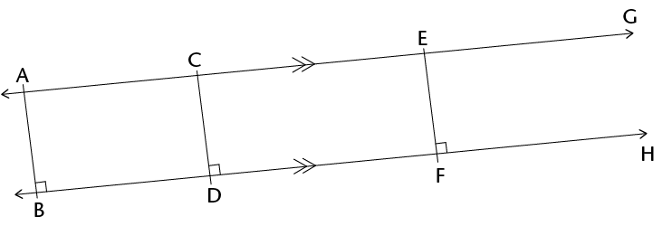
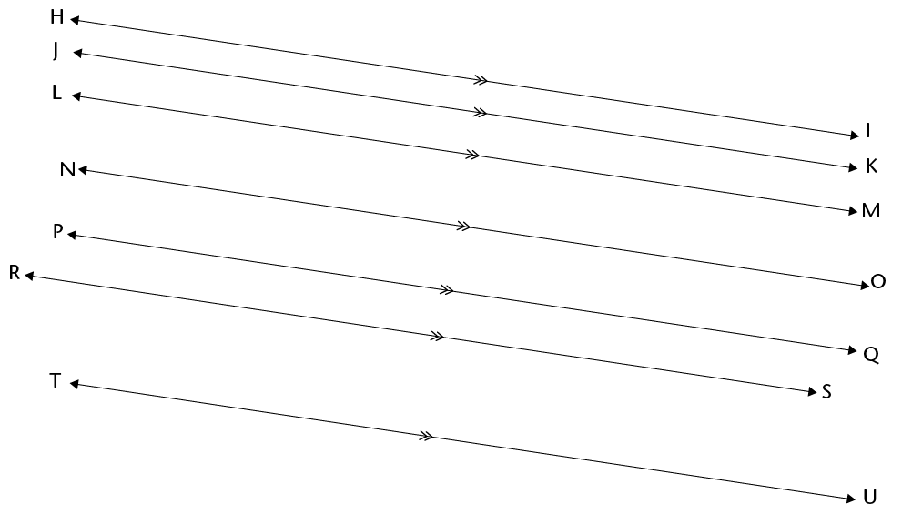
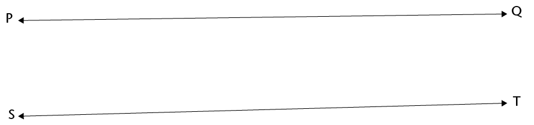
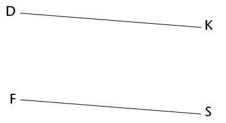
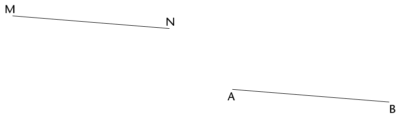
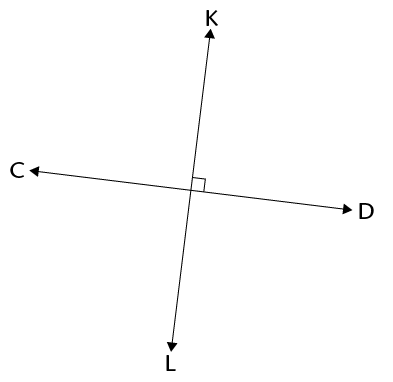

## Parallel and perpendicular lines

### Parallel lines

Two lines that are a constant distance apart are called **parallel lines**. Lines AG and BH below are parallel. The symbol || is used to indicate parallel lines. We write: AG || BH.

2. Measure
               the distance between the two lines:
   2. at A and
                      B
   4. at C and D
   6. at E and F
   Here are some more parallel lines:
   
4. Draw two
               parallel lines.
6. Draw three lines
               that are parallel to each other.
8. Will parallel
               lines meet somewhere?
10. Do you think lines PQ and ST are parallel? How
               can you check?
   
12. 2. Draw two lines that are almost parallel, but not
                      quite.
   4. Describe what you did to
                      make sure that your two lines are not parallel.
14. Can two line segments be
               parallel?
16. Are line segments DK and FS parallel?
   
18. Are line segments MN and AB parallel?
   
20. What can you do so that you will
               be better able to check whether the above two line segments are parallel or
               not?
22. Can a line be parallel on its own?
24. Draw a line that is
               parallel to line XY above.

### Perpendicular lines

Lines CD and KL below are
        perpendicular to each other. The symbol  is used to indicate
        perpendicular lines. We write: CD  KL.

2. How many
               angles are formed at the point where the above two lines meet?
   <Callout type="note" title="Note">
   Two lines that form right angles are **perpendicular** to each other.
   </Callout>
4. Draw two rays that have the same starting point.
   
6. Draw two rays that are
               perpendicular to each other and have the same starting point.
   
8. Draw two rays
               that meet, but not at their starting points.
   
10. Draw two
               rays that meet but not at their starting points, and that are perpendicular to
               each other.
   
12. Can you
               draw two rays that have the same starting point, and are parallel to each
               other?
   
