## Angles revision

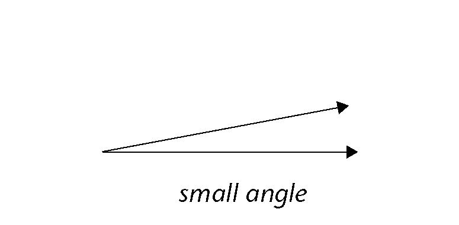

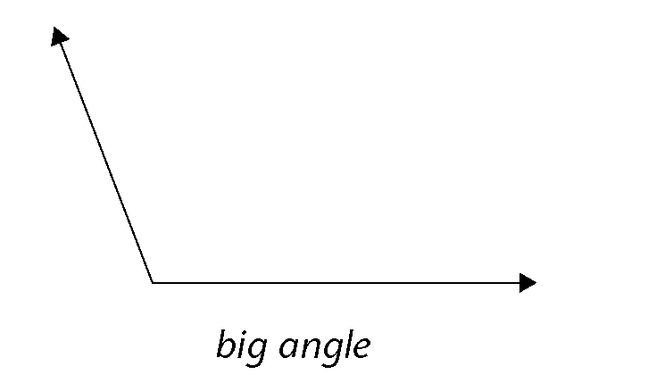

When two lines point in different directions, we say they are **at an angle** to each other. If the directions are almost the same, we say the **angle** between them is small. If the directions are very different, we say the angle between them is big.

**Words we use to describe angles:**

<Callout type="note" title="Note">
- **Arms of the angle:** the two lines that are at
              an angle to each other
- **The vertex:** the point where the two arms meet
- **Vertices:** plural of
              'vertex'

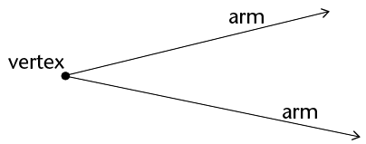
</Callout>

**Symbols to describe angles:**

<Callout type="note" title="Note">
**Arrowheads** on the lines mean that the lines keep on going. The length of an angle's arms does not change the size of the angle. Whether the arms are long or short, the angle size stays the same.

There are **two angles at a
              vertex** so it is important to show which one we are talking about

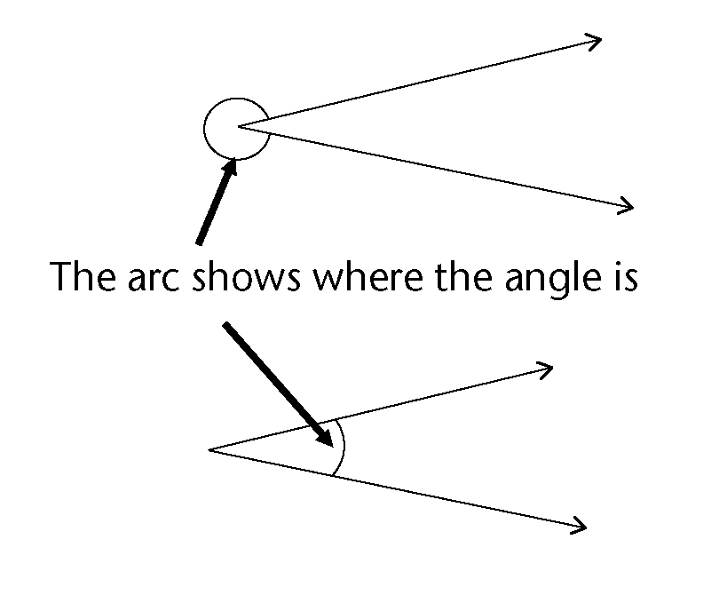
</Callout>

**Labelling angles:**

<Callout type="note" title="Note">
There are many different ways to label angles. Look at the examples below:

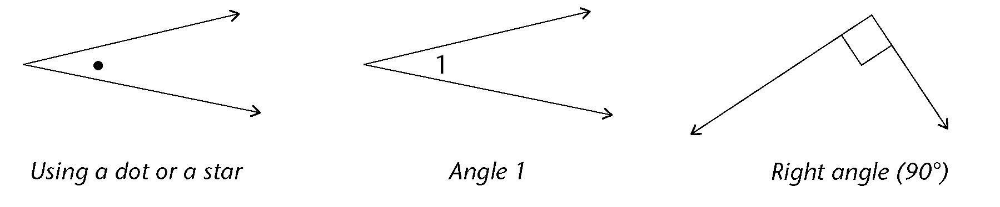

You can name the angle on the right in different
            ways: you can say
            \(A\hat{B}C\) or
            \(C\hat{B}A\) or just \(\hat{B}\). The 'hat' on the letter
            shows where the angle is.

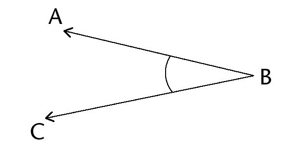
</Callout>

### Revision: seeing angles and describing angles

2. Look at
               the drawing on the right.
   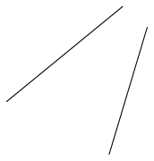
   2. Are
                      these lines at an angle to each other?
      Do the lines have to meet to be at an angle?
   4. Use a pencil and your ruler to draw the lines
                      a bit longer so they meet. Did you change the angle between the lines when you
                      extended them?
4. Arrange the angles from biggest to
               smallest. Just write the letters (a) to (f) in the correct order.
   2. 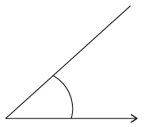
   4. 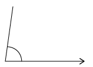
   6. 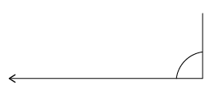
   8. 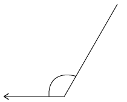
   10. 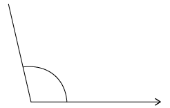
   12. 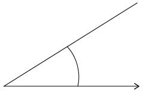
6. How can
                 you check that an angle is a right angle without using any special mathematics
               equipment? (*Hint*: Think about where you can find right angles
               around you.)
8. Are these two angles the same size?
               Describe how you found your answer. (*Hint*: A piece of scrap paper may
               help!)
   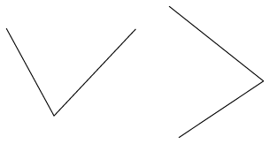
10. Two lines are drawn by holding down a
               ruler and drawing lines on both sides. What can you say about the two
               lines?
   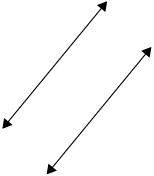
12. Look at the analogue clock face on the
               right. The minute hand and the hour hand make an angle. Focus on the smaller
               angle for now.
   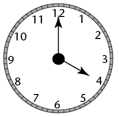
   2. Explain why the
                      angle between the hands at 8 o' clock is the same size as the angle at 4
                      o' clock.
   4. Compare the angle at 2 o' clock with the angle
                      at 4 o' clock. What do you notice? Why is this so?
   6. Is the angle at 3 o' clock the same as the angle
                      at a quarter past 12? Explain.
14. When you open the cover of a hardcover
               book you can make different angles. Can you think of at least five other
               situations in everyday life where objects are turned through angles? Say what
               the arms and the vertices are in each of your examples.
