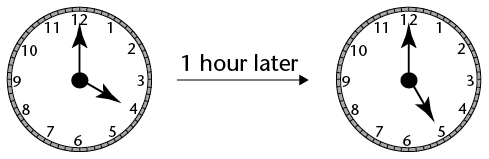
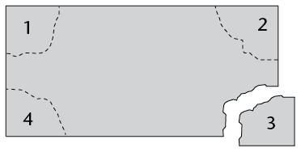

## The degree: a unit for measuring angles

Imagine if we didn't have units for measuring length.

How would tailors make
        clothes to the right size without a tape measure? How could an architect design
        a safe and beautiful house without a ruler? How could we lay out a professional
        soccer field without being able to measure accurately in metres?

We need units and measuring instruments in many situations. You know that we use metres, centimetres, kilometres, millimetres, etc. for measuring lengths.

We should also
        have units for measuring angles. The units we use for measuring angles are very
        ancient. No one today is completely sure why, but our ancestors decided many
        thousands of years ago that a revolution should be divided into 360 equal parts.
        We call these parts degrees. The symbol for a degree is °.

### Some familiar angles in degrees

2. Complete
               the table by filling in the size of each angle described.
   | Angle (in words) | Angle (degrees) |
   | --- | --- |
   | right angle | 90° |
   | straight angle |  |
   | revolution | 360° |
   | half a right angle |  |
   | a third of a right angle |  |
   | a quarter of a right angle | 22,5° |
   | half a straight angle |  |
   | three quarters of a revolution |  |
   | a third of a revolution |  |
4. Look at the clock shown. How many degrees does:
   
   2. the minute hand move in
                      an hour?
   4. the hour hand move in an hour?
6. In Grade 6 you learnt that angles are
               classified into types. Complete the table. The first one has been done as an
               example for you.
   | Angle | Size of the angle | Sketch of the angle |
   | --- | --- | --- |
   | Acute angle | Between 0° and 90° |  |
   | Right angle |  |  |
   | Obtuse angle |  |  |
   | Straight angle |  |  |
   | Reflex angle |  |  |
   | Revolution |  |  |

### Comparing angles using paper

You need a sheet of A4 paper. At the corners you have four right angles. Number them and tear the corners off as shown in the diagram. Do not make them too small.

Now use your right angles to investigate the following situations:

2. Show that a straight angle is two right angles.
   You can sketch what you have done
4. Show
               that a revolution is four right angles.
   You can sketch what you have done
6. Create a
               right angle using three of your corners.
   You can sketch what you have done
8. Describe
               how you can use one of your corners to check if an angle is acute, right or
               obtuse.
10. 2. Fold corner 1 so that you can use it to measure
                      45°.
   4. Fold corner 2 so that
                      you can use it to measure 30°.
   6. Fold corner 3 so that
                      you can measure 22,5°.
   8. Which is bigger: a right
                      angle *or* half a right angle + a third of a right angle + a quarter of a
                      right angle? Can you do a calculation to show that?

**Important:** Keep your folded pieces of paper for the next lesson!
