## Using the protractor

<Callout type="note" title="Note">
We have a special instrument for measuring angles. It is called a **protractor**. Look at the picture of a typical protractor with its important parts labelled.

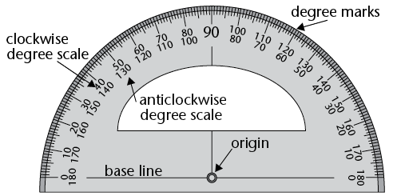

Protractors can be big or small but they all
          measure angles in exactly the same way. The
          size of the protractor makes no difference to
          an angle’s size.
</Callout>

### Measuring some familiar angles

You need the four folded angles from the previous activity. If you didn't do that activity, then go back now and follow the instructions in question 5.

2. In a group of three or four, use your protractor to measure the angles that you
               made: 90°; 45°; 30° and 22,5°.
4. Did you measure the
               correct sized angle? If not, then ask
               yourself the following questions:

- Did you put the vertex of
            the angle at the origin of the protractor?
- Is the bottom arm of
            your angle lined up with the base line?
- Did you fold your
            corners correctly?

### How to use a protractor to measure an angle

**Step 1: Are the angle arms long enough?**

The angle arms must be a little longer than the distance from the origin of the protractor to its edge. If they are too short, use a sharp pencil and a ruler to make them longer. Be careful to line the ruler up with the arm.

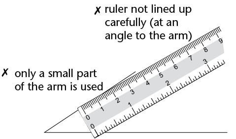

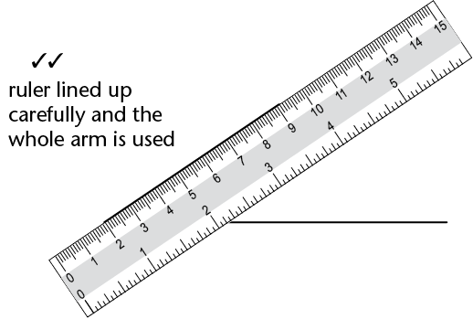

Now you are ready to start measuring your angle.

**Step 2: Line up the
          angle and your protractor**

Place your protractor on top of the angle. Make sure of the following:

- the origin is exactly on the vertex of the angle, and
- the base line is exactly on top of one of the arms of the angle.

Keep adjusting the position of the protractor until the origin and the base line are exactly lined up.

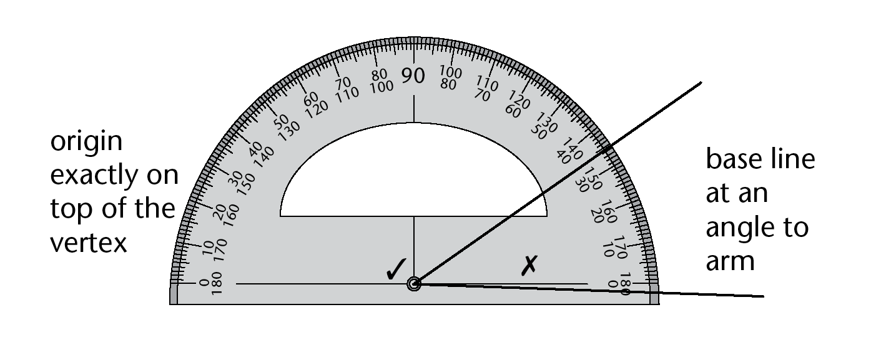

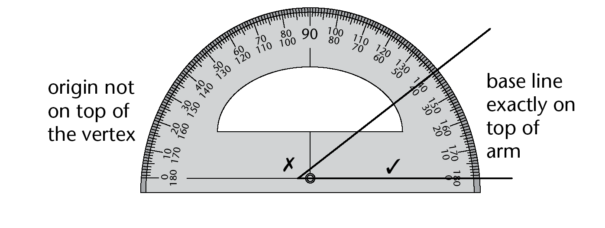

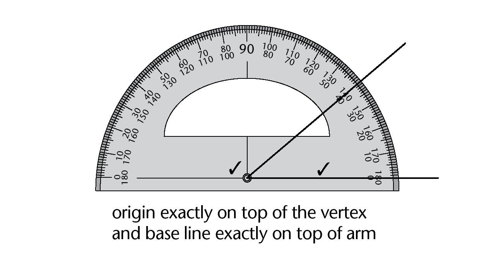

Once your protractor is in the
        correct place keep a finger on the protractor to stop it from moving. If it
        moves… start again! You are now ready to make a
        measurement.

**Step 3: Measure the
          angle**

A protractor gives a clockwise
        degree scale and an anticlockwise degree scale. You choose the correct scale by
        finding the one that starts with 0° on the angle arm. Look at where
        the other angle arm passes under the degree scale. That is where your
        measurement is.

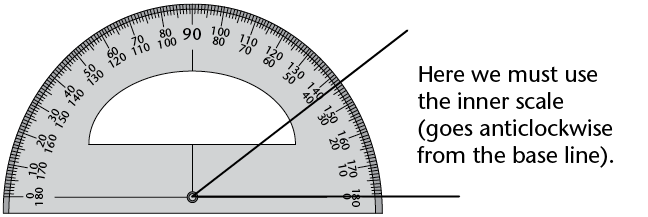

You can also place the protractor on the angle using the other arm. Then the correct position looks like this:

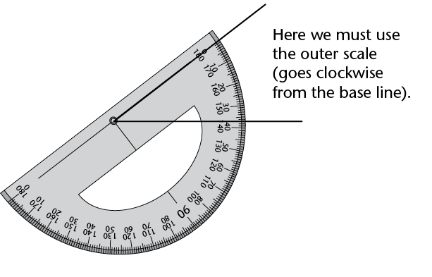

The angle in the pictures
        above is 37°. Do you agree? Do you see that there are two ways to
        measure an angle?

### Practise measuring with a protractor

2. Measure the angles and complete the table on the next page. You can extend the
               arms if you need to; it doesn't matter if they go across text or another
               drawing.
   2. 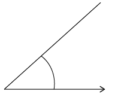
   4. 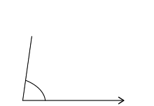
   6. 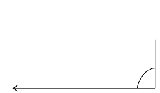
   8. 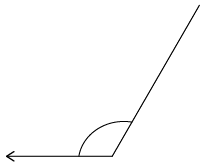
   10. 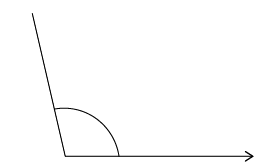
   12. 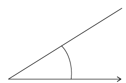
   | Angle | (a) | (b) | (c) | (d) | (e) | (f) |
   | --- | --- | --- | --- | --- | --- | --- |
   | Angle size in degrees |  |  |  |  |  |  |
4. Measure all the numbered angles in the
               following figure. Some angles can be measured directly, others not. Your
               protractor cannot measure reflex angles like angles 7 and 8. So you will have to
               make a plan!
   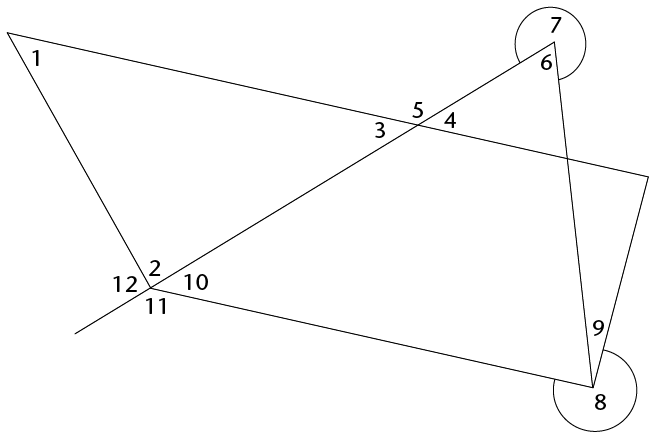
   | Angle | Size |
   | --- | --- |
   | 1 |  |
   | 2 |  |
   | 3 |  |
   | 4 |  |
   | 5 |  |
   | 6 |  |
   | 7 |  |
   | 8 |  |
   | 9 |  |
   | 10 |  |
   | 11 |  |
   | 12 |  |
6. Write a short note for yourself about measuring
               reflex angles here:

### Some things to think about

Look at your answers in question 2.

2. How do angles 3 and 4
                 compare?
4. What about angles 6 and 7?
6. What about angles 4 and 5?
8. There are some interesting ideas
                 here. Try to do some further investigation and show your teacher what you
                 discover.
