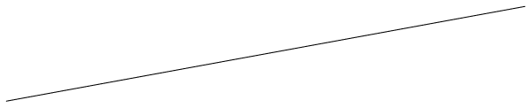
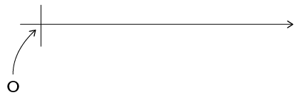
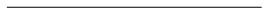
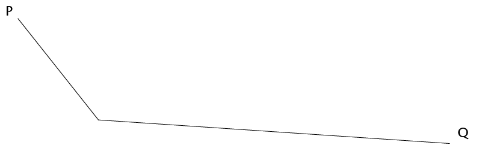

## Using a protractor to construct angles

### Constructing angles to a given line

Work together with a partner on this activity. You need your protractor, a sharp pencil and a straight ruler.

2. Your first challenge is to construct a line at exactly right angles to the one
               below. Begin by choosing a point on the line. You must mark this point clearly and neatly with a small dot. Then
               use your understanding of a protractor to draw a 90° angle.
   
4. Now fill in the
               missing words in the steps:
   **Step 1:** Choose a point anywhere on the line. Make a small mark on the line. (You don't always have a choice here. Sometimes you must use a specific point on the line.)
   **Step 2:** Place the protractor with its ______ on the line and its origin exactly on top of the ______
   **Step 3:** Make a small, clear mark at the ______
   **Step 4:** Use a ruler to line up the two ______ and draw a straight line that passes exactly through them.
6. Construct the angles using the line below. The
               line below will be one arm of the angles you are going to construct. The vertex
               for each of your angles is the point labelled O where the tiny vertical line
               cuts the long horizontal one. Your angles must be measured *anticlockwise*
               from the line.
   2. 23°
   4. 45°
   6. 65°
   8. 79°
   10. 90°
   12. 121°
   14. 154°
   16. 180°
   18. 200°
   20. 270°
   22. 300°
   <Callout type="note" title="Note">
   **Angle
                   direction**
   The line you have
                 been given below is called a **reference line**.
   Mathematicians usually
                 measure angles **anticlockwise** from the reference line.
   </Callout>
   
8. Use the
               line below. At each end you need to draw lines at an angle of 60° to
               form a triangle. What sort of triangle is this?
   
10. Complete the
               quadrilateral below. The angle at P must be 52° and the one at Q,
               23°.
   
