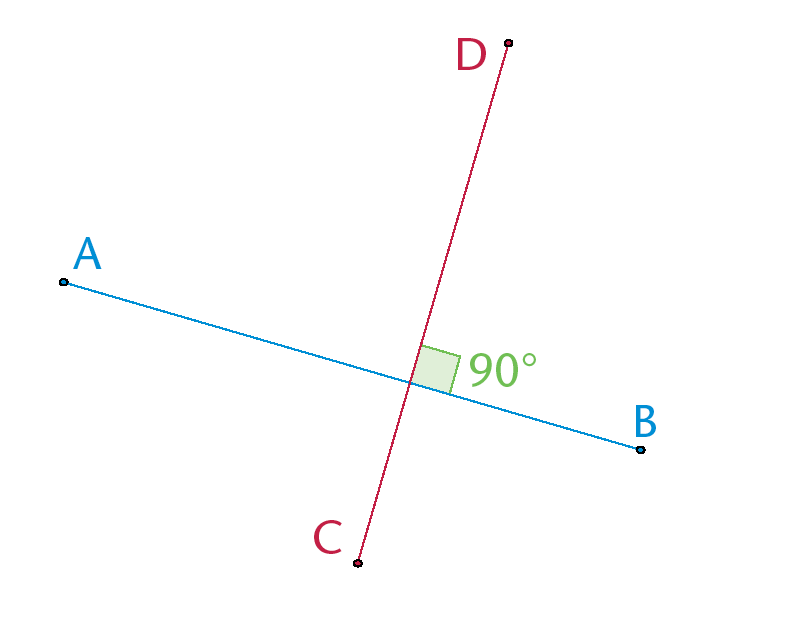
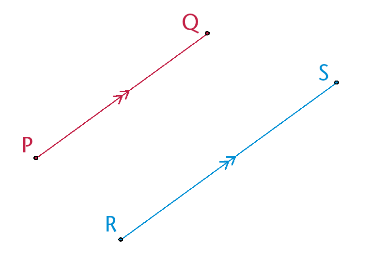
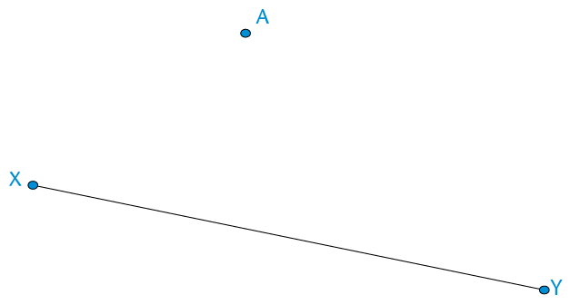
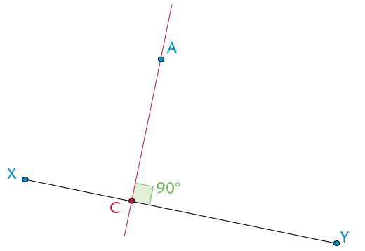
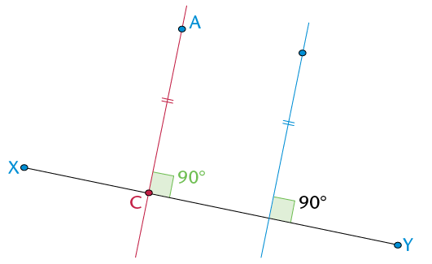
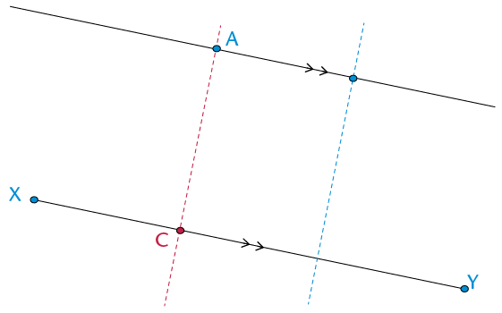

## Parallel and perpendicular lines

<Callout type="note" title="Note">
**Perpendicular lines** meet each other at an
          angleof 90°.

The sketch shows two perpendicular lines.

We say: AB is perpendicular to DC.

We write: AB
          \(\perp\) DC

</Callout>

<Callout type="note" title="Note">
**Parallel lines** never meet each other. They are an equal distance apart. They have the same direction.

The sketch shows two parallel lines.

We say: PQ is parallel to RS.

We write: PQ
          \(\parallel\) RS

The arrows on the middle of the lines show that the lines are parallel to each other.

</Callout>

### Constructing perpendicular and parallel lines

When constructing parallel lines, remember that the lines always stay the same distance apart. Follow the steps below to draw perpendicular and parallel lines using a protractor and a ruler.

2. We want
               to draw a line that is parallel to XY and that passes through point A.
   
   **Step 1: Draw a perpendicular line between A and
                 XY.**
   Use
               your protractor to draw a line that goes through A and is at 90° to
               XY.Label
               the point C where your new line touches XY.Look at the sketch below if you
               get stuck.
   
   **Step 2: Measure the perpendicular distance
                 between the point and the line.**
   Write down the length of AC:
   **Step 3: Draw a point
                 that is the same distance from the line.**
   Draw
               another line that is perpendicular to line XY.Mark off the same length as AC on
               that line.The sketch shows what you must do.
   
   **Step 4: Draw the parallel line.**
   Join A
               with the new point that is an equal distance away from XY.You now have a
               parallel line.
   
4. In your exercise book, practise constructing
               perpendicular and parallel lines using a protractor and a ruler.
