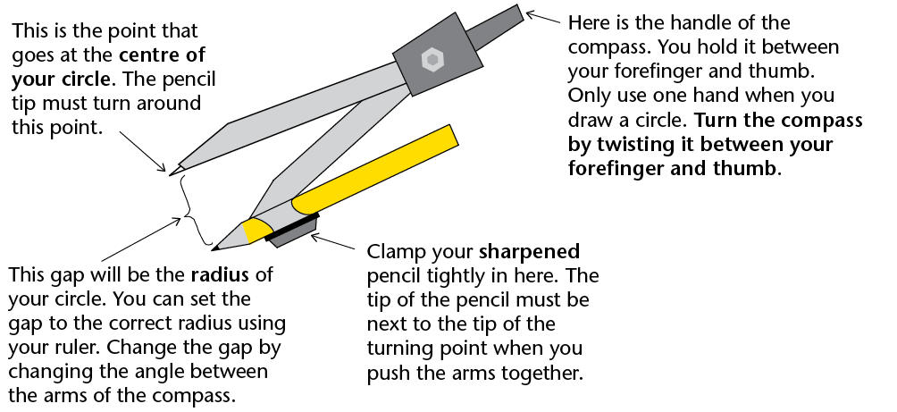
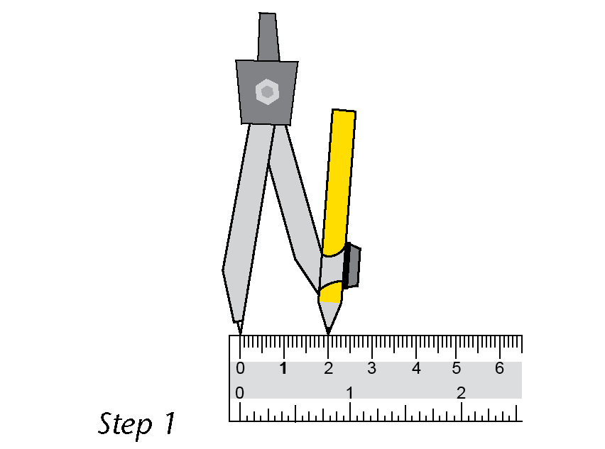
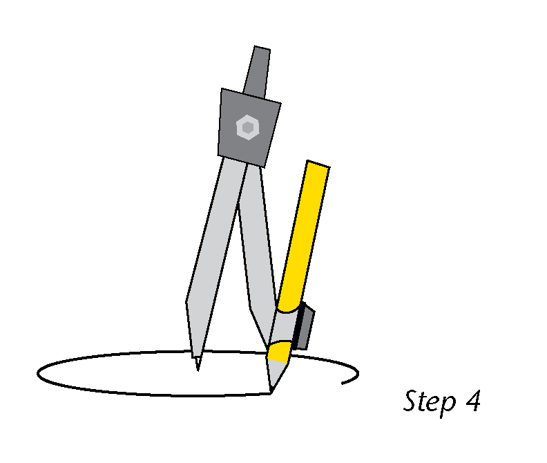
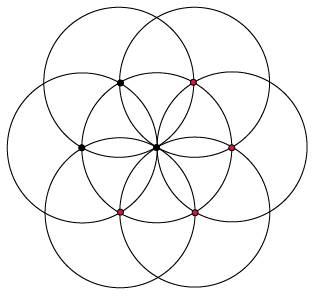

## Using the compass

We need a special instrument for drawing circles. It must have a pointy tip, like the centre pencil. It must also have a drawing tip, like the pencil you moved. If you can set the distance between these two tips, you can draw circles of any radius. This instrument is called a **pair of compasses**, or often just a **compass**.

### Constructing circles with a compass

2. At the top of the next page you will see a point labelled A. Follow the steps
               below and on the next page to draw a circle with a radius of 2 cm. The centre
               must be at A.
   ** Step 1:** Place the pointed tip on the zero line of your ruler. Carefully widen the angle between the arms. Move the pencil tip until it is exactly at 2 cm. Make sure that the pointed tip is still on zero. Be careful not to change the gap once it is set to 2 cm.
   ** Step 2:** Gently push the pointed tip into point A. Push just deep enough into the paper to keep it in place. This will be the centre of your circle.
   
   
   
   **Step 3:** Hold the handle between the forefinger and thumb of your writing hand. Keep your other hand out of the way. Use only one hand when you draw a circle with a compass.
   **Step 4:** Twist the handle between your thumb and forefinger. If you are right-handed it is easiest to twist the compass clockwise. If you are left-handed, turn anticlockwise. Let the pencil tip *drag* over the paper. Don't push down too hard on the pencil. Rather, push down lightly on the pointed arm as you draw. The pencil tip must move smoothly and easily.
4. Draw concentric circles at centre A above with
               radii of 3 cm, 4 cm, 5 cm and 6 cm. Set the gap carefully each time. Write the
               radius on the edge of each circle.

<Callout type="note" title="Note">
**Concentric circles** have the same midpoint.
</Callout>

<Callout type="note" title="Note">
Learning to use a compass is like learning to ride a bicycle. It takes co-ordination and practice. Don't be embarrassed if it goes wrong. With practice you will get very good at it. If your circles end up being all wobbly lines, just begin again!
</Callout>

**Here are some tips for drawing circles:**

<Callout type="note" title="Note">
- If
              your circles are turning into spirals it is because the arms of your compass
              have moved. Check their width again against a ruler.
- If the arms of your compass won't stay in the position you set them at, it is because the nut at the hinge below the handle is loose. Ask your teacher to help you if you can't tighten it yourself.
- If you can't do the twist, imagine you have a small piece of soft clay between your thumb and forefinger and you are trying to roll it into a small strip. The twist for turning your compass uses the same type of sliding movement. Let the compass hang from your hand in the air and twist the handle. Then try it on scrap paper a few times until you can turn the compass easily.
</Callout>

### Circles on circles

It's time to have some fun with the compass while getting better at using it. Follow these instructions to draw the beautiful pattern shown on the right in your exercise book.

2. Make
               sure your pencil is sharp; then place it in the compass.
4. Set the radius
               to 4 cm. Draw a circle at the centre of your page. Important: your radius must
               stay the same for the whole activity.
6. Put your compass
               point anywhere on the circle edge. Draw another circle. This circle should pass
               through the centre of your first circle (they have the same
               radius).
8. Your second
               circle cuts the first circle at two points. Choose one of these points. Place
               your compass point at this point. Draw another circle of radius 4
               cm.
10. Repeat step 3
               with your third circle, fourth circle etc. You should end up with six circles on
               your first circle. That is, seven circles in total.
12. Decorate it as
               you please. (You can decorate your pattern further by adding more circles or
               joining points with straight lines, and so on. See what patterns and shapes you
               can discover among all the circles.)
