## Using circles to draw other figures

### Geometric figures hiding in the circles

Below is a set of seven circles like the one you drew. Sit with a partner and try to find hidden polygons.

You will find these polygons by joining the points where the circles cut each other. The points will be the vertices of the polygons. Look carefully. There are triangles, quadrilaterals, pentagons and hexagons. When you can see them, neatly and carefully rule in their sides with a pencil. If there is not enough space on the set of circles below, redraw the circles on a separate piece of paper and show the figures there. If you wish, you can measure the angles at each vertex and the lengths of the sides.

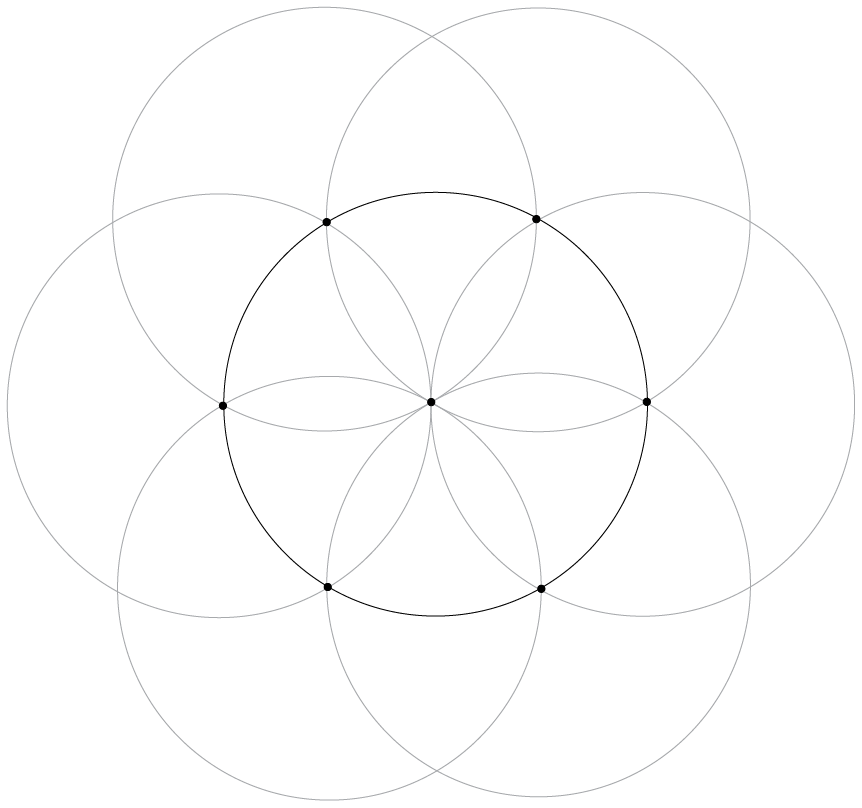

**Arcs of circles**

We do not have to draw whole circles to construct figures. We are only really interested in the points where the circles cross each other, so we could just draw arcs where they cross. Next year, you will use arcs in your geometric constructions.

<Callout type="note" title="Note">
An **arc** is a small part of a circle. We use the term **circumference** when we refer to the distance around a circle or around any other curved shape.
</Callout>

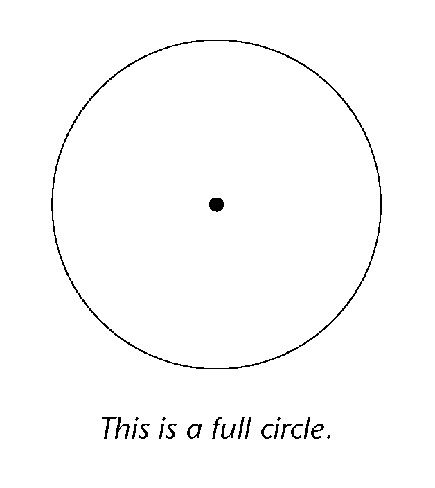

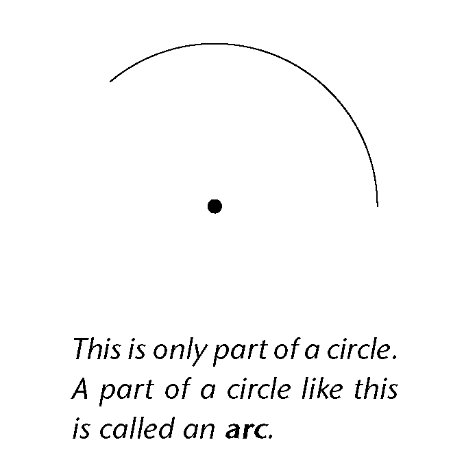

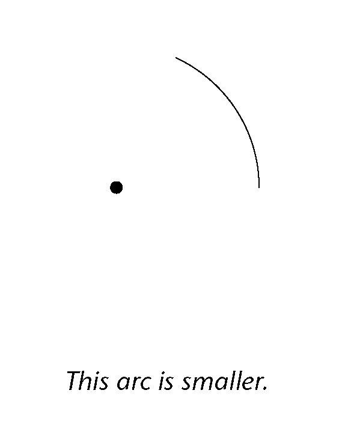

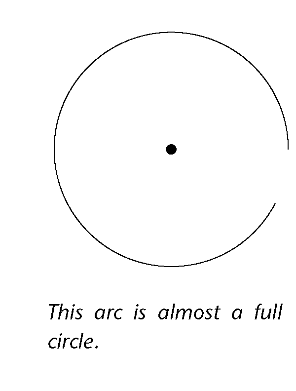

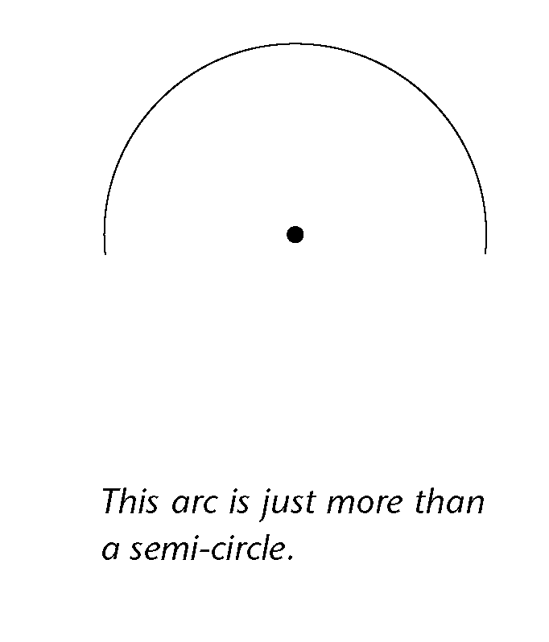

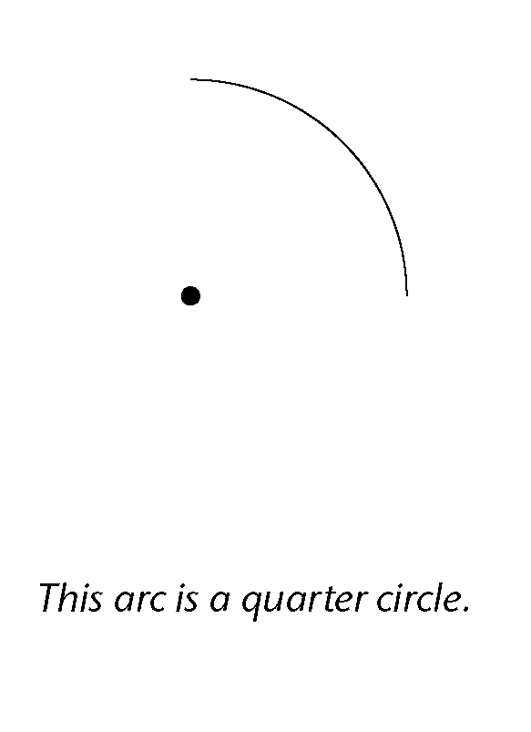

Do the following in your exercise book:

2. Draw an arc using a
                 radius of 3 cm.
4. Draw an arc bigger than a
                 quarter circle, using a radius of 5 cm.
6. Draw an arc smaller than a
                 quarter circle, using a radius of 5 cm.

### Enrichment

Once you have finished the work in section 4.8, experiment with drawing only the arcs that you need in various constructions. Here is an example to show how to construct a regular hexagon with only arcs:

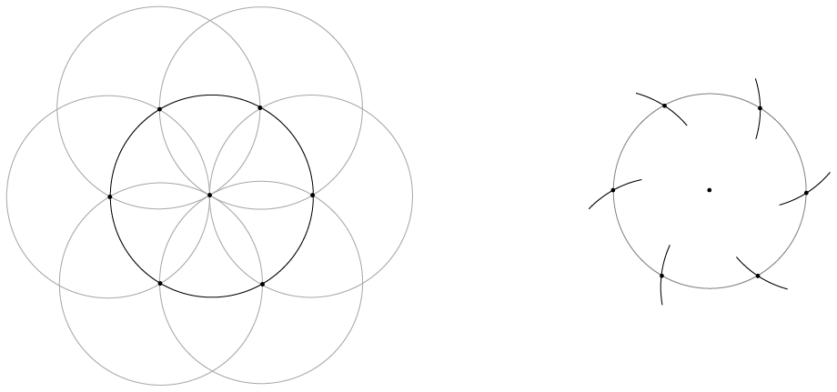

### Familiar figures in the seven-circle pattern

For this activity you need five seven-circle sets like the ones drawn in the previous two activities. Start by drawing these on blank pieces of paper. Don't make your radius bigger than 4 cm. Number your sets figure 2 to figure 6. Label each figure as shown on the right.

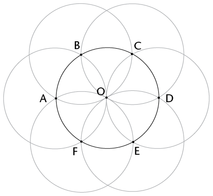

2. Follow the
                 instructions below.
   - Figure 1: Use the figure alongside. Draw lines connecting AB, BC, CD,. . . up to FA.
   - Figure 2: Draw lines connecting A, O and B.
   - Figure 3: Draw lines connecting B, F and D.
   - Figure 4: Draw lines connecting BC, CE, EF and FB.
   - Figure 5: Draw lines connecting CD, DE, EF and FC.
   - Figure 6: Draw lines connecting AB, BC, CE and EA.
4. Complete the table below.
   It shows the name of each figure and its properties.
   Figure 1 (on the
                 right) has been done as an example.
   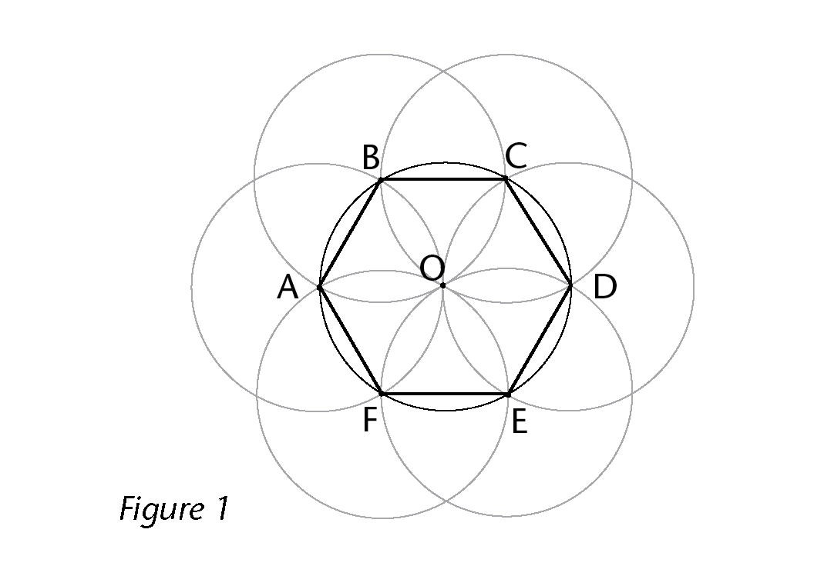
   | Figure | Name of figure | Properties |
   | --- | --- | --- |
   | 1 | Regular hexagon | 6-sided figure. All the sides are equal. All the interior angles are equal. |
   | 2 |  |  |
   | 3 |  |  |
   | 4 |  |  |
   | 5 |  |  |
   | 6 |  |  |

### Construct some more figures

Read the instructions carefully and follow them exactly.

2. 2. Draw a line in
                        your exercise book. The line should be between 3 and 6 cm long. Draw it in the
                        middle of your page.
   4. Label the ends A and B.
   6. Place the point of your
                        compass at point A. Carefully set the radius of your compass to the distance
                        between A and B.
   8. Draw a circle with the
                        compass point at A.
   10. Draw another circle with
                        the compass point at B without changing the radius width.
   12. The circles cross at two
                        points. Choose one of these points. Label it C. Check that you are on the
                        right track by comparing your sketch to the one on the right.
   14. Carefully rule the lines
                        AC and BC.
   16. What sort of figure is
                        ABC? Check this by measuring angles. Why do you think this happened?
      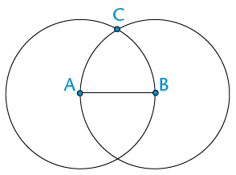
4. 2. Draw two lines PQ and QR in your exercise
                        book.
      - The lines meet and form an angle at Q.
      - You can make your angle any size.
      - Make your line lengths different.
      - Do not make your lines longer than 6 cm each.
        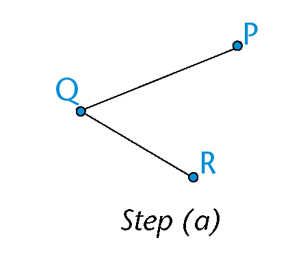
      - Place
                              your compass point at point Q. Set the radius of your compass to the
                              distance QP. Place the compass point at R. Draw a circle.
        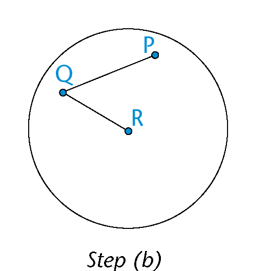
      - Place the compass point
                              back at Q. Set the radius to the length QR. Place the compass point
                              at P. Draw a circle.
      - The two circles cross at
                              two points. Decide which point will be the vertex of a parallelogram. Call
                              this point S.
        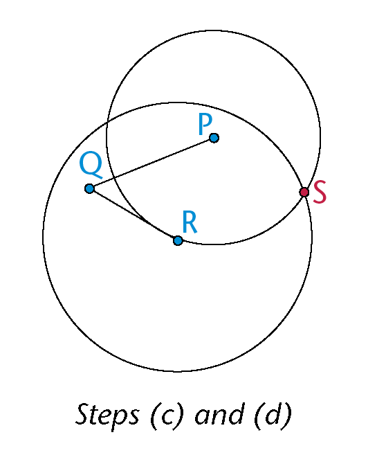
      - Join the lines SP and
                              SR. Is PQRS a parallelogram?

<Callout type="note" title="Note">
**Something to think about**

Why does this method form a parallelogram?
</Callout>

## Parallel and perpendicular lines with circles

### Parallel and perpendicular

2. Revision:
                 Complete these definitions.
   2. When one line is
                        parallel to another line, the lines
   4. When one line is perpendicular to another line,
                        the lines
4. A seven-circle
                 figure has been drawn below. The intersection points have been marked. A line
                 segment has been drawn in. Use a ruler and pencil to join pairs of points so
                 that the lines are:
   2. parallel to the line
                        segment
   4. perpendicular to the
                        line segment.
   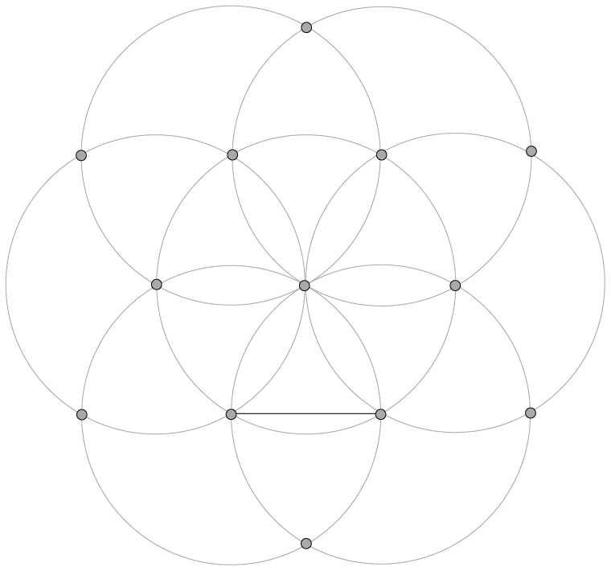
   <Callout type="note" title="Note">
   When two lines (or
                   arcs) cross each other we say they **intersect**.
   The
                   **intersection point** is the place where they meet.
   </Callout>
   You should have
                 drawn 7 lines (2 parallel and 5 perpendicular to the line segment).Compare your
                 lines with a friend's lines. Do you agree?
6. In your
                 exercise book, draw a few circles with the same radius along a line. Start by
                 drawing a line. Then use your compass to draw a circle with the midpoint on the
                 line.
   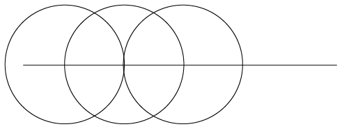
   Keep your compass the same width and draw another circle with the centre
                 where the first circle crossed the line. Repeat as many times as you wish. In
                 the example at the bottom of the previous page only three circles have been
                 drawn.
   2. Can you find that
                        example in the seven-circle figure? Look carefully until you see it.
   4. Can you see where you
                        can construct lines that are perpendicular to the given line? Draw them
                        carefully with a pencil and your ruler.
   6. Can you see the two
                        lines that are parallel to the given line? Draw them in
                        too.
8. Use circles to construct
                 a line that is perpendicular to the line below.
   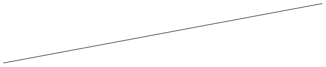
10. Use circles to
                 construct a line that is parallel to the line below.
   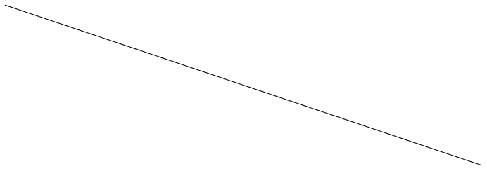

### Extension

2. Set your compass at a certain distance, for
                   example 3 cm, and investigate points that are the same distance from a fixed
                   point, P.
   
4. Use your compass and investigate all the points
                   that are at the same distance, for example 3 cm, from two fixed points, A
                   and B.
   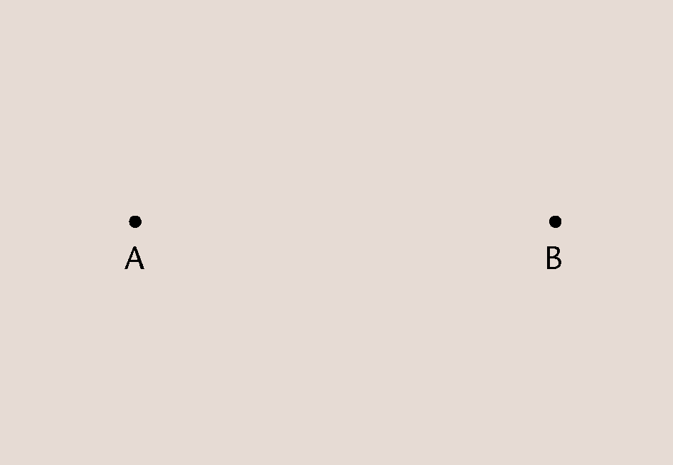

# Geometry of shapes

In this chapter, you
          will learn about different kinds of 2D shapes. You will learn the names given to
          different shapes. You will also learn about the different properties that
          different types of shapes have in relation to their sides and angles.

## Triangles, quadrilaterals, circles and others

### Decide which is which and draw some figures

<Callout type="note" title="Note">
A **triangle** is a closed figure with three straight sides and three angles.

A **quadrilateral** has four straight sides and four angles.

A **circle** is round and the edge is always at the same distance from the centre.
</Callout>

2. Which shapes on the opposite page are
                 circles?
4. Which shapes on the opposite page are
                 triangles?
6. Which shapes on the opposite page are
                 quadrilaterals?
   Use your ruler to do the following:
8. Make a
                 drawing of one triangle with three acute angles, and another triangle with one
                 obtuse angle.
10. 2. Draw a quadrilateral
                        with two obtuse angles.
   4. Can you
                        draw a triangle with two obtuse angles?
12. 2. Draw a triangle with one right angle, and a
                        triangle without any right angles.
   4. Can you draw a triangle
                        with two right angles?
   6. Can you draw a
                        quadrilateral with four right angles?
14. These four lines form
                 quadrilateral ABCD.
   
   The two red sides, BC and AD, are called **opposite sides** of quadrilateral ABCD.
   Which other two sides of ABCD are also opposite sides?
16. The lines DA and AB in the figure in
                 question 7 are called **adjacent sides**. They meet at a point that is one of
                 the vertices (corner points) of the quadrilateral.
   2. Name another two
                        adjacent sides in ABCD.
   4. AB is adjacent to DA in the quadrilateral ABCD.
                        Which other side of ABCD is also adjacent to DA?
18. William says:
   *"Each side of a quadrilateral has two adjacent sides.*
   * Each side of a quadrilateral also has two opposite sides."*
   Is William correct? Give reasons for your answer.
20. William also says:
   *"In a triangle, each side is adjacent to all the other sides."*
   Is this true? Give a reason for your answer.
22. In each case, say whether the
                 two sides are opposite sides or adjacent sides of the quadrilateral
                 PQRS.
   
   2. QP and PS
   4. QP and SR
   6. PQ and RQ
   8. PS and QR
   10. SR and QR

## Different types of triangles

### Equilateral, isosceles, scalene and right-angled triangles

<Callout type="note" title="Note">
A triangle with two equal sides is called an **isosceles triangle**.

A triangle with three equal sides is called an **equilateral triangle**.

A triangle with a right angle is called a **right-angled triangle**.

A triangle with three sides with different lengths and no right angle is called a **scalene triangle**.
</Callout>

2. Measure every angle in each of the **isosceles triangles** given above. Do
                 you notice anything special? If you are not sure, draw more isosceles triangles
                 in your exercise book.
4. Measure the angles and sides of the
                 following triangles. What is special about these triangles? In other words, what
                 makes these triangles different to other triangles?
   
   <Callout type="note" title="Note">
   These triangles are called **equilateral triangles**.
   </Callout>
6. 2. Measure each angle in each of the following triangles.
                        Do you notice anything special about these angles?
      
   4. Identify the longest
                        side in each of the triangles. If you are not sure which one is the longest
                        side, measure the sides. What do you notice about the longest side in each of
                        these triangles?

<Callout type="note" title="Note">
These triangles are called **right-angled triangles**.
</Callout>

### Comparing and describing triangles

When two or more sides of a shape are equal in length, we show this using short lines on the equal sides.

2. Use the
                 following triangles to answer the questions that follow:
   
   
   
   2. Which
                        triangle has only two sides that are equal?
      What is this type of triangle called?
   4. Which triangle has all three
                        sides equal?
      What is this type of triangle called?
   6. Which triangle has an angle
                        equal to 90°?
      What is this type of triangle called?
4. Write down the type of each of the following triangles in the space
                 provided:

### Finding unknown sides in triangles

2. 2. Name each type
                        of triangle below.
      
      
      
   4. Use the given information to
                        determine the length of the following sides:
      AB:
      BC:
      EF:
   6. Can you determine the lengths of GH and HI?
                        Explain your answer.
4. The square in the corner of
                 \(\triangle\)JKL shows that it is a right angle. Give a reason for each of your
                 answers below.
   
   2. Is this triangle
                        scalene, isosceles, or equilateral?
   4. Name the two sides of the triangle that are
                        equal.
   6. What is the length of JK?
   8. Name two equal angles in this triangle.
   10. What is the size of
                        \(\hat{J}\) and
                        \(\hat{L}\) ?

## Different types of quadrilaterals

### Investigating quadrilaterals

2. The two
                 pages that follow show different groups of quadrilaterals.
   2. In which
                        groups are both pairs of opposite sides parallel?
   4. In which groups are only some
                        adjacent sides equal?
   6. In which groups are all four
                        angles equal?
   8. In which groups are all the
                        sides in each quadrilateral equal?
   10. In which groups are all four
                        sides equal?
   12. In which groups is each side
                        perpendicular to the sides adjacent to it?
   14. In which groups are opposite
                        sides equal?
   16. In which groups is at least one
                        pair of adjacent sides equal?
   18. In which groups is at least one
                        pair of opposite sides parallel?
   20. In which groups are all the
                        angles right angles?
4. The figures in group 1 are called
                 **parallelograms**.
   2. What do you observe
                        about the opposite sides of parallelograms?
   4. What do you observe about the angles of
                        parallelograms?
6. The figures in group 2 are called
                 **kites**.
   2. What do you observe
                        about the sides of kites?
   4. What else do you observe about the kites?
   **Group 1**
   
   **Group 2**
   
   **Group 3**
   
   **Group 4**
   
   **Group 5**
   
   **Group 6**
   
8. The figures in
                 group 3 are called **rhombi**.
   2. What do you observe
                        about the sides of rhombi?
   4. What else do you observe about the rhombi?
   <Callout type="note" title="Note">
   Note: One
                   **rhombus**; two or more **rhombi**.
   </Callout>
10. The figures in group 4 are called
                 **rectangles**.
   2. What do you observe
                        about the opposite sides of rectangles?
   4. What do you observe about the angles of
                        rectangles?
   6. What do you observe about the adjacent sides of
                        rectangles?
12. The figures in group 5 are called
                 **trapeziums**. What do you observe about the opposite sides of
                 trapeziums?
   <Callout type="note" title="Note">
   The arrows show which sides are parallel to each other.
   </Callout>
14. The figures in group 6 are called
                 **squares**.
   2. What do you observe
                        about the sides of squares?
   4. What do you observe about the angles of
                        squares?

### Comparing and describing shapes

2. Name
                 each shape in each group.
   Group A
   
   
   
   Group B
   
   
   
4. In what way(s)
                 are the figures in each group the same?
   **Group A:**
   **Group B:**
6. In what way(s) does one of the figures
                 in each group differ from the other two figures in the group?
   **Group A:**
   **Group B:**

### Finding unknown sides in quadrilaterals

Use what you know about the sides and angles of quadrilaterals to answer the following questions. **Give reasons for your answers.**

2. 
   2. What type of quadrilateral is ABCD?
   4. Name a side equal to AB.
   6. What is the length of BC?
4. 
   2. What type of quadrilateral is EFGH?
   4. What are the lengths of the following sides?
      EF:
      GH:
6. 
   2. What type of quadrilateral is JKLM?
   4. What is the length of JK?
8. 
   Figure PQRS is a kite with PQ = 4 cm and QR = 10 cm. Complete the following drawing by:
   2. labelling the vertices of the kite
   4. showing on the drawing which sides are equal
   6. labelling the length of each side.

## Circles

2. 
   2. Make a dot in the middle of the circle on the right. Write the letter M next to the dot. If your dot is in the middle of the circle, it is called the **midpoint** or **centre**.
   4. Draw lines MA, MB and MC from M to the red points A, B and C.
   <Callout type="note" title="Note">
   The
                   three red points are on the circle with midpoint M.
   A straight line ,such as AC, drawn across a
                   circle and passing through its midpoint is called the **diameter** of the
                   circle.
   </Callout>
4. Measure MA, MB and MC.
   If MA, MB and MC are equal in length, you have chosen the midpoint well.If they are not equal, you may wish to improve your sketch of a circle and its parts.

<Callout type="note" title="Note">
A straight line from the midpoint of a circle to
            a point on the circle is called a **radius** of the circle.

The blue line, MA ,is a
            **radius**. Any straight line from the centre to the circle is
            a radius.

The black line AB
            joins two points on the circle. We call this a **chord** of
            the circle.

</Callout>

<Callout type="note" title="Note">
In
            the following two diagrams, the coloured sections are **segments** of a
            circle. A segment is the area between a chord and an arc.
</Callout>

<Callout type="note" title="Note">
In the circle on the right, the red section is called a **sector** of a circle. As you can see, a sector is the region between two radii and an arc.
</Callout>

## Similar and congruent shapes

Three groups of quadrilaterals are shown on this page and the next.

What makes each group different from the other groups, apart from the colours?

2. Group
                 A:
4. Group B:
6. Group C:
   **Group A**
   
   **Group B**
   
   **Group C**
   
   <Callout type="note" title="Note">
   Shapes that have the same form, such as the blue shapes on the previous page, are said to be **similar** to each other. Similar shapes may differ in size, but will always have the same shape.
   </Callout>
   
   Example of similar shapes
   
   Example of congruent shapes
   <Callout type="note" title="Note">
   Shapes that have the same form and the same size, such as the red shapes on the previous page, are said to be **congruent** to each other. These shapes are always the same size and shape.
   </Callout>
8. Are the red shapes on the previous page
                 *similar* to each other?
10. Look at groups D, E, F, and G on this
                 page and the next. In each case say whether the shapes are similar and
                 congruent, similar but not congruent, or neither similar nor congruent.
   2. Group D:
   4. Group E:
   6. Group F:
   8. Group G:
   **Group D**
   
   **Group E**
   
   **Group F**
   
   **Group G**
   

# Term revision and assessment

## Revision

You should not use a
          calculator for any of the questions in this section. Do show your steps of
          working.

### Working with whole numbers

2. Make the number sentences below true. Into the first block in each question,
                 write a multiplication or division sign. Into the second block, write either 10,
                 100 or 1 000.
   2. 8 ☐ ☐ = 800
   4. 740 000 ☐
                        ☐= 740
4. Circle all the numbers
                 given below that will round off to 60 000.
   62 495; 54 498 ; 65 000;
                 56 002 ; 67 024
6. Calculate the
                 following:
   2. \(274 561 + 367
                        238\)
   4. \(4 672 - 3
                        937\)
   6. \(3 458 \times 43\)
   8. \(6 624
                        \div 18\)
8. Write the missing
                 numbers in the blocks.
   2. 8; 15; 22; 29; ☐
   4. 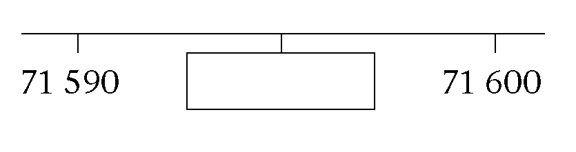
10. Tumi makes a sequence of
                 numbers using the following rule: "Take half the
                 previous number and then add 12." Write the next three
                 numbers in the sequence:
   56; 40; 32;
12. Two three-digit numbers are added
                 together as shown, and produce a three-digit answer - but some of the digits are
                 missing. Fill in the missing digits so as to make the calculation correct.
   59 ☐+ 3
                 ☐9=☐53
14. Ismail has the following
                 numbers:
   71; 72; 73; 74;
                 75; 76; 77; 78; 79; 80
   He wishes to sort them
                 by placing them in the sorting diagram below. Help Ismail by placing the
                 numbers in the correct blocks.
   |  | Prime number | Not a prime number |
   | --- | --- | --- |
   | Multiple of 4 |  |  |
   | Not a multiple of 4 |  |  |
16. Write down,
                 using *only* numbers from the cloud:
   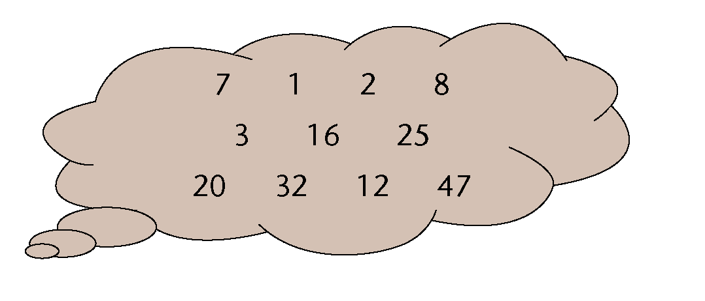
   2. All the prime numbers
   4. All the square
                        numbers
   6. All the cube numbers
   8. All the
                        multiples of 8
   10. All the factors of
                        8
18. Teacher
                 Ramushwana states:
   "Every **even
                   number** (greater than or equal to 6) can be written as the sum of a
   **pair of odd prime
                   numbers**, for example \(10 = 3 + 7\)."
   2. Write down *two*
                        pairs of odd prime numbers that each sum to 20.
   4. Choose any even number greater than 30 and write
                        it as a sum of two odd prime numbers.
20. 2. Write the following as a product of prime
                        factors:
      2. 576
      4. 600
   4. Find both the (i) HCF and (ii) LCM of 576 and
                        600.
      2. HCF
      4. LCM (leave your answer as a product of
                               prime factors)
22. How many hours will it take the
                 Adams family to reach their holiday destination if it is 495 km away and they
                 travel at an average speed of 110 km/h?
24. Graeme,
                 Thuli and Andile have worked as a team over the holidays, mowing the lawns of
                 their neighbours. They collected a total of R1 200 and now need to share it.
                 They agree that as they didn't all work an equal amount, the money should be
                 shared between Graeme, Thuli and Andile in the ratio 4 : 6 : 5. How much money
                 will Thuli receive?
26. Mr Khumalo decides to try to
                 make some money buying and selling used furniture. He has R6 000 in his bank
                 account, and uses some of the money to buy an old bed base and mattress for
                 R800, a dresser for R2 500, two lockers for R300 each, and a washing machine for
                 R900.
   2. How much is left in his
                        bank account after these purchases?
   4. Suppose that he sells the bed base and mattress
                        for R980, the dresser for R2 950, and both lockers for a total of R750.
                        Nobody seems to want his washing machine though. At this stage he has
                        made a loss. What is the value of the loss?
   6. How much does he need to sell the washing
                        machine for to have an overall profit of R1 000?
28. Mrs Steyn takes out a loan of
                 R55 000 from Fidelity Bank. The bank charges simple interest of R500 per
                   month. How much money will Mrs Steyn owe after \(1\frac{1}{2}\)
                   years?
30. John earns R480 on a Saturday.
                 He works from 08:00 to 14:00. Calculate his hourly rate.

### Exponents

2. Calculate.
   2. \(12
                        \times 12\)
   4. \( 8 \times
                        8 \)
   6. \( 7 \times 7 \times 7\)
   8. \( 3 \times
                        3 \times 3 \)
   10. \( 6 \times 6 \times 6
                        \)
   12. \( 13
                        \times 13 \)
4. Explain the difference between \(4 \times 3\)
                 and \(4^3\).
6. Write \(
                 5^5\) in expanded form.
8. Write the following in exponential
                 form:
   2. \( 2 \times
                        2 \times 2 \)
   4. \( 3 \times
                        3 \times 3 \times 3 \times 3 \times 3 \times 3 \times 3 \)
10. Write the numbers in exponential form. Check
                 your answers.
   2. 81
   4. 10 000
12. Complete:
   2. 5 squared is
   4. 5 cubed is
14. Calculate:
   2. \(
                        7^2\)
   4. \( 15^2\)
   6. \(3^2 \times 4^2 \)
   8. \(\sqrt{16}\)
16. Are the following
                 statements true or false? Explain your answers.
   2. The number 64 can be
                        written both as a square and a cube.
   4. \( 2^5\)
                        is smaller than \(30^1\).
18. Calculate the following and give reasons
                 for your answers.
   2. \(\sqrt[3]{216}\)
   4. \(\sqrt[3]{8}\)
   6. \(\sqrt[3]{125}\)
   8. \(\sqrt[3]{27}\)
20. Determine the
                 value of each of the following:
   2. \(
                        3^2-2^3\)
   4. \(4(10 -
                        1^{100})\)
   6. \((8-2)^2\)
   8. \(\sqrt{4} \times
                        \sqrt{81}\)
   10. \((\sqrt{58})^2\)
   12. \(\sqrt[3]{27} \div \sqrt{9}\)
   14. \(10 \times \sqrt{81}\)
   16. \(\sqrt{2
                      \times 32}\)
22. \(13=169; 14^2
                 =196; 15^2=225; 16^2=256; 7^3=343; 8^3=512;
                 3^3=27\)
   Use these facts to calculate the value of each of the following:
   2. \(\sqrt{196}-\sqrt[3]{512}\)
   4. \(\sqrt{169 \times 225}\)
   6. \(\frac{\sqrt{196}}{\sqrt[3]{343}}\)
   8. \(\frac{14^2- 13^2}{3^3}\)
24. If
                 \(56^3= 175 616\), write down the value of \(\sqrt[3]{175 616}\).

### Geometry of straight lines

2. Consider the grid shown
                 alongside.
   2. Is PS a line, ray or
                        line segment?
      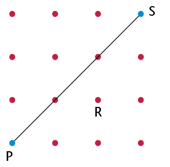
   4. Draw on the grid a line segment through R
                        that will be perpendicular to PS. Label it TU.
   6. Draw on the grid a line
                        that is parallel to PS. Label it WX.
4. Provide the
                 correct name for each of the geometric features AB and CD, shown on the
                 diagram:
   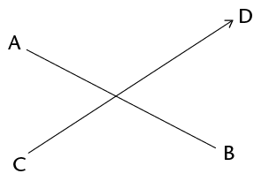
   AB:
   CD:
6. There is a geometric relationship
                 between line segments PR and QS shown in the diagram. Describe the relationship
                 by adding the correct word on the dotted line:
   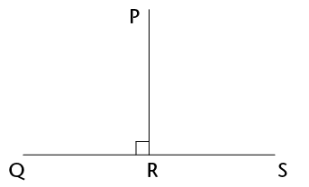
   PR is ____________ QS.
8. Draw a ray and a line
                 that will never meet.

### Construction of geometric figures

2. Use a protractor to accurately measure the following angles, as shown on the
                 diagram below, and write the answers in the table provided:
   2. \(\hat{B}\)
   4. \(A\hat{D}B\)
   6. \(D\hat{A}B\)
   8. \(C\hat{D}B\)
   10. reflex \(C\hat{A}B\)
   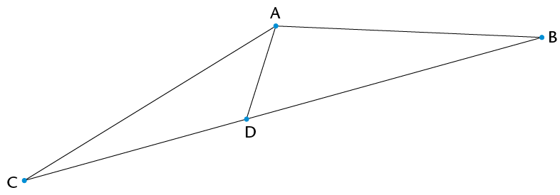
   | Angle name | Size | Classification |
   | --- | --- | --- |
   | \(\hat{B}\) |  |  |
   | \(A\hat{D}B\) |  |  |
   | \(D\hat{A}B\) |  |  |
   | \(C\hat{D}B\) |  |  |
   | Reflex
                         \(C\hat{A}B\) |  | Reflex |
4. Construct a semi-circle with a radius of 3
                 cm.
   
6. Use a
                 ruler and protractor to construct angles that are the given sizes. Label the
                 angles correctly.
   2. \(E\hat{F}G =
                        152^{\circ}\)
   4. \(X\hat{Y}Z = 289^{\circ}\)
   
8. Use circles to
                 construct two lines, CD and EF, that are parallel to line AB below. Line CD
                 should be above line AB, and line EF below line AB. Label both lines.
   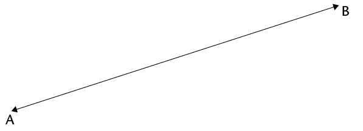
10. Consider
                 the diagram alongside.Write down the names of the pair of perpendicular
                 lines.
   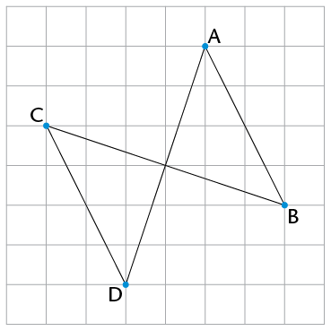

### Geometry of shapes

2. Give the
                 full name of the shape that fits the given descriptions:
   2. A three-sided shape that
                        has exactly two sides equal in length
   4. A four-sided shape with both pairs of opposite
                        sides parallel and equal in length, and with no right angles
   6. A four-sided shape with only one pair of
                        opposite sides parallel
4. What is the correct term for each of the
                 following parts of the circle with centre B, as shown alongside?
   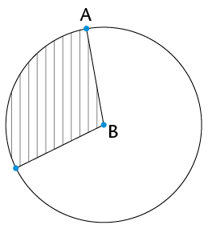
   2. Line AB
   4. The shaded area
6. On the square
                 grid alongside, two sides of a kite have been drawn. Use a ruler and complete
                 the kite on the grid.
   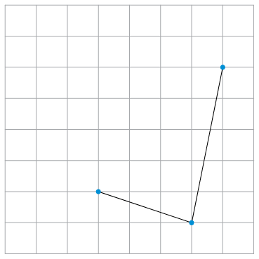
8. Darrel says, "The four-sided shapes I am thinking of
                 have at least one pair of adjacent sides equal. What are they?" Write down the
                 names of all the shapes that fit his description.
10. DEFG is a kite, and DE = 4 cm and EF =
                 5,2 cm. Write down the lengths of DG and GF.
12. STUV is a rectangle. Write down the
                 value of \(\hat{T} +
                 \hat{V}\). Give a
                 reason for your answer.
14. Consider the diagram alongside.
   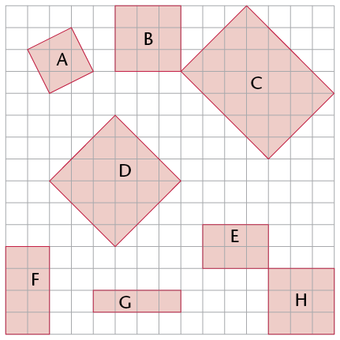
   2. Write down the
                        letters of all the shape(s) that are *congruent* to shape B.
   4. Write down the letters of all the shape(s)
                        that are *similar* to shape B.
16. An isosceles triangle, LMN, has LM = 4
                 cm and a perimeter of 16 cm. Investigate and write down *all* the possible
                 lengths of MN and LN.
18. In each case say whether the two sides
                 are opposite sides or adjacent sides of quadrilateral DEFG.
   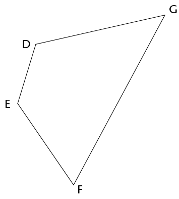
   2. GD and DE
   4. DE and GF

## Assessment

In this section, the numbers indicated in brackets at the end of a question indicate the number of marks that this question is worth. Use this information to help you determine how much working is needed.

The total number of marks allocated to
          the assessment is 60.

<Callout type="note" title="Note">
Do not use your calculator!
</Callout>

2. Here are five one-digit cards:
   
   Two-digit numbers can be made by
                 placing two cards next to each other - so, for example, taking the 1 and the 2
                 and putting them next to each other will create the number 12 (twelve).
   Choose two cards each
                 time to make the following two-digit numbers:
   2. An odd number
   4. A multiple of 9
   6. A factor of 126
   8. A square number
4. Ayanda has a pack of cards numbered from
                 1 to 16. He chooses four cards at random from the pack:
   - One is a factor of
                     39.
   - Two are
                     multiples of 4.
   - Three are
                     even.
   - The total of
                     the four numbers is more than 45, but less than 50.
   Write down the
                 values of the four numbers.
6. All 769 learners from the Sibanye
                 Primary School are going to an athletics meeting. The school hires buses from a
                 local company. Each bus can take only 52 passengers, and each bus has to have
                 two teachers on board. How many buses will the school have to hire to get
                 everyone to the meeting?
8. Calculate the total number of test
                 wickets taken by the top four wicket takers in the Proteas' cricket history
                 (figures correct as at June 2013):
   - Shaun Pollock:
                     421
   - Makhaya Ntini:
                     390
   - Dale Steyn:
                     332
   - Allan Donald:
                     330
10. Use prime factors to find the LCM of 42 and 18.
12. Dintle's family needs to get to
                 Polokwane, 330 km away, by 11 a.m. If they leave at 7.40 a.m. and drive at an
                 average speed of 100 km/h, will they reach their destination on time? Show all
                 your working.
14. Determine the value of each of the following:
   2. \( 6^3 - (7^2 + 6^2)\)
   4. \((8-5)^3\)
   6. \((\sqrt[3]{125})^2\)
   8. \(12^2 - 4\sqrt{121} \div
                        2^2\)
   10. \(3\sqrt{64}\)
16. 2. Write down the letters of all the acute angles in the diagram.
      
   4. Measure the size of angle \(d\) in the diagram and write it down.
   6. Classify angle
                        \(d\) according to its size.
18. Draw and
                 correctly label angle \(K\hat{L}M = 168^{\circ}\).
   
20. Use your
                 ruler and protractor to draw a line that is parallel to line segment FG drawn
                 below, and goes through point H.
   
22. Four
                 circles are drawn so that they fit neatly into a square with side length of 6
                 cm, as shown (*not* to scale). Write down the radius of each
                 circle.
   
24. 2. What is the geometrical name of the shape shown on the dot grid below?
   4. Draw two shapes that are *similar* to the shape shown, anywhere on the grid. Each shape that you draw should have a different size.
   
26. The
                 following diagram shows a square drawn on a dot grid. The square is divided into
                 four triangles, namely A, B, C, and D.
   
   2. Write down the
                        letters of all the right-angled triangles.
   4. Write down the letters of all the
                        isosceles triangles.
   6. Write down the letters of the two
                        congruent triangles.
28. I am a quadrilateral with two
                 pairs of opposite sides equal, no adjacent sides equal, and no right angles.
                 What shape am I?
30. What is the special name we give
                 to the perimeter of a circle?
32. Draw a rhombus of any size on
                 the dot grid below. Add appropriate symbols on the diagram to show that the
                 opposite sides of a rhombus are parallel.
   
34. In trapezium JKLM, JK is parallel to the opposite side.
   Complete the
                 statement:
   JK ||
36. Study the following diagram:
   
   Cross out the
                 *incorrect* word or symbol in each set of brackets:
   AD is
                 (parallel/perpendicular) to BC. This can be shown in symbols as follows:
   (AD
                 \(\perp\) BC
                 / AB || BC).
