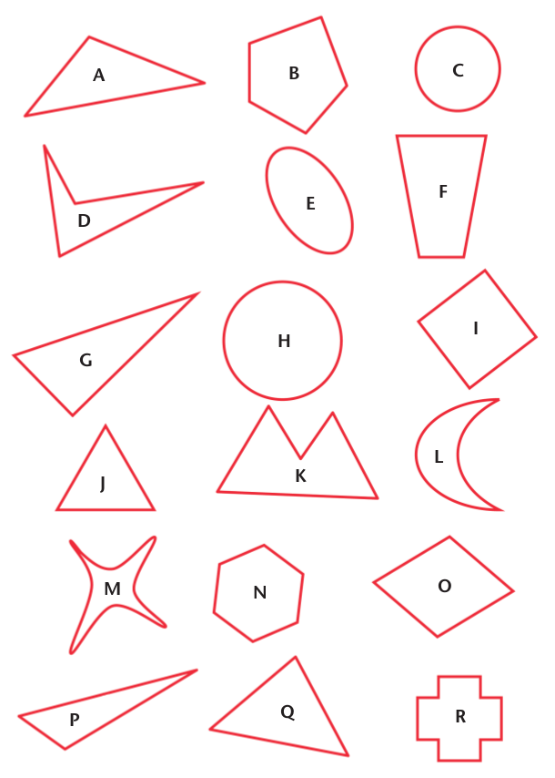
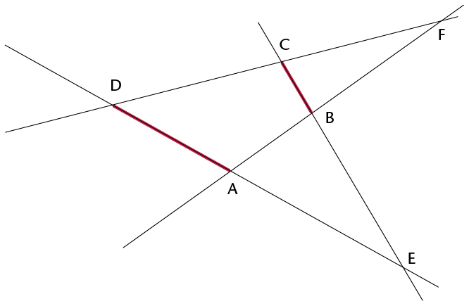
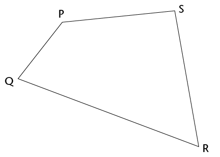

## Triangles, quadrilaterals, circles and others

### Decide which is which and draw some figures

<Callout type="note" title="Note">
A **triangle** is a closed figure with three straight sides and three angles.

A **quadrilateral** has four straight sides and four angles.

A **circle** is round and the edge is always at the same distance from the centre.
</Callout>

2. Which shapes on the opposite page are
               circles?
4. Which shapes on the opposite page are
               triangles?
6. Which shapes on the opposite page are
               quadrilaterals?
   Use your ruler to do the following:
8. Make a
               drawing of one triangle with three acute angles, and another triangle with one
               obtuse angle.
10. 2. Draw a quadrilateral
                      with two obtuse angles.
   4. Can you
                      draw a triangle with two obtuse angles?
12. 2. Draw a triangle with one right angle, and a
                      triangle without any right angles.
   4. Can you draw a triangle
                      with two right angles?
   6. Can you draw a
                      quadrilateral with four right angles?
14. These four lines form
               quadrilateral ABCD.
   
   The two red sides, BC and AD, are called **opposite sides** of quadrilateral ABCD.
   Which other two sides of ABCD are also opposite sides?
16. The lines DA and AB in the figure in
               question 7 are called **adjacent sides**. They meet at a point that is one of
               the vertices (corner points) of the quadrilateral.
   2. Name another two
                      adjacent sides in ABCD.
   4. AB is adjacent to DA in the quadrilateral ABCD.
                      Which other side of ABCD is also adjacent to DA?
18. William says:
   *"Each side of a quadrilateral has two adjacent sides.*
   * Each side of a quadrilateral also has two opposite sides."*
   Is William correct? Give reasons for your answer.
20. William also says:
   *"In a triangle, each side is adjacent to all the other sides."*
   Is this true? Give a reason for your answer.
22. In each case, say whether the
               two sides are opposite sides or adjacent sides of the quadrilateral
               PQRS.
   
   2. QP and PS
   4. QP and SR
   6. PQ and RQ
   8. PS and QR
   10. SR and QR
