## Different types of triangles

### Equilateral, isosceles, scalene and right-angled triangles

<Callout type="note" title="Note">
A triangle with two equal sides is called an **isosceles triangle**.

A triangle with three equal sides is called an **equilateral triangle**.

A triangle with a right angle is called a **right-angled triangle**.

A triangle with three sides with different lengths and no right angle is called a **scalene triangle**.
</Callout>

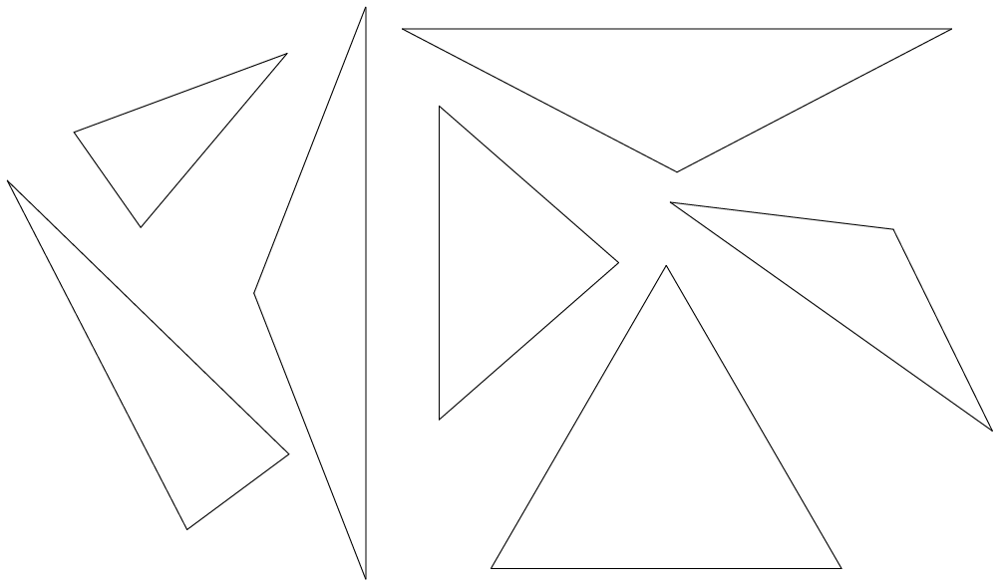

2. Measure every angle in each of the **isosceles triangles** given above. Do
               you notice anything special? If you are not sure, draw more isosceles triangles
               in your exercise book.
4. Measure the angles and sides of the
               following triangles. What is special about these triangles? In other words, what
               makes these triangles different to other triangles?
   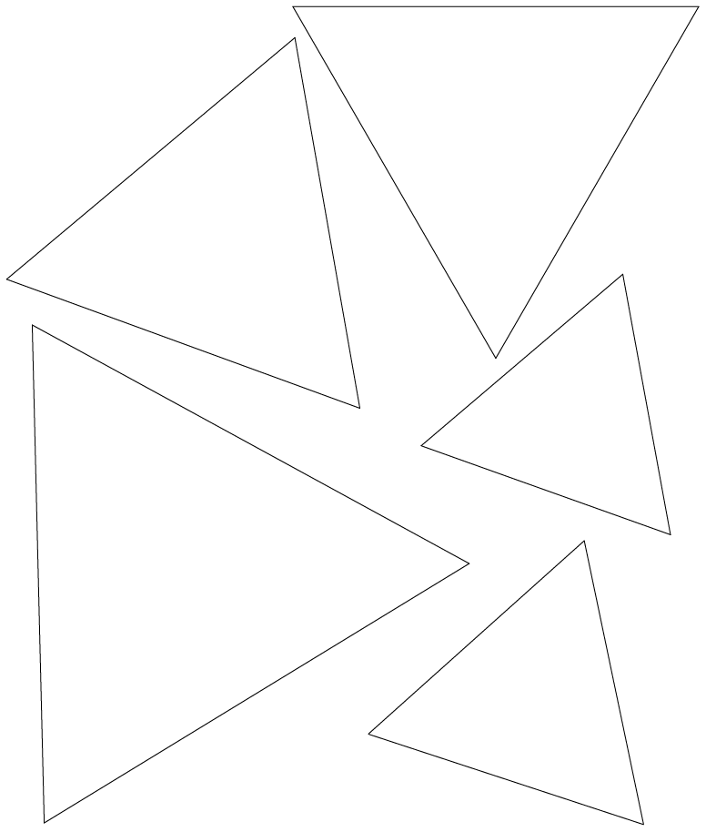
   <Callout type="note" title="Note">
   These triangles are called **equilateral triangles**.
   </Callout>
6. 2. Measure each angle in each of the following triangles.
                      Do you notice anything special about these angles?
      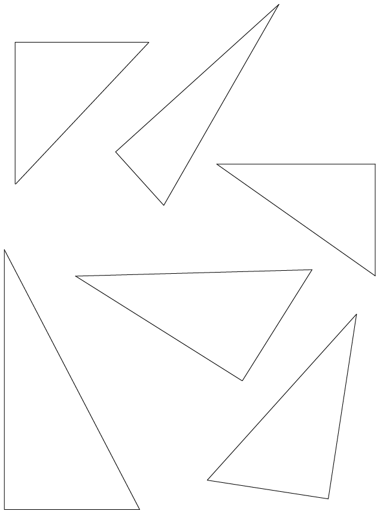
   4. Identify the longest
                      side in each of the triangles. If you are not sure which one is the longest
                      side, measure the sides. What do you notice about the longest side in each of
                      these triangles?

<Callout type="note" title="Note">
These triangles are called **right-angled triangles**.
</Callout>

### Comparing and describing triangles

When two or more sides of a shape are equal in length, we show this using short lines on the equal sides.

2. Use the
               following triangles to answer the questions that follow:
   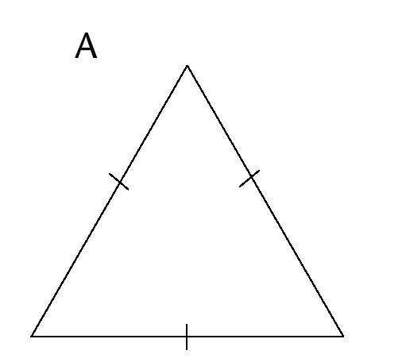
   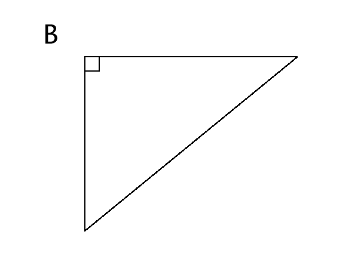
   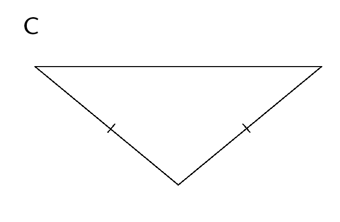
   2. Which
                      triangle has only two sides that are equal?
      What is this type of triangle called?
   4. Which triangle has all three
                      sides equal?
      What is this type of triangle called?
   6. Which triangle has an angle
                      equal to 90°?
      What is this type of triangle called?
4. Write down the type of each of the following triangles in the space
               provided:

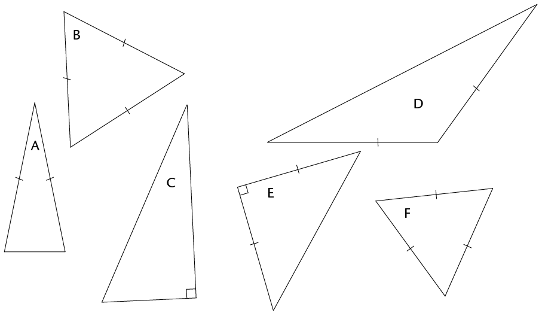

### Finding unknown sides in triangles

2. 2. Name each type
                      of triangle below.
      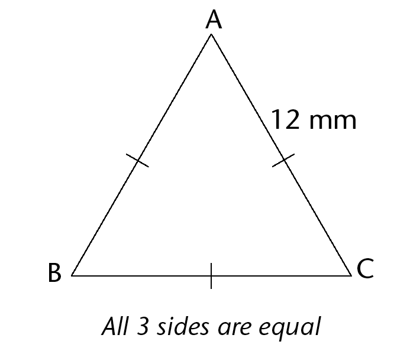
      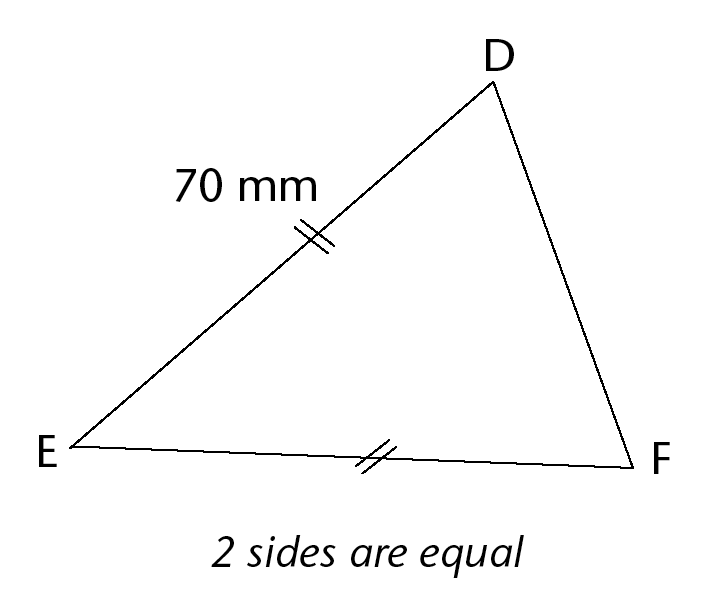
      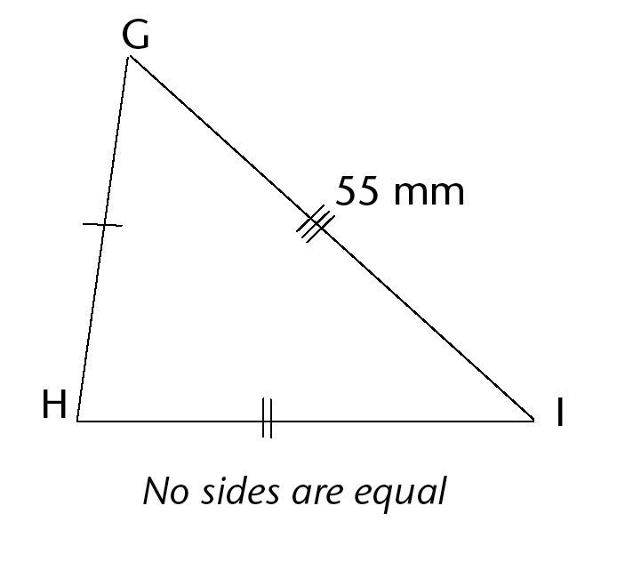
   4. Use the given information to
                      determine the length of the following sides:
      AB:
      BC:
      EF:
   6. Can you determine the lengths of GH and HI?
                      Explain your answer.
4. The square in the corner of
               \(\triangle\)JKL shows that it is a right angle. Give a reason for each of your
               answers below.
   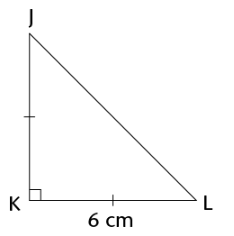
   2. Is this triangle
                      scalene, isosceles, or equilateral?
   4. Name the two sides of the triangle that are
                      equal.
   6. What is the length of JK?
   8. Name two equal angles in this triangle.
   10. What is the size of
                      \(\hat{J}\) and
                      \(\hat{L}\) ?
