## Different types of quadrilaterals

### Investigating quadrilaterals

2. The two
               pages that follow show different groups of quadrilaterals.
   2. In which
                      groups are both pairs of opposite sides parallel?
   4. In which groups are only some
                      adjacent sides equal?
   6. In which groups are all four
                      angles equal?
   8. In which groups are all the
                      sides in each quadrilateral equal?
   10. In which groups are all four
                      sides equal?
   12. In which groups is each side
                      perpendicular to the sides adjacent to it?
   14. In which groups are opposite
                      sides equal?
   16. In which groups is at least one
                      pair of adjacent sides equal?
   18. In which groups is at least one
                      pair of opposite sides parallel?
   20. In which groups are all the
                      angles right angles?
4. The figures in group 1 are called
               **parallelograms**.
   2. What do you observe
                      about the opposite sides of parallelograms?
   4. What do you observe about the angles of
                      parallelograms?
6. The figures in group 2 are called
               **kites**.
   2. What do you observe
                      about the sides of kites?
   4. What else do you observe about the kites?
   **Group 1**
   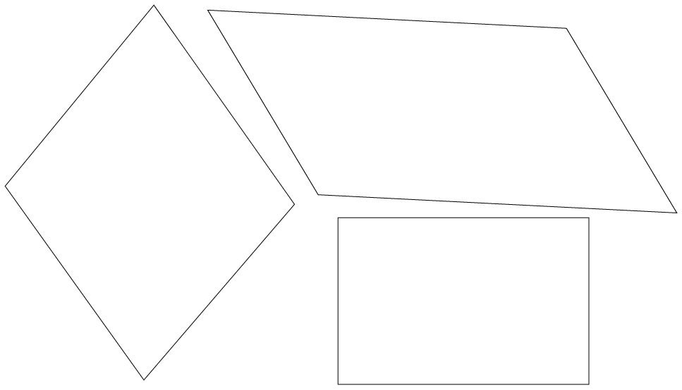
   **Group 2**
   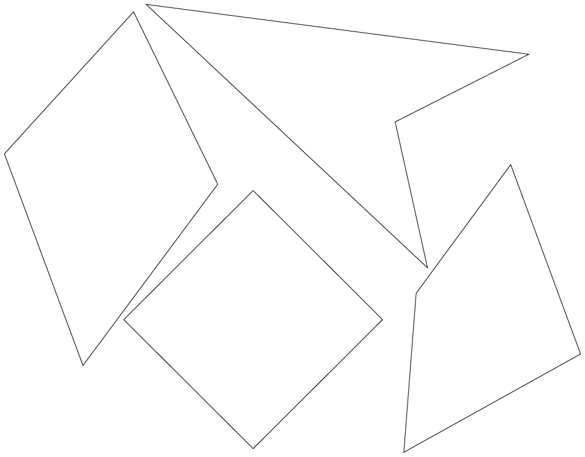
   **Group 3**
   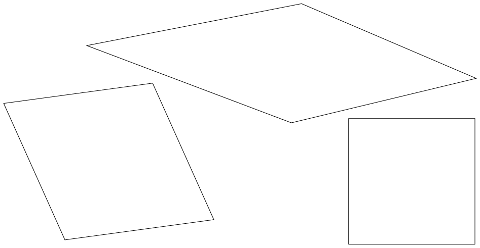
   **Group 4**
   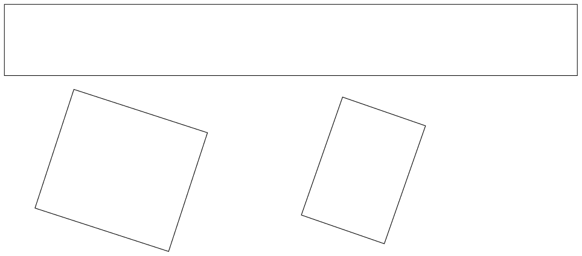
   **Group 5**
   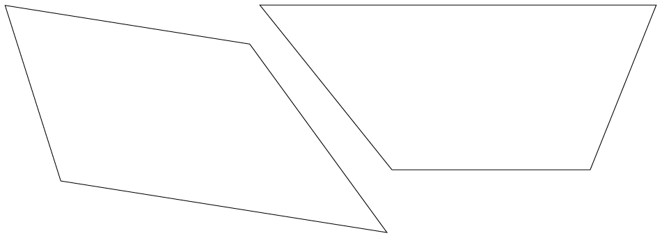
   **Group 6**
   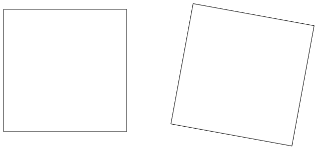
8. The figures in
               group 3 are called **rhombi**.
   2. What do you observe
                      about the sides of rhombi?
   4. What else do you observe about the rhombi?
   <Callout type="note" title="Note">
   Note: One
                 **rhombus**; two or more **rhombi**.
   </Callout>
10. The figures in group 4 are called
               **rectangles**.
   2. What do you observe
                      about the opposite sides of rectangles?
   4. What do you observe about the angles of
                      rectangles?
   6. What do you observe about the adjacent sides of
                      rectangles?
12. The figures in group 5 are called
               **trapeziums**. What do you observe about the opposite sides of
               trapeziums?
   <Callout type="note" title="Note">
   The arrows show which sides are parallel to each other.
   </Callout>
14. The figures in group 6 are called
               **squares**.
   2. What do you observe
                      about the sides of squares?
   4. What do you observe about the angles of
                      squares?

### Comparing and describing shapes

2. Name
               each shape in each group.
   Group A
   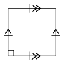
   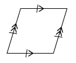
   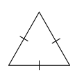
   Group B
   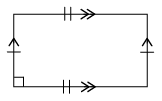
   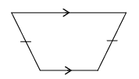
   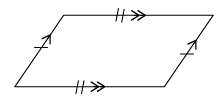
4. In what way(s)
               are the figures in each group the same?
   **Group A:**
   **Group B:**
6. In what way(s) does one of the figures
               in each group differ from the other two figures in the group?
   **Group A:**
   **Group B:**

### Finding unknown sides in quadrilaterals

Use what you know about the sides and angles of quadrilaterals to answer the following questions. **Give reasons for your answers.**

2. 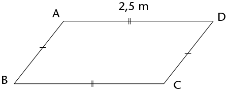
   2. What type of quadrilateral is ABCD?
   4. Name a side equal to AB.
   6. What is the length of BC?
4. 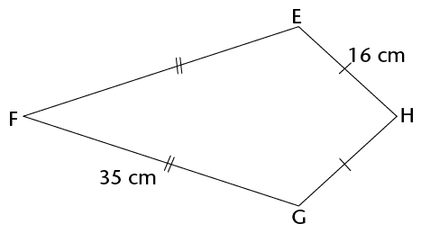
   2. What type of quadrilateral is EFGH?
   4. What are the lengths of the following sides?
      EF:
      GH:
6. 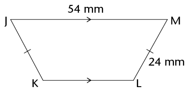
   2. What type of quadrilateral is JKLM?
   4. What is the length of JK?
8. 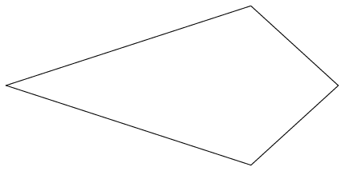
   Figure PQRS is a kite with PQ = 4 cm and QR = 10 cm. Complete the following drawing by:
   2. labelling the vertices of the kite
   4. showing on the drawing which sides are equal
   6. labelling the length of each side.
