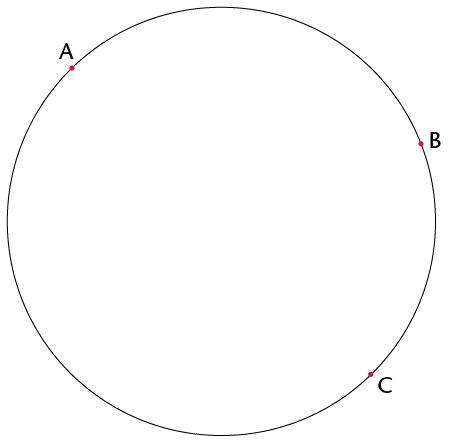
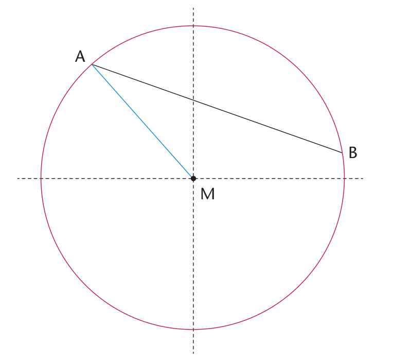
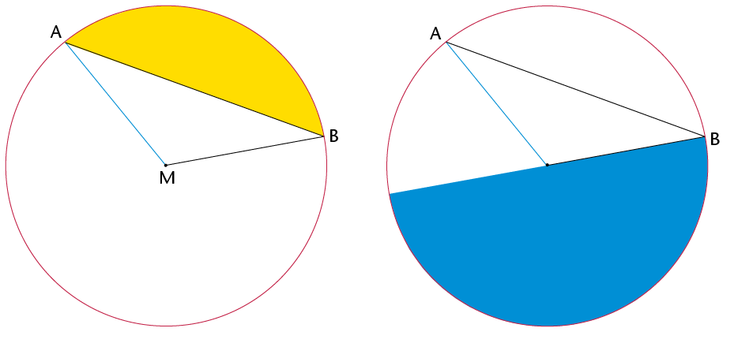

## Circles

2. 
   2. Make a dot in the middle of the circle on the right. Write the letter M next to the dot. If your dot is in the middle of the circle, it is called the **midpoint** or **centre**.
   4. Draw lines MA, MB and MC from M to the red points A, B and C.
   <Callout type="note" title="Note">
   The
                 three red points are on the circle with midpoint M.
   A straight line ,such as AC, drawn across a
                 circle and passing through its midpoint is called the **diameter** of the
                 circle.
   </Callout>
4. Measure MA, MB and MC.
   If MA, MB and MC are equal in length, you have chosen the midpoint well.If they are not equal, you may wish to improve your sketch of a circle and its parts.

<Callout type="note" title="Note">
A straight line from the midpoint of a circle to
          a point on the circle is called a **radius** of the circle.

The blue line, MA ,is a
          **radius**. Any straight line from the centre to the circle is
          a radius.

The black line AB
          joins two points on the circle. We call this a **chord** of
          the circle.

</Callout>

<Callout type="note" title="Note">
In
          the following two diagrams, the coloured sections are **segments** of a
          circle. A segment is the area between a chord and an arc.
</Callout>

<Callout type="note" title="Note">
In the circle on the right, the red section is called a **sector** of a circle. As you can see, a sector is the region between two radii and an arc.
</Callout>
