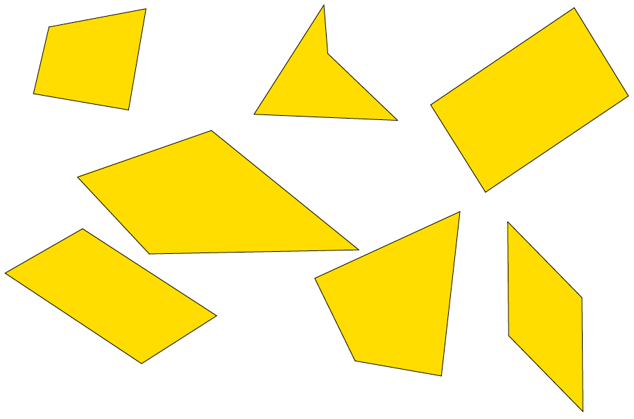
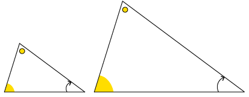
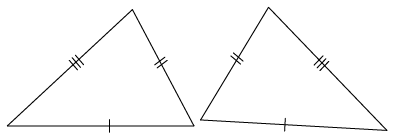
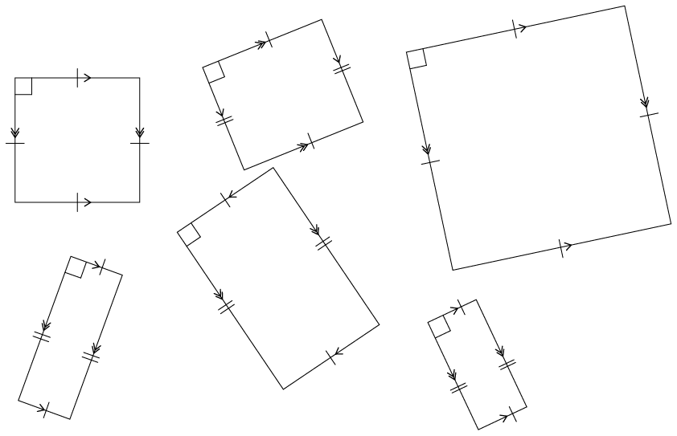
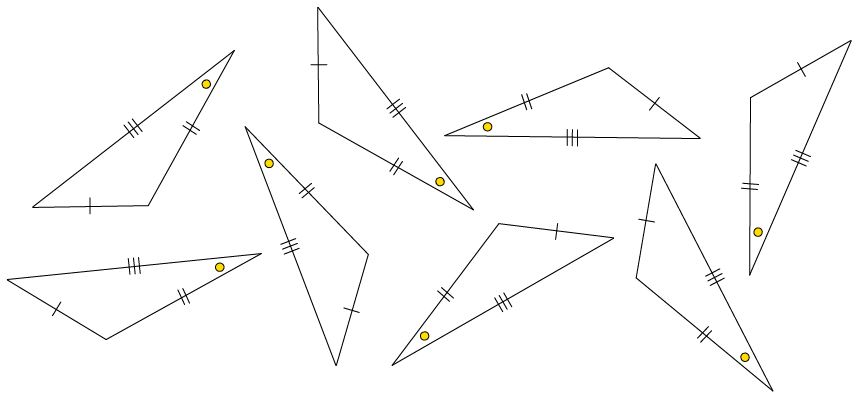
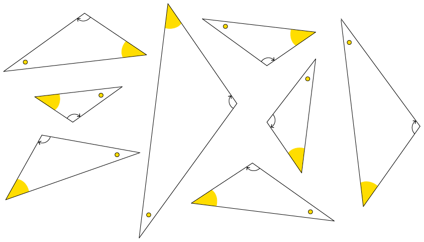
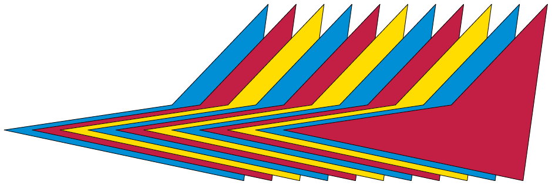

## Similar and congruent shapes

Three groups of quadrilaterals are shown on this page and the next.

What makes each group different from the other groups, apart from the colours?

2. Group
               A:
4. Group B:
6. Group C:
   **Group A**
   
   **Group B**
   
   **Group C**
   
   <Callout type="note" title="Note">
   Shapes that have the same form, such as the blue shapes on the previous page, are said to be **similar** to each other. Similar shapes may differ in size, but will always have the same shape.
   </Callout>
   
   Example of similar shapes
   
   Example of congruent shapes
   <Callout type="note" title="Note">
   Shapes that have the same form and the same size, such as the red shapes on the previous page, are said to be **congruent** to each other. These shapes are always the same size and shape.
   </Callout>
8. Are the red shapes on the previous page
               *similar* to each other?
10. Look at groups D, E, F, and G on this
               page and the next. In each case say whether the shapes are similar and
               congruent, similar but not congruent, or neither similar nor congruent.
   2. Group D:
   4. Group E:
   6. Group F:
   8. Group G:
   **Group D**
   
   **Group E**
   
   **Group F**
   
   **Group G**
   
