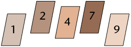
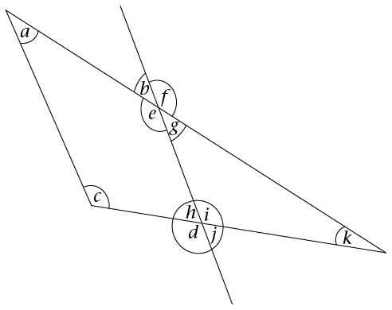
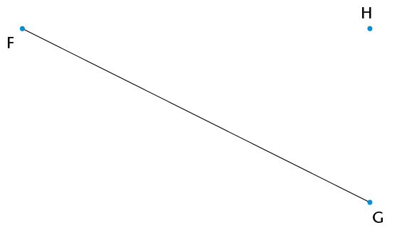
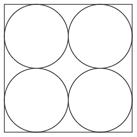
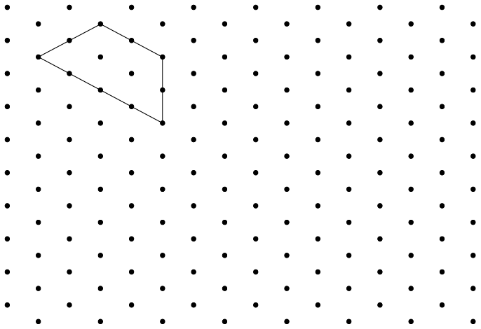
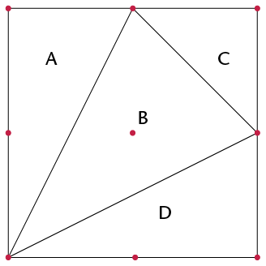
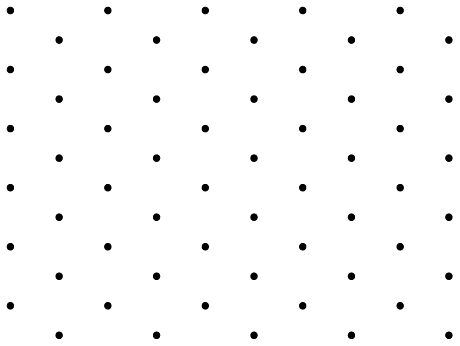
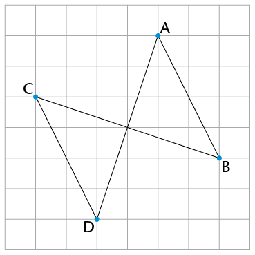

## Assessment

In this section, the numbers indicated in brackets at the end of a question indicate the number of marks that this question is worth. Use this information to help you determine how much working is needed.

The total number of marks allocated to
        the assessment is 60.

<Callout type="note" title="Note">
Do not use your calculator!
</Callout>

2. Here are five one-digit cards:
   
   Two-digit numbers can be made by
               placing two cards next to each other - so, for example, taking the 1 and the 2
               and putting them next to each other will create the number 12 (twelve).
   Choose two cards each
               time to make the following two-digit numbers:
   2. An odd number
   4. A multiple of 9
   6. A factor of 126
   8. A square number
4. Ayanda has a pack of cards numbered from
               1 to 16. He chooses four cards at random from the pack:
   - One is a factor of
                   39.
   - Two are
                   multiples of 4.
   - Three are
                   even.
   - The total of
                   the four numbers is more than 45, but less than 50.
   Write down the
               values of the four numbers.
6. All 769 learners from the Sibanye
               Primary School are going to an athletics meeting. The school hires buses from a
               local company. Each bus can take only 52 passengers, and each bus has to have
               two teachers on board. How many buses will the school have to hire to get
               everyone to the meeting?
8. Calculate the total number of test
               wickets taken by the top four wicket takers in the Proteas' cricket history
               (figures correct as at June 2013):
   - Shaun Pollock:
                   421
   - Makhaya Ntini:
                   390
   - Dale Steyn:
                   332
   - Allan Donald:
                   330
10. Use prime factors to find the LCM of 42 and 18.
12. Dintle's family needs to get to
               Polokwane, 330 km away, by 11 a.m. If they leave at 7.40 a.m. and drive at an
               average speed of 100 km/h, will they reach their destination on time? Show all
               your working.
14. Determine the value of each of the following:
   2. \( 6^3 - (7^2 + 6^2)\)
   4. \((8-5)^3\)
   6. \((\sqrt[3]{125})^2\)
   8. \(12^2 - 4\sqrt{121} \div
                      2^2\)
   10. \(3\sqrt{64}\)
16. 2. Write down the letters of all the acute angles in the diagram.
      
   4. Measure the size of angle \(d\) in the diagram and write it down.
   6. Classify angle
                      \(d\) according to its size.
18. Draw and
               correctly label angle \(K\hat{L}M = 168^{\circ}\).
   
20. Use your
               ruler and protractor to draw a line that is parallel to line segment FG drawn
               below, and goes through point H.
   
22. Four
               circles are drawn so that they fit neatly into a square with side length of 6
               cm, as shown (*not* to scale). Write down the radius of each
               circle.
   
24. 2. What is the geometrical name of the shape shown on the dot grid below?
   4. Draw two shapes that are *similar* to the shape shown, anywhere on the grid. Each shape that you draw should have a different size.
   
26. The
               following diagram shows a square drawn on a dot grid. The square is divided into
               four triangles, namely A, B, C, and D.
   
   2. Write down the
                      letters of all the right-angled triangles.
   4. Write down the letters of all the
                      isosceles triangles.
   6. Write down the letters of the two
                      congruent triangles.
28. I am a quadrilateral with two
               pairs of opposite sides equal, no adjacent sides equal, and no right angles.
               What shape am I?
30. What is the special name we give
               to the perimeter of a circle?
32. Draw a rhombus of any size on
               the dot grid below. Add appropriate symbols on the diagram to show that the
               opposite sides of a rhombus are parallel.
   
34. In trapezium JKLM, JK is parallel to the opposite side.
   Complete the
               statement:
   JK ||
36. Study the following diagram:
   
   Cross out the
               *incorrect* word or symbol in each set of brackets:
   AD is
               (parallel/perpendicular) to BC. This can be shown in symbols as follows:
   (AD
               \(\perp\) BC
               / AB || BC).
