## Measuring accurately with parts of a unit

### A strange measuring unit

In this activity, you will measure
        lengths with a unit called a *greystick*. The grey
        measuring stick below is exactly 1 greystick long. You will use
        this stick to measure different objects.

The red bar below is exactly 2
        greysticks long.

As you can see, the yellow bar below
        is longer than 1 greystick but shorter than 2 greysticks.

To try to measure the yellow bar
        accurately, we will divide one greystick into six equal
        parts:

So each of these parts is **one
          sixth** of a greystick.

2. Do you think one can
               say the yellow bar is **one and four sixths of a greystick**
               long?
   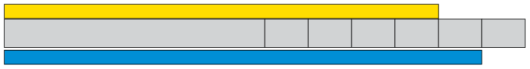
4. Describe the length of the
               blue bar in words.
   This greystick ruler is divided into
               seven equal parts:
   Each part is **one seventh** of a
               greystick.
   
6. In each case below, say what the smaller parts of the greystick
               may be called. Write your answers in words.
   2. 
   4. 
   6. 
   8. 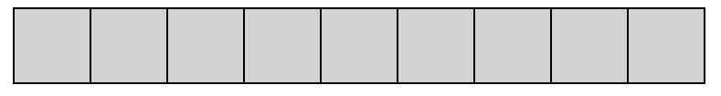
   10. 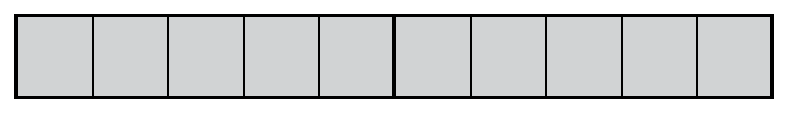
   12. 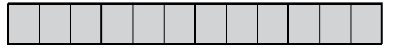
   14. 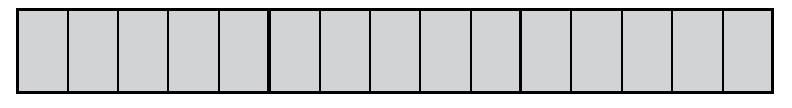
   16. 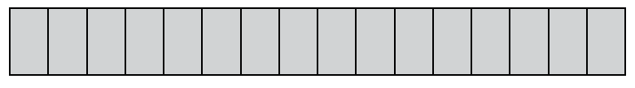
   18. 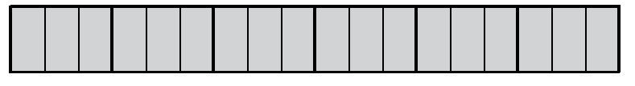
   20. 
   22. 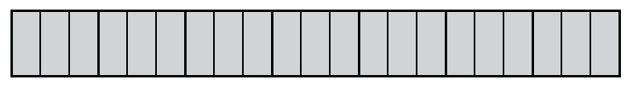
   24. 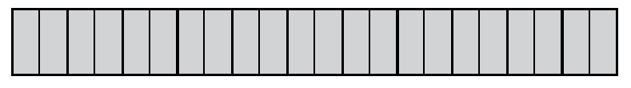
   26. 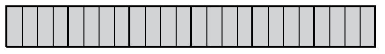
   28. 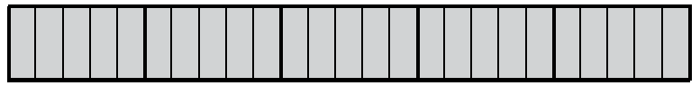
   How did you find out what to call
               the small parts?
   Write all your
               answers to the following questions *in words*.
8. 2. How long is the upper yellow bar?
      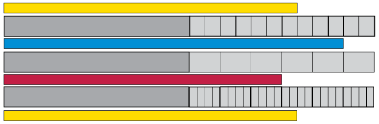
   4. How long is the lower yellow bar?
10. 2. How long is the blue bar at the
                      bottom of the previous page?
   4. How long is the red bar at the bottom of
                      the previous page?
12. 2. How many twelfths of a greystick is
                      the same length as one sixth of a greystick?
   4. How many twenty-fourths is the same
                      length as one sixth of a greystick?
   6. How many twenty-fourths is the same
                      length as seven twelfths of a greystick?
14. 2. How long is the upper yellow bar
                      below?
      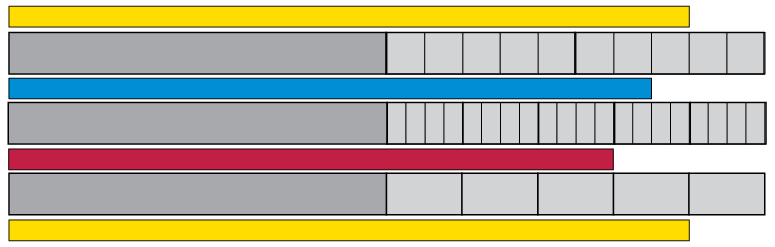
   4. How long is the lower yellow bar
                      above?
   6. How long is the blue bar?
   8. How long is the red bar?
16. 2. How many fifths of a greystick is the
                      same length as 12 twentieths of a greystick?
      
   4. How many fourths (or quarters) of a
                      greystick is the same length as 15 twentieths of a
                      greystick?

### Describe the same length in different ways

Two fractions may describe the same
        length. You can see here that three sixths of a greystick is
        the same as four eighths of a greystick.

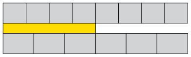

<Callout type="note" title="Note">
When two fractions describe
          the same portion we say they are **equivalent**.
</Callout>

2. 2. What can each small part on this
                      greystick be called?
      
   4. How many eighteenths is
                      one sixth of the greystick?
   6. How many eighteenths is
                      one third of the greystick?
   8. How
                      many eighteenths is five sixths of the greystick?
4. 2. Write (in words) the names of four
                      different fractions that are all equivalent to three quarters.
                      You may look at the yellow greysticks on page 154 to help
                      you.
   4. Which equivalents for two thirds can you
                      find on the yellow greysticks?
6. The information that 2
               thirds is equivalent to 4 sixths, to 6 ninths and to 8 twelfths
               is written in the second row of the table below. Complete the
               other rows of the table in the same way. The diagrams on page
               154 may help you.
   | thirds | fourths | fifths | sixths | eighths | ninths | tenths | twelfths | twentieths |
   | --- | --- | --- | --- | --- | --- | --- | --- | --- |
   | 1 |  |  |  |  |  |  |  |  |
   | 2 | - | - | 4 | - | 6 | - | 8 | - |
   | - | 3 |  |  |  |  |  |  |  |
   | - | - | 1 |  |  |  |  |  |  |
   | - | - | 2 |  |  |  |  |  |  |
   | - | - | 3 |  |  |  |  |  |  |
   | - | - | 4 |  |  |  |  |  |  |
8. Complete this table in the
               same way as the table in question 3.
   | fifths | tenths | fifteenths | twentieths | twenty-fifths | fiftieths | hundredths |
   | --- | --- | --- | --- | --- | --- | --- |
   | 1 |  |  |  |  |  |  |
   | 2 |  |  |  |  |  |  |
   | 3 |  |  |  |  |  |  |
   | 4 |  |  |  |  |  |  |
   | 5 |  |  |  |  |  |  |
   | 6 |  |  |  |  |  |  |
   | 7 |  |  |  |  |  |  |
10. Draw on the greysticks
               below to show that 3 fifths and 9 fifteenths are equivalent.
               Draw freehand; you need not measure and draw accurately.
   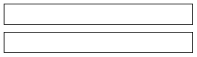
12. Complete these tables in the
               same way as the table in question 4.
   | eighths | sixteenths | 24ths |
   | --- | --- | --- |
   | 1 |  |  |
   | 2 |  |  |
   | 3 |  |  |
   | 4 |  |  |
   | 5 |  |  |
   | 6 |  |  |
   | 7 |  |  |
   | 8 |  |  |
   | 9 |  |  |
   | 24ths | sixths | twelfths | 18ths |
   | --- | --- | --- | --- |
   |  | 1 |  |  |
   |  | 2 |  |  |
   |  | 3 |  |  |
   |  | 4 |  |  |
   |  | 5 |  |  |
   |  | 6 |  |  |
   |  | 7 |  |  |
   |  | 8 |  |  |
   |  | 9 |  |  |
14. 2. How much is five
                      twelfths plus three twelfths?
   4. How much is five twelfths
                      plus one quarter?
   6. How much is five twelfths
                      plus three quarters?
   8. How much is one third plus one quarter?
                      It may help if you work with the equivalent fractions in
                      twelfths.
