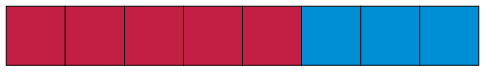
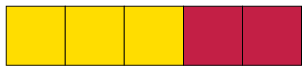
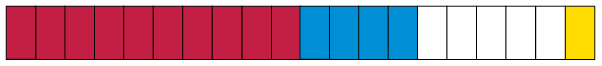
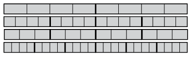

## Different parts in different colours

This strip is divided into eight
        equal parts.

Five eighths of this strip is
        red.

2. What part of the strip is
               blue?
4. What part of this strip is
               yellow?
   
6. What part of the strip is
               red?
8. What part of this strip is
               coloured blue and what part is coloured red?
   
10. 2. What part of this strip is blue, what
                      part is red and what part is white?
      
   4. Express your answer differently with
                      equivalent fractions.
12. A certain strip is not
               shown here. Two ninths of the strip is blue, and three ninths
               of the strip is green. The rest of the strip is red. What part
               of the strip is red?
14. What part of the strip below
               is yellow, what part is blue, and what part is red?
   

The number of parts in a fraction is
        called the **numerator** of the fraction. For example, the
        numerator in 5 sixths is 5.

The type of part in a fraction is called the
        **denominator**. It is the name of the parts that are being
        referred to and it is determined by the size of the part. For
        example, sixths is the denominator in 5 sixths.

<Callout type="note" title="Note">
To **enumerate** means "to
          find the number of".

To **denominate** means "to give a
          name to".
</Callout>

<Callout type="note" title="Note">
\( ^5/_6 \) is a short way to write 5 sixths.

We may also write \(\frac{5}{6}\)

Even when we write \( ^5/_6 \) or \(\frac{5}{6}\), we still say "5 sixths".

\( ^\text{ }/_6 \) and \(\frac{\text{ }}{6}\) are short ways to write *sixths*.

The numerator (number of
          parts) is written above the line of the fraction: \(\frac{\textit{numerator}}{\text{...}}\)

The denominator is indicated by a number written below the line: \(\frac{\text{...}}{\textit{denominator}}\)
</Callout>

2. Consider the fraction 3
               quarters. It can be written as \(\frac{3}{4}\).
   2. Multiply both the numerator and the
                      denominator by 2 to form a new fraction. Is the new
                      fraction equivalent to \(\frac{3}{4}\)? You may check on the
                      diagram below.
      
   4. Multiply both the numerator and the
                      denominator by 3 to form a new fraction. Is the new
                      fraction equivalent to \(\frac{3}{4}\)?
   6. Multiply both the numerator and the
                      denominator by 4 to form a new fraction. Is the new
                      fraction equivalent to \(\frac{3}{4}\)?
   8. Multiply both the numerator and the
                      denominator by 6 to form a new fraction. Is the new
                      fraction equivalent to \(\frac{3}{4}\)?
