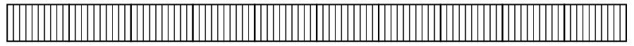
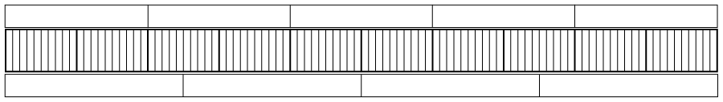
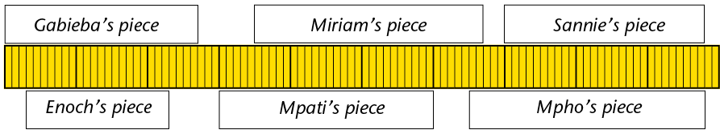

## Tenths and hundredths (percentages)

2. 2. 100 children each get 3 biscuits. How
                      many biscuits is this in total?
   4. 500 sweets are shared equally between
                      100 children. How many sweets does each child get?
4. The picture below
               shows a strip of licorice. The very small pieces can easily be
               broken off on the thin lines. How many very small pieces are
               shown on the picture?
   
6. Gatsha runs a spaza shop. He
               sells strips of licorice like the above for R2 each.
   2. What is the cost of one very small piece
                      of licorice, when you buy from Gatsha?
   4. Jonathan wants to buy one fifth of a
                      strip of licorice. How much should he pay?
   6. Batseba eats 25 very small pieces. What
                      part of a whole strip of licorice is this?
8. Each small piece of the above
               strip is **one hundredth** of the whole strip.
   2. Why can each small piece be called
                      *one hundredth* of the whole strip?
   4. How many hundredths is the same as one
                      tenth of the strip?
10. Gatsha often sells parts of licorice
               strips to customers. He uses a "quarters marker" and a "fifths
               marker" to cut off the pieces correctly from full strips. His
               two markers are shown below, next to a full strip of
               licorice.
   
   2. How many hundredths is the same as
                      two fifths of the whole strip?
   4. How many tenths is the same as \(\frac{2 }{5 }\)
                      of the whole strip?
   6. How many hundredths is the same as \(\frac{3 }{4 }\)
                      of the whole strip?
   8. Freddie bought \(\frac{60 }{100 }\) of a strip. How many fifths of a strip is
                      this?
   10. Jamey bought part of a strip for R1,60.
                      What part of a strip did she buy?
12. Gatsha, the owner of
               the spaza shop, sold pieces of yellow licorice to different
               children. Their pieces are shown below. How much (what part of
               a whole strip) did each of them get?
   
14. The yellow licorice
               shown above costs R2,40 (240 cents) for a strip. How much does
               each of the children have to pay? Round off the amounts to the
               nearest cent.
16. 2. How much is \(\frac{1 }{100 }\) of 300 cents?
   4. How much is \(\frac{7 }{100 }\) of 300 cents?
   6. How much is \(\frac{25}{100}\) of 300 cents?
   8. How much is \(\frac{1}{4}\) of 300 cents?
   10. How much is \(\frac{40}{100}\) of 300 cents?
   12. How much is \(\frac{2}{5}\) of 300 cents?
18. Explain why your answers for
               questions 8(e) and 8(f) are the same.
   <Callout type="note" title="Note">
   Another word for
                 **hundredth** is **per cent**.
   Instead of saying
   Miriam received **32 hundredths** of a licorice strip,
                 we can say
   Miriam received **32 per cent** of a licorice strip.
   The symbol for per cent is
                 %.
   </Callout>
20. How much is 80% of each of
               the following?
   2. R500
   4. R480
   6. R850
   8. R2400
22. How much is 8% of each of the
               amounts in 10(a), (b), (c) and (d)?
24. How much is 15% of each of
               the amounts in 10(a), (b), (c) and (d)?
26. Building costs of
               houses increased by 20%. What is the new building cost for a
               house that previously cost R110 000 to build?
28. The value of a car
               decreases by 30% after one year. If the price of a new car is
               R125 000, what is the value of the car after one year?
30. Investigate which
               denominators of fractions can easily be converted to powers of
               10.
