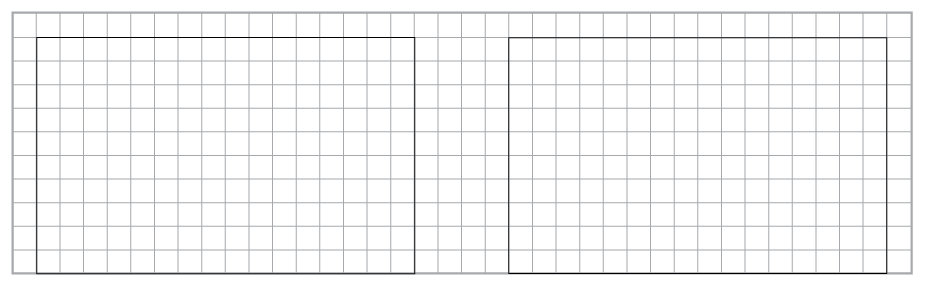
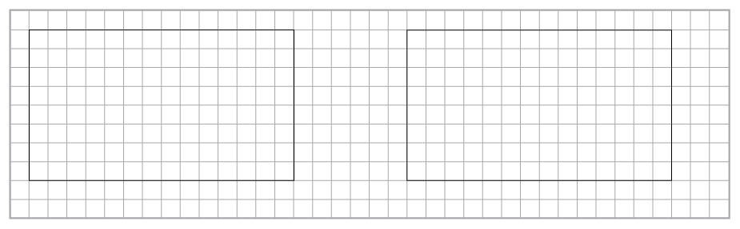
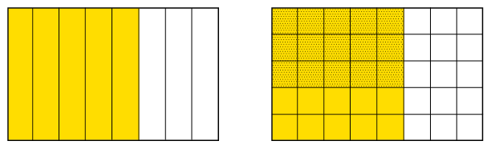
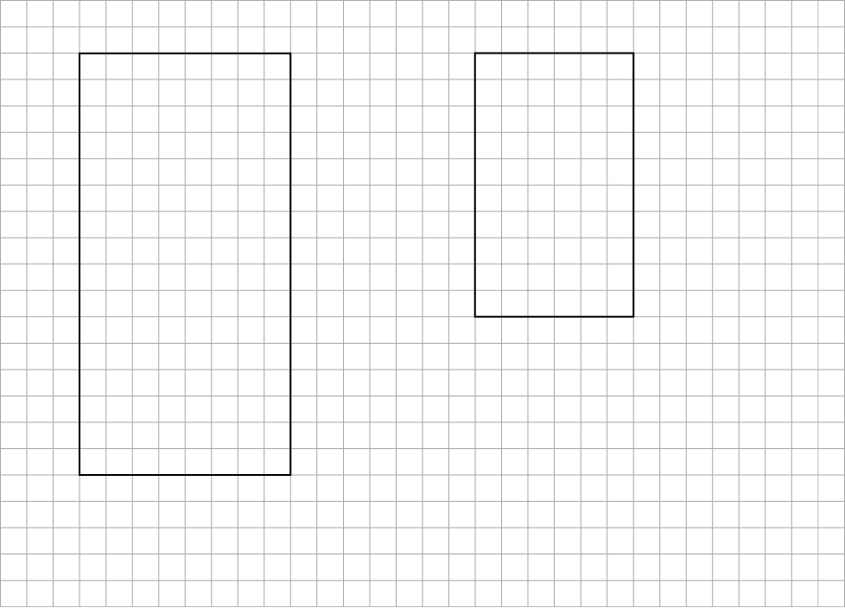
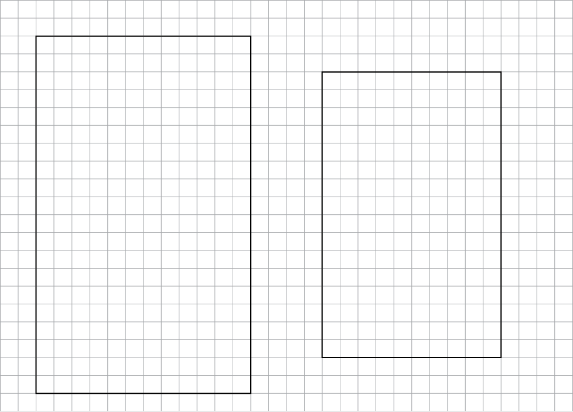
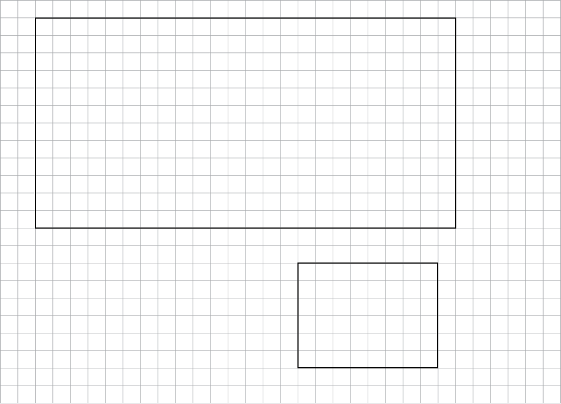

## Multiplying with fractions

### Parts of rectangles, and parts of parts

2. 2. Divide the rectangle on the left into
                      eighths by drawing vertical lines. Lightly shade the left 3
                      eighths of the rectangle.
   4. Divide the rectangle on the right into
                      fifths drawing horizontal lines. Lightly shade the upper 2
                      fifths of the rectangle.
      
4. 2. Shade 4 sevenths of the rectangle on
                      the left below.
   4. Shade 16 twenty-eighths of the rectangle
                      on the right below.
      
6. 2. What part of each big
                      rectangle below is coloured yellow?
   4. What part of the
                      *yellow* part of the rectangle on the right is dotted?
      
   6. Into how many squares is
                      the whole rectangle on the right divided?
   8. What part of the whole rectangle on the
                      right is yellow *and* dotted?
8. Make diagrams on the
               grid below to help you to figure out how much each of the
               following is:
   2. \(\frac{3}{4}\) of \(\frac{5}{8}\)
   4. \(\frac{2}{3}\) of \(\frac{4}{5}\)
   
   Here is something you can do with the
               fractions \(\frac{3}{4}\) and \(\frac{5}{8}\) :
   Multiply the two numerators and make
               this the numerator of a new fraction. Also multiply the two
               denominators, and make this the denominator of a new fraction \(\frac{3 \times 5}{4 \times 8} = \frac{15}{32}\).
10. Compare the above with
               what you did in question 14(a) of section 6.6 and in question 4(a) at
               the top of this page. What do you notice about
               \(\frac{3}{4}\) of \(\frac{5}{8}\) and \(\frac{3 \times 5}{4 \times 8} = \frac{15}{32}\)?
12. 2. Alan has 5 heaps of 8 apples each.
                      How many apples is that in total?
   4. Sean has 10 heaps of 6 quarter apples
                      each. How many apples is that in total?
   <Callout type="note" title="Note">
   Instead of saying
                   \(\frac{5}{8}\) of R40 or \(\frac{5}{8}\) of \(\frac{2}{3}\) of a floor surface, we
                   may say \(\frac{5}{8} \times \) R40 or \(\frac{5}{8} \times \frac{2}{3}\) of a floor surface.
   </Callout>
14. Use the diagrams below to
               figure out how much each of the following is:
   2. \(\frac{3}{10} \times \frac{5}{6}\)
   4. \(\frac{2}{5} \times \frac{7}{8}\)
      
16. 2. Perform the calculations \(\frac{\text{numerator} \times
                      \text{numerator}}{\text{denominator} \times \text{denominator}}\) for
                      \(\frac{3}{10}\) and \(\frac{5}{6}\) and compare the answer to your answer for
                      question 7(a).
   4. Do the same
                        for \(\frac{2}{5}\) and \(\frac{7}{8}\)
18. Perform the calculations
               \(\frac{\text{numerator} \times \text{numerator}}{\text{denominator}
               \times \text{denominator}}\) for
   2. \(\frac{5}{6}\) and \(\frac{7}{12}\)
   4. \(\frac{3}{4}\) and \(\frac{2}{3}\)
20. Use the diagrams
               below to check whether the formula \(\frac{\text{numerator} \times
               \text{numerator}}{\text{denominator} \times \text{denominator}}\) produces the
               correct answers
               for \(\frac{5}{6} \times \frac{7}{12}\) and \(\frac{3}{4} \times \frac{2}{3}\).
   
22. Calculate each of the
               following:
   2. \(\frac{1}{2}\) of \(\frac{1}{3}\) of R60
   4. \(\frac{2}{7}\) of \(\frac{2}{9}\) of R63
   6. \(\frac{4}{3}\) of \(\frac{2}{5}\) of R45
24. 2. John normally practises soccer for
                      three quarters of an hour every day. Today he practised for
                      only half his usual time. How long did he practise today?
   4. A bag of peanuts weighs \(\frac{3}{8}\)
                      of a kilogram. What does \(\frac{3}{4}\)
                      of a bag weigh?
   6. Calculate the mass of
                      \(7\frac{3}{8}\)
                      packets of sugar if 1 packet has a mass
                      of \(\frac{3}{4}\)
                      kg.
