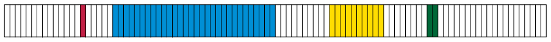

## Other symbols for tenths and hundredths

### Tenths and hundredths again...

2. 2. What part of the rectangle below is
                      coloured yellow?
      
   4. What part of the rectangle is red? What
                      part is blue? What part is green, and what part is not
                      coloured?
   <Callout type="note" title="Note">
   0,1 is another way to write
                 \(\frac{1}{10}\) and
   \(0,01\) is another way to write \(\frac{1}{100}\).
   \(0,1\) and \(\frac{1}{10}\) are different notations for the same number.
   \(\frac{1}{10}\) is called the **(common) fraction
                   notation**
   and \(0,1\) is called the
                 **decimal notation**.
   </Callout>
4. Write the answers for 1(a) and
               (b) in decimal notation.
6. 3 tenths and 7
               hundredths of a rectangle is coloured red, and 2 tenths and 6
               hundredths of the rectangle is coloured brown. What part of the
               rectangle (how many tenths and how many hundredths) is not
               coloured? Write your answer in fraction notation and in decimal
               notation.
8. On Monday, Steve ate 3
               tenths and 7 hundredths of a strip of licorice. On Tuesday,
               Steve ate 2 tenths and 5 hundredths of a strip of licorice. How
               much licorice did he eat on Monday and Tuesday together? Write
               your answer in fraction notation and in decimal notation.
10. Lebogang's answer for
               question 4 is *5 tenths and 12 hundredths*. Susan's answer
               is *6 tenths and 2 hundredths*. Who is right, or are they
               both wrong?
   <Callout type="note" title="Note">
   The same quantity can be
                 expressed in different ways in tenths and hundredths.
   For example, *3 tenths and 17 hundredths can be
                   expressed as 2 tenths and 27 hundredths or 4 tenths and
                   7 hundredths.*
   All over the world, people have agreed to keep the
                 number of hundredths in such statements below 10.
                 This means that the normal way of expressing the
                 above quantity is *4 tenths and 7 hundredths*.
   **Written in decimal notation, 4 tenths and
                   7 hundredths is 0,47**. This is read as *nought
                   comma four seven* and NOT *nought comma forty-seven*.
   </Callout>
12. What is
               the decimal notation for each of the following numbers?
   2. \(3\frac{7}{10}\)
   4. \(4\frac{19}{100}\)
   6. \(\frac{47}{10}\)
   8. \(\frac{3}{100}\)

### ... and thousandths

<Callout type="note" title="Note">
\(0,001\) is another way of
          writing \(\frac{1}{1000}\).
</Callout>

2. What is
               the decimal notation for each of the following?
   2. \(\frac{7}{1000}\)
   4. \(\frac{9}{1000}\)
   6. \(\frac{147}{1000}\)
   8. \(\frac{999}{1000}\)
4. Write
               the following numbers in the decimal notation:
   2. \(2+\frac{3}{10} + \frac{7}{100} + \frac{4}{1000}\)
   4. \(12 + \frac{1}{10} + \frac{4}{1000}\)
   6. \(2 + \frac{4}{1000}\)
   8. \(67\frac{123}{1000}\)
   10. \(34\frac{61}{1000}\)
   12. \(654\frac{3}{1000}\)
