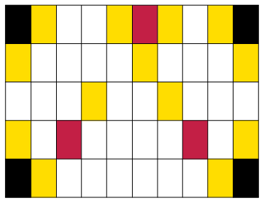

## Percentages and decimal fractions

### Hundredths, percentages and decimals

2. The rectangle below is divided
               into small parts.
   
   2. How many of these small parts are there
                      in the rectangle? And in one tenth of the rectangle?
   4. What part of the rectangle is blue? What
                      part is green? What part is red?
   <Callout type="note" title="Note">
   Instead of
                 *6 hundredths*, you may say 6 *per cent*. It means
                 the same.
   10 per cent of the rectangle above is yellow.
   </Callout>
4. Use the word "per cent" to say
               what part of the rectangle is green. What part is red?
6. What percentage of the
               rectangle is blue? What percentage is white?
   <Callout type="note" title="Note">
   We do not say: "How many per
                 cent of the rectangle is green?" We say: "What percentage of the
                 rectangle is green?"
   </Callout>
   <Callout type="note" title="Note">
   The symbol % is used for
                 "per cent".
   Instead of writing "17 per
                 cent", you may write 17%.
   *Per cent* means
                 *hundredths*. The symbol % is a bit like the symbol
                 \(\frac{}{100}\)
   </Callout>
8. 2. How much is 1% of R400? (In other
                      words: How much is \(\frac{1}{100}\) or 0,01 of R400?)
   4. How much is 37% of R400?
   6. How much is 37% of R700?
10. 2. 25 apples are shared equally between
                      100 people. How much apple does each person get? Write your
                      answer as a common fraction and as a decimal fraction.
   4. How much is 1% (one hundredth) of
                      25?
   6. How much is 8% of 25?
   8. How much is 8% of 50? And how much is
                      0,08 of 50?
   <Callout type="note" title="Note">
   0,37 and 37% and
                 \(\frac{37}{100}\) are different symbols for the same thing: *37
                   hundredths.*
   </Callout>
12. Express each of the following
               in three ways:
   - in the
                   *decimal notation*,
   - in the
                   *percentage notation* and
   - if
                   possible, in the *common fraction notation, using
                     hundredths*.
   2. 3 tenths
   4. 7 hundredths
   6. 37 hundredths
   8. 7 tenths
   10. 3 quarters
   12. 7 eighths
14. 2. How much is 3 tenths of R200 and 7
                      hundredths of R200 altogether?
   4. How much is \(\frac{37}{100}\) of R200?
   6. How much is 0,37 of R200?
   8. And how much is 37% of R200?
16. Express each of the following
               in three ways:
   - in the
                   *decimal notation*,
   - in the
                   *percentage notation* and
   - in the
                   *common fraction notation*, *using
                     hundredths*.
   2. 20 hundredths
   4. 50 hundredths
   6. 25 hundredths
   8. 75 hundredths
18. 2. Jan eats a quarter of a watermelon.
                      What percentage of the watermelon is this?
   4. Sibu drinks 75% of the milk in a bottle.
                      What fraction of the milk is this?
   6. Jeminah uses 0,75 (7 tenths and 5
                      hundredths) of the paint in a tin. What percentage of the paint
                      does she use?
20. The floor of a large
               room is shown below. What part of the floor is covered in
               each of the four colours? Express your answer in four ways:
   2. in the *common fraction notation, using hundredths*,
   4. in the *decimal notation*,
   6. in the *percentage notation*,
                      and
   8. if possible, *in the common fraction
                        notation, as tenths* **and**
      *hundredths* (for example \(\frac{3}{10} + \frac{4}{100}\)) .
   
   |  | (a) | (b) | (c) | (d) |
   | --- | --- | --- | --- | --- |
   | white |  |  |  |  |
   | red |  |  |  |  |
   | yellow |  |  |  |  |
   | black |  |  |  |  |
