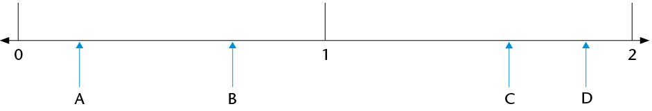
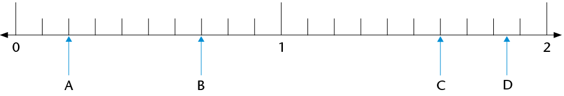
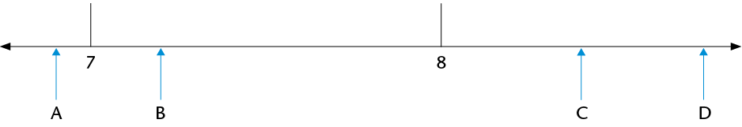
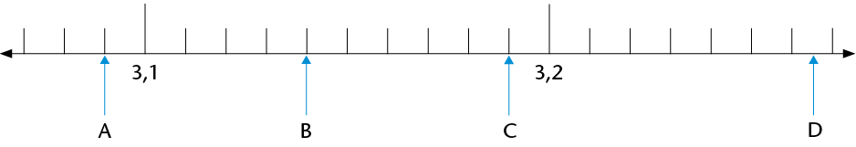
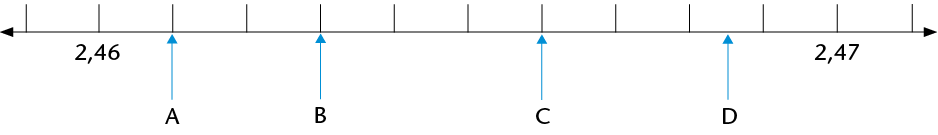
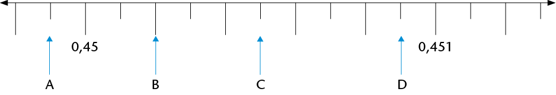
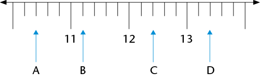
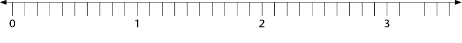
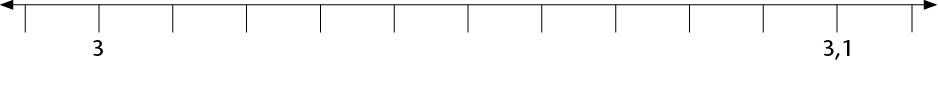

## Decimal measurements

### Measuring on a number line

2. Read the lengths at
               the marked points (A to D) on the number lines. Give your
               answers as accurate as possible in decimal notation.
   2. 
   4. 
   6. 
   8. 
   10. 
   12. 
   14. 
4. Show the following numbers on
               the number line below:
   2. 0,6
   4. 1,2
   6. 1,85
   8. 2,3
   10. 2,65
   12. 3,05
   14. 0,08
   
6. Show the following numbers on
               the number line below:
   2. 3,06
   4. 3,08
   6. 3,015
   8. 3,047
   10. 3,005
   
