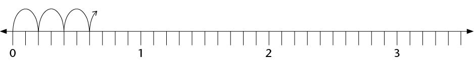
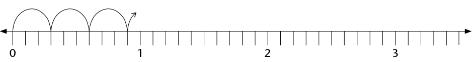
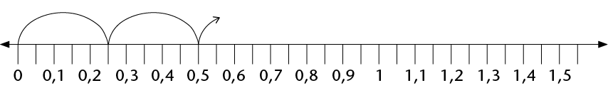

## More decimal concepts

### Decimal jumps

2. Write the next ten numbers in the
               number sequences and show your number sequences, as far as
               possible, on the number lines.
   2. 0,2; 0,4; 0,6;
   4. 
   6. How many 0,2s are there in
                      1?
   8. Write 0,2 as a common fraction.
4. 2. 0,3; 0,6; 0,9;
   4. 
   6. How many 0,3s are there in
                      3?
   8. Write 0,3 as a common fraction.
6. 2. 0,25; 0,5;
   4. 
   6. How many 0,25s are there
                      in 1?
   8. Write 0,25 as a common fraction.
   <Callout type="note" title="Note">
   A calculator can be
                 programmed to do the same operation over and over again.
               For example, press 0,1 \(+\) \(=\) (do not press CLEAR or
               any other operation). Press the \(=\) key repeatedly and
               see what happens.
   The calculator counts in 0,1s.
   </Callout>
8. You can check your answers for questions 1 to 3 with a
               calculator. Program the calculator to help you.
10. Write the next five numbers in
               the number sequences:
   9,3; 9,2; 9,1;
   0,15; 0,14; 0,13; 0,12;
12. Check your answers with a
               calculator. Program the calculator to help you.

### Place value

2. Write each of the following as
               one number:
   2. 2 + 0,5 + 0,07
   4. 2 + 0,5 + 0,007
   6. 2 + 0,05 + 0,007
   8. 5 + 0,4 + 0,03 + 0,001
   10. 5 + 0,04 + 0,003 + 0,1
   12. 5 + 0,004 +
                    0,3 + 0,01

We can write 3,784 in expanded
        notation as 3,784 = 3 + 0,7 + 0,08 + 0,004.We can also name
        these parts as follows:

- the 3
            represents the **units**
- the 7
            represents the **tenths**
- the 8
            represents the **hundredths**
- the 4
            represents the **thousandths**

<Callout type="note" title="Note">
We say: the **value** of
          the 7 is 7 tenths but the **place value** of the 7 is
          tenths, because any digit **in that place** will represent
          the number of tenths.

or example, in 2,536 the **value** of the 3 is 0,03,
          and its **place value** is hundredths, because the value
          of the **place where it stands** is hundredths.
</Callout>

2. Now write the value
               (in decimal fractions) and the place value of each of the
               underlined digits.
   2. 2,345
   4. 4,678
   6. 1,953
   8. 34,856
   10. 564,34
   12. 0,987
