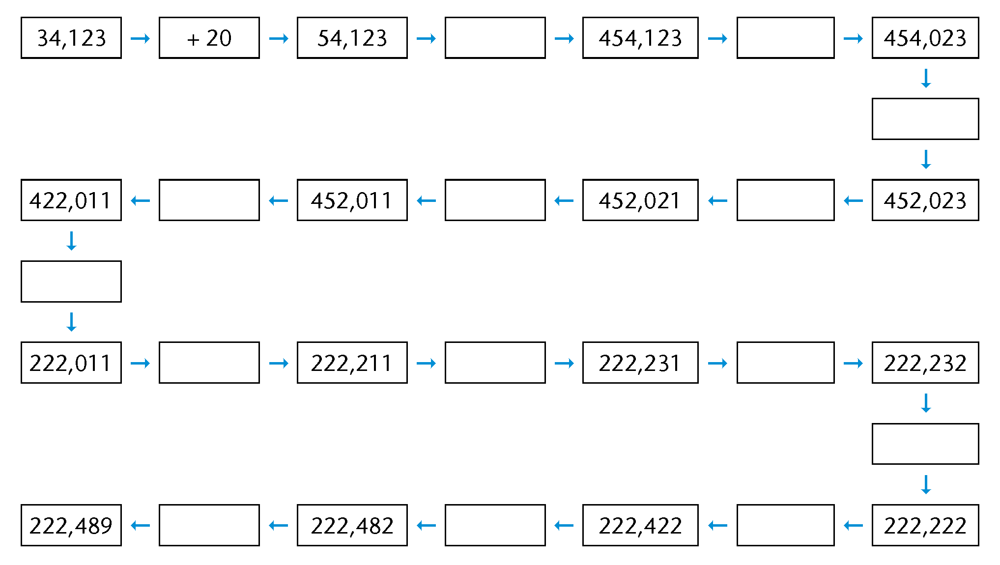
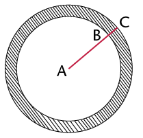

## Addition and subtraction with decimal fractions

### Mental calculations

2. Complete the number chain.
   
   <Callout type="note" title="Note">
   When you add or subtract
                 decimal fractions, you can change them to common fractions to
                 make the calculation easier.
   \(0,4 + 0,5 \\ = \frac{4}{10} + \frac{5}{10} \\ = \frac{9}{10} \\ = 0,9\)
   </Callout>
4. Calculate each of the
               following:
   2. \(0,7 + 0,2\)
   4. \(0,7 + 0,4\)
   6. \(1,3 + 0,8\)
   8. \(1,35 + 0,8\)
   10. \(0,25 + 0,7\)
   12. \(0,25 + 0,07\)
   14. \(3 - 0,1\)
   16. \(3 - 0,01\)
   18. \(2,4 - 0,5\)

### Some real-life problems

2. The owner of an
               internet café looks at her bank statement at the end
               of the day. She finds the following amounts paid into her
               account: R281,45; R39,81; R104,54 and R9,80. How much money was
               paid into her account on that day?
4. At the beginning of a
               journey the odometer in a car reads: 21589,4. At the end of the
               journey the odometer reads: 21763,7. What distance was
               covered?
6. At an athletics
               competition, an athlete runs the 100 m race in 12,8 seconds.
               The announcer says that the athlete has broken the previous
               record by 0,4 seconds. What was the previous record?
8. In a surfing
               competition five judges give each contestant a mark out of 10.
               The highest and the lowest marks are ignored and the other
               three marks are totalled. Work out each contestant's score and
               place the contestants in order from first to last.
   A: 7,5; 8; 7; 8,5; 7,7;
   B: 8,5; 8,5; 9,1; 8,9;
               8,7
   C: 7,9; 8,1; 8,1; 7,8; 7,8;
   D: 8,9; 8,7; 9; 9,3;
               9,1
10. A pipe is measured
               accurately. AC = 14,80 mm and AB = 13,97 mm.
   How thick is the pipe
               (BC)?
   
12. Mrs Mdlankomo buys
               three packets of mincemeat. The packets weigh 0,356 kg, 1,201
               kg and 0,978 kg respectively. What do they weigh together?
