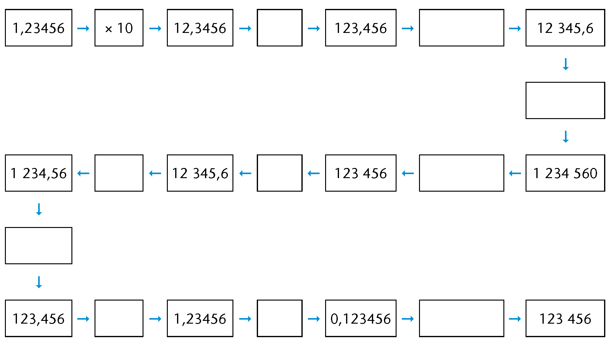

## Multiplication and decimal fractions

### The power of ten

2. 2. Complete the multiplication
                      table.
      | \(\times\) | 1 000 | 100 | 10 | 1 | 0,1 | 0,01 | 0,001 |
      | --- | --- | --- | --- | --- | --- | --- | --- |
      | 6 | 6
                              000 |  | 60 |  |  | 0,06 |  |
      | 6,4 |  | 640 |  |  |  |  |  |
      | 0,5 |  |  |  |  | 0,05 |  |  |
      | 4,78 | 4
                              780 |  | 47,8 |  |  |  |  |
      | 41,2 | 41
                              200 |  |  |  |  |  |  |
   4. Is it correct to say that
                      "multiplication makes bigger"? When does multiplication make
                      bigger?
   6. Formulate rules for multiplying with 10;
                      100; 1 000; 0,1; 0,01 and 0,001. Can you explain the rules?
   8. Now use your rules to calculate each of
                      the following:
      \(0,5 \times 10\)
      \(0,3 \times 100\)
      \(0,42 \times 10\)
      \(0,675 \times 100\)
4. 2. Complete the division table.
      | \(\div\) | 0,001 | 0,01 | 0,1 | 1 | 10 | 100 | 1 000 |
      | --- | --- | --- | --- | --- | --- | --- | --- |
      | 6 |  |  |  | 6 | 0,6 | 0,06 |  |
      | 6,4 |  |  | 64 | 6,4 |  |  |  |
      | 0,5 |  |  |  |  |  | 0,005 |  |
      | 4,78 |  |  | 47,8 |  |  |  |  |
      | 41,2 |  | 4
                              120 |  |  |  |  |  |
   4. Is it correct to say that
                      "division makes smaller"? When does division make
                      smaller?
   6. Formulate rules for dividing with 10;
                      100; 1 000; 0,1; 0,01 and 0,001. Can you explain the rules?
   8. Now use your rules to calculate each of
                      the following:
      \(0,5 \div 10\)
      \(0,3 \div 100\)
      \(0,42 \div 10\)
6. Complete the following:
   2. Multiplying with 0,1 is
                      the same as dividing by
   4. Dividing by 0,1 is the
                      same as multiplying by
      Now discuss it with a partner or
                      explain to him or her why this is so.
8. Fill in the missing
               numbers:
   

#### What does multiplying a decimal number with a
        whole number mean?

What does something like \(4 \times 0,5\)
        mean?

What does something like
        \(0,5 \times 4\) mean?

\(4 \times 0,5\) means 4
        groups of \(\frac{1}{2}\), which is \(\frac{1}{2} + \frac{1}{2} + \frac{1}{2} + \frac{1}{2}\), which is 2.

\(0,5 \times 4\) means \(\frac{1}{2}\) of 4, which is 2.

A real-life example where
        we would find this is:

\[\begin{align} 6 \times 0,42 \text{ kg} &= 6 \times \frac{42}{100}\\
        &=(6 \times 42) \div 100\\
        & =252 \div 100\\
        &= 2,52 \text{ kg} \end{align} \]

What really happens is that we
        convert \(6 \times 0,42\) to the product of two whole numbers, do
        the calculation and then convert the answer to a decimal
        fraction again (\(\div 100\)).

### Multiplying decimals with whole numbers

2. Calculate each of the
               following. Use fraction notation to help you.
   2. \(0.3 \times 7\)
   4. \(0.21 \times 91\)
   6. \(8 \times 0.4\)
4. Estimate the answers to each
               of the following and then calculate:
   2. \(0,4 \times 7\)
   4. \(0,55 \times 7\)
   6. \(12 \times 0,12\)
   8. \(0,601 \times 2\)
6. Make a rule for multiplying
               with decimals. Explain your rule to a partner.

#### What does multiplying a decimal with a
        decimal mean?

For example, what does \(0,32 \times 0,87\) mean?

If
        you buy 0,32 m of ribbon and each metre costs R0,87, you can
        write it as \(0,32 \times 0,87\).

\[\begin{align} 0.32 \times 0.87 &= \frac{32}{100} \times \frac{87}{100} &\text{ [Write as common fractions]} \\
        & = \frac{32 \times 87}{10000}& \text{ [Multiplication of two fractions]}\\
        & =\frac{2784}{10000} &\text{ [The product of the whole numbers } 32 \times 87\text{]}\\
        &=0.2784 &\text{ [Convert to a decimal by dividing the product by 10 000]} \end{align}\]

The product of two decimals is thus
        converted to the product of whole numbers and then converted
        back to a decimal.

The product of
        two decimals and the product of two whole numbers with the same
        digits differ only in terms of the place value of the products,
        in other words the position of the decimal comma. It can also
        be determined by estimating and checking.

### Multiplying decimals with decimals

2. Calculate each of the
               following. Use fraction notation to help you.
   2. \(0,6 \times 0,4 \)
   4. \( 0,06 \times 0,4\)
   6. \( 0,06 \times 0,04\)

Mandla uses this method to multiply
        decimals with decimals:

\[\begin{align} 0,84 \times 0,6 &= (84 \div 100) \times (6 \div
        10) \\
        & = (84 \times 6) \div (100 \times 10)\\
        & = 504 \div 1 000\\
        & = 0,504 \end{align}\]

2. Calculate the following using
               Mandla's method:
   2. \( 0,4 \times 0,7 \)
   4. \( 0,4 \times 7\)
   6. \( 0,04 \times 0,7\)
