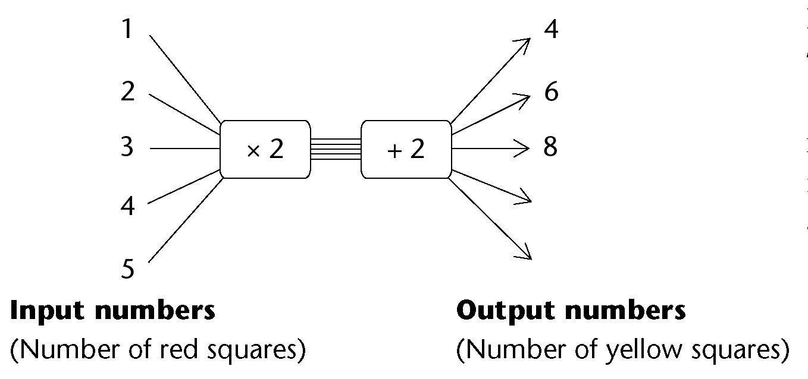

## Constant and variable quantities

### Look for connections between quantities

2. 2. How many fingers does a person who is
                      14 years old have?
   4. How many fingers does a person who is 41
                      years old have?
   6. Does the number of fingers on a person's
                      hand depend on their age? Explain.
   <Callout type="note" title="Note">
   There are two quantities in
                 the above situation: **age** and the **number of
                   fingers** on a person's hand. The number of fingers remains
                 the same, irrespective of a person's age. So we say the
                 number of fingers is a **constant** quantity. However, age
                 changes, or varies, so we say age is a **variable**
                 quantity.
   </Callout>
4. Now consider each
               situation below. For each situation, state whether one quantity
               influences the other. If it does, try to say *how* the one
               quantity will influence the other quantity. Also say whether
               there is a constant in the situation.
   2. The number of calls you make and the
                      amount of airtime left on your cellphone
   4. The number of houses to be built and the
                      number of bricks required
   6. The number of learners at a school and
                      the duration of the mathematics period
   <Callout type="note" title="Note">
   If one variable quantity is
                 influenced by another, we say there is a **relationship**
                 between the two variables. It is sometimes possible to find
                 out what value of the one quantity, in other words what
                 number, is linked to a specific value of the other
                 variable.
   </Callout>
6. Consider the following
               arrangements:
   
   2. How many yellow squares
                      are there if there is only one red square?
   4. How many yellow squares
                      are there if there are two red squares?
   6. How many yellow squares
                      are there if there are three red squares?
   8. Complete the flow diagram below by
                      filling in the missing numbers.
      Can you see the connection between
                      the arrangements above and the flow diagram? We can also
                      describe the relationship between the red and yellow squares in
                      words.
      
      **In words:**
      The number of yellow
                      squares is found by
                      multiplying the number of
                      red squares by 2 and then
                      adding 2 to the answer.
   10. How many yellow squares
                      will there be if there are 10 red squares?
   12. How many yellow squares
                      will be there if there are 21 red squares?
