## Different ways to describe relationships

### Complete some flow diagrams and tables of values

<Callout type="note" title="Note">
A relationship between two
          quantities can be shown with a flow diagram. In a flow
          diagram we cannot show all the numbers, so we show only
          some.
</Callout>

2. Calculate the missing input
               and output numbers for the flow diagram below.
   <Callout type="note" title="Note">
   Each **input number** in a
                 flow diagram has a corresponding **output number**. The
                 first (top) input number corresponds to the first output number. The second input number corresponds to
                 the second output number, and so on.
   We say \(\times 2\) is the
                 **operator**.
   </Callout>
   2. 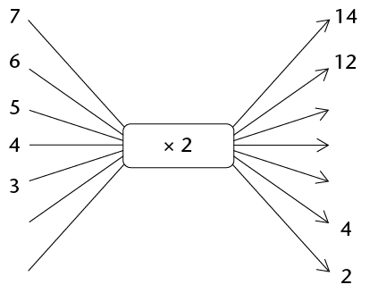
   4. What types of numbers are given as input
                      numbers?
   6. In the above flow diagram,
                      the output number 14 corresponds to the input number 7.
                      Complete the following sentences in the same way:
      In the relationship shown in
                      the above flow diagram, the output number ______ corresponds to the input
                      number 5.
      The input number ______ corresponds to the output
                      number 6.
      If more places are added to the flow
                      diagram, the input number ______ will correspond to the output number 40.
4. Complete this flow
               diagram by writing the appropriate operator, and then write the
               rule for completing this flow diagram in words.
   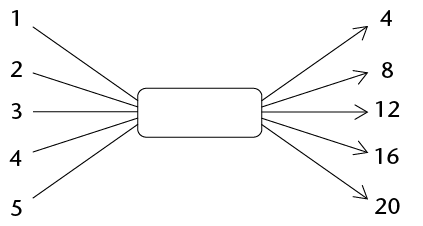
   **In words:**
6. Complete the flow
               diagrams below. You have to find out what the operator for (b)
               is and fill it in yourself.
   2. 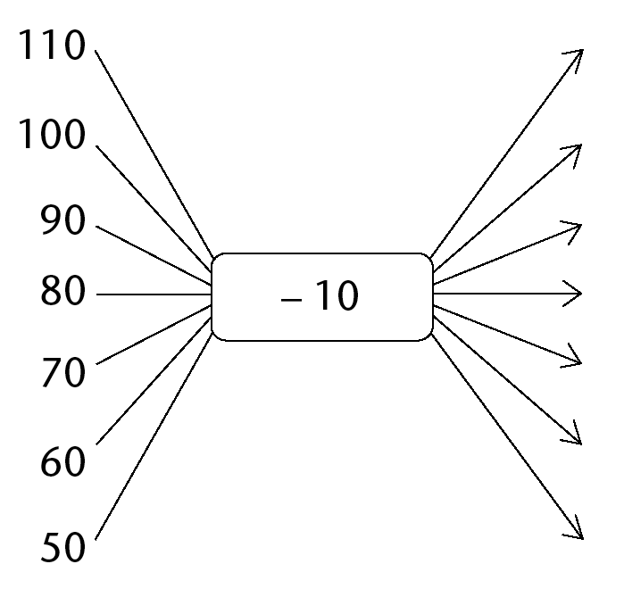
   4. 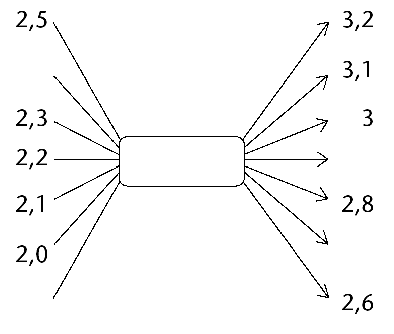
8. Complete the flow diagram:
   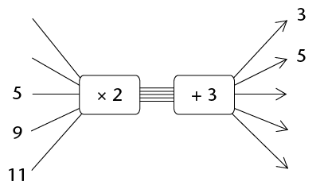
   <Callout type="note" title="Note">
   A completed flow diagram
                 shows two kinds of information:
   - It shows what calculations are done to produce the
                     output numbers.
   - It shows which output number is connected to
                     which input number.
   </Callout>
   The flow diagram that you completed
               in question 4 shows the following information:
   - Each input
                   number is multiplied by 2 and then 3 is added to produce the
                   output numbers.
   - It shows
                   which output number is connected to which input number.
   The relationship between the input
               and output numbers can also be shown in a table:
   | Input
                       numbers | 0 | 1 | 5 | 9 | 11 |
   | --- | --- | --- | --- | --- | --- |
   | Output
                       numbers | 3 | 5 | 13 | 21 | 25 |
10. 2. Describe in words how the output
                      numbers below can be calculated.
      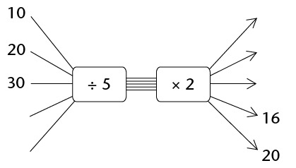
   4. Use the table below to show which output
                      numbers are connected to which input numbers in the above flow
                      diagram.
   6. Fill in the appropriate operator and
                      complete the flow diagram.
      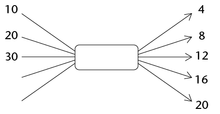
   8. The flow diagrams in question 5(a) and
                      5(c) have different operators, but they produce the same output
                      values for the same input values. Explain.
12. The rule for
               converting temperature given in degrees Celsius to degrees
               Fahrenheit is given as: "Multiply the degrees Celsius by 1,8
               and then add 32."
   2. Check whether the table below was
                      completed correctly. If you find a mistake, correct it.
      | Temperature in degrees Celsius | 0 | 5 | 20 | 32 | 100 |
      | --- | --- | --- | --- | --- | --- |
      | Temperature in degrees Fahrenheit | 32 | 41 | 68 |  | 212 |
   4. Complete the flow diagram to represent
                      the information in (a).
      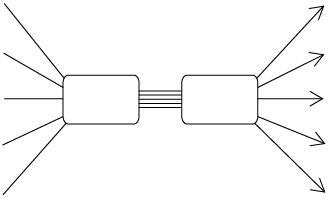
14. Another rule for
               converting temperature given in degrees Celsius to degrees
               Fahrenheit is given as: "Multiply the degrees Celsius by 9,
               then divide the answer by 5 and then add 32 to the answer."
   2. Complete the flow diagram below.
      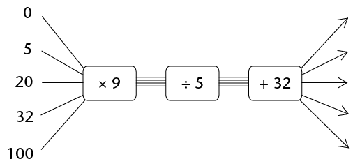
   4. Why do you think the flow diagrams in
                      questions 6(b) and 7(a) produce the same output numbers for the
                      same input numbers, even though they have different
                      operators?
   6. Will the flow diagram below give the
                      same output values as the flow diagram in question 7(a)?
                      Explain.
      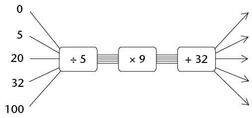
16. The rule for
               calculating the area of a square is: "Multiply the length of a
               side of the square by itself."
   2. Complete the table below.
      | Length of
                              side | 4 | 6 |  | 10 |  |
      | --- | --- | --- | --- | --- | --- |
      | Area of
                              square |  |  | 64 |  | 144 |
   4. Complete the flow diagram to represent
                      the information in the table.
      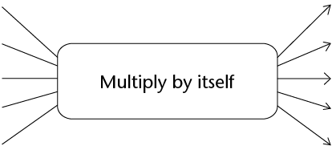
18. 2. The pattern below shows stacks of
                      building blocks. The number of blocks in each stack is
                      dependent on the number of the stack.
      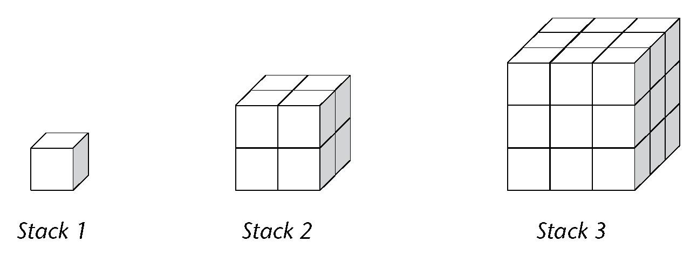
      Complete the table below to represent the
                      relationship between the number of blocks and the number of the
                      stack.
      | Stack
                              number | 1 | 2 | 3 | 4 | 5 | 6 | 7 | 8 |
      | --- | --- | --- | --- | --- | --- | --- | --- | --- |
      | Number of
                              blocks | 1 | 8 |  |  |  |  |  |  |
   4. Describe in words how the output values
                      can be calculated.

### Extension: linking dlow diagrams, tables of values, and rules

2. Complete the flow
                 diagrams below.
   2. 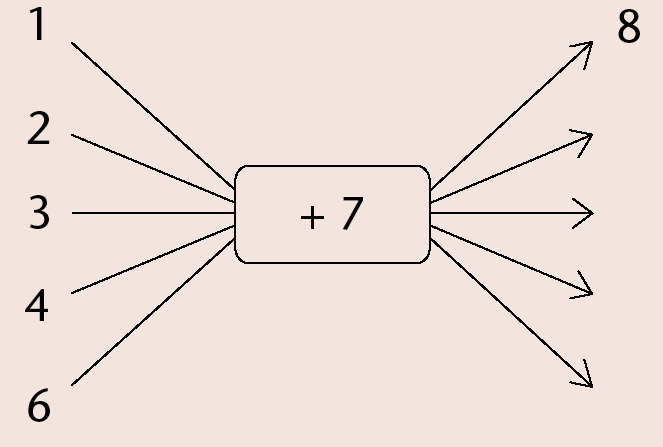
   4. 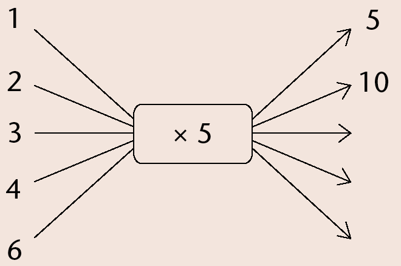
   6. 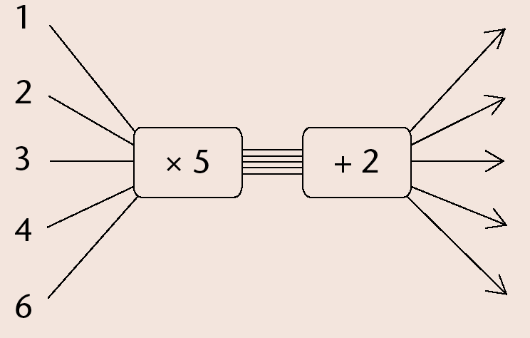
   8. 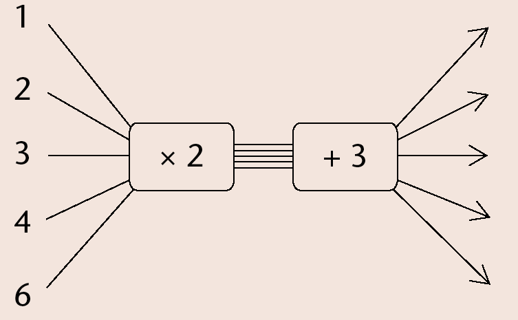
   10. 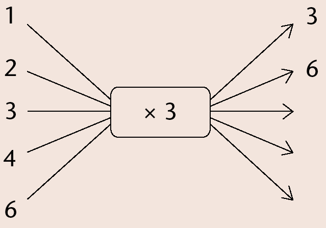
   12. 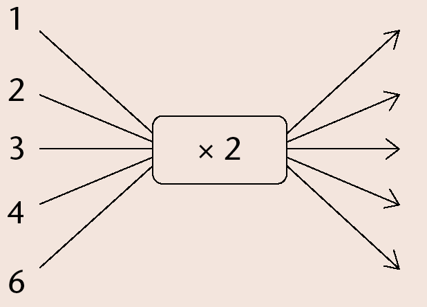
4. Calculate the
                 differences between the consecutive output numbers and
                 compare them to the differences between the consecutive
                 input numbers. Consider the operator of the flow
                 diagram. What do you notice?
6. Determine the rule to
                 calculate the missing output numbers in this
                 relationship and complete the table:
   | Input numbers | 1 | 2 | 3 | 4 | 5 | 7 | 10 |
   | --- | --- | --- | --- | --- | --- | --- | --- |
   | Output
                         numbers | 9 | 16 | 23 |  |  |  |  |
