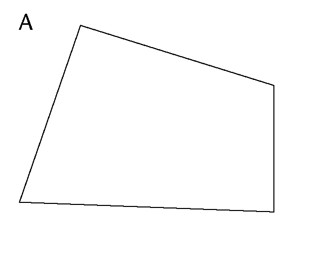
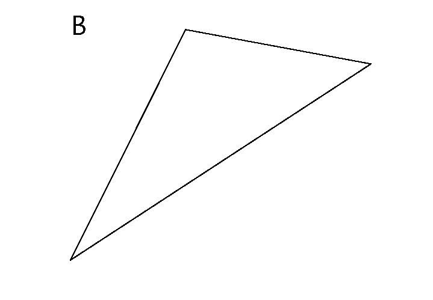
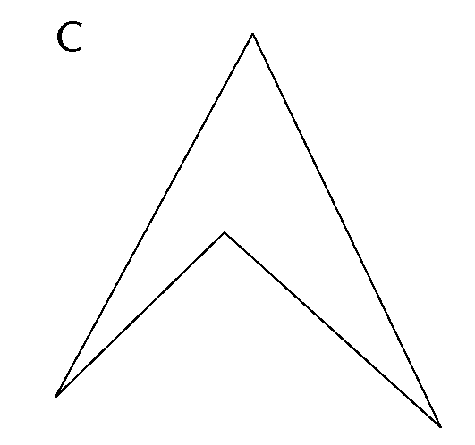
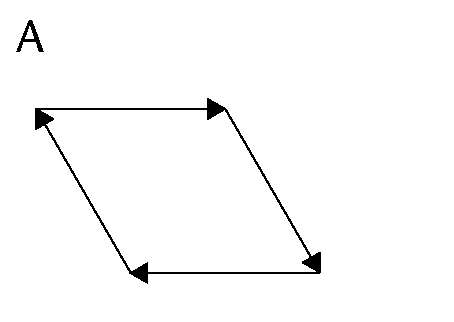
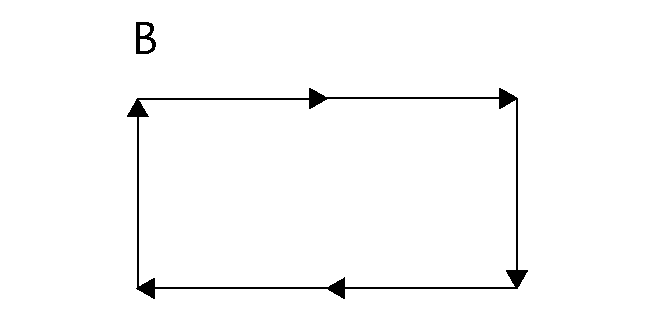
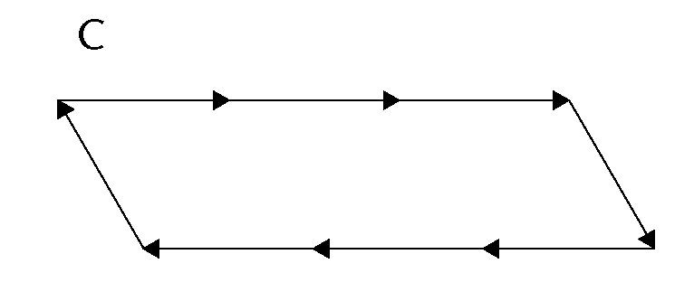
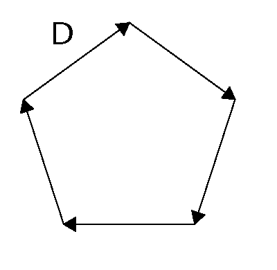
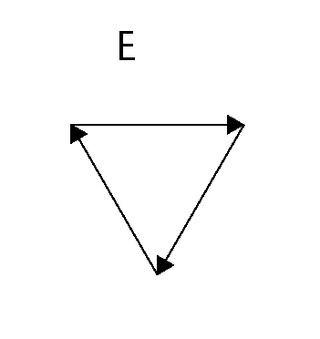
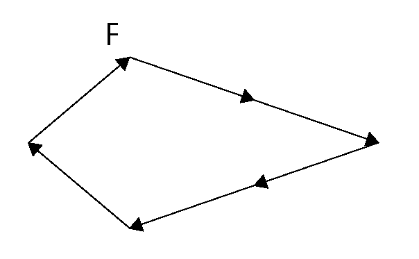
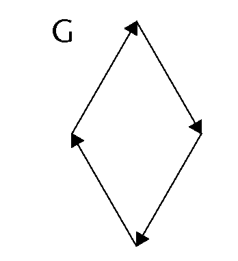

## Perimeter of polygons

The **perimeter** of a shape is
        the total distance around the shape, or the lengths of its
        sides added together. Perimeter (*P*) is measured in units
        such as millimetres (mm), centimetres (cm) and metres (m).

### Measuring perimeters

2. 2. Use a compass and/or a ruler to
                      measure the length of each side in figures A to C. Write the
                      measurements in mm on each figure.
   4. Write down the perimeter of each
                      figure.
      
      
      
4. The following shapes consist
               of arrows that are equal in length.
   2. What is the perimeter of each shape in
                      number of arrows?
   4. If each arrow is 30 mm long, what is the
                      perimeter of each shape in mm?
      
      
      
      
      
      
      
