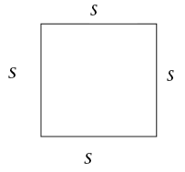
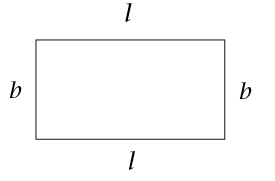
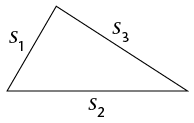

## Perimeter formulae

If the sides of a square are all
        \(s\) units long:

\[\begin{align} \textbf{Perimeter of square} &= s+ s+s+s\\
        &= 4 \times s\\
        \text{or } P &= 4s\end{align}\]

If the length of a rectangle is
        \(l\) units and the
        breadth (width) is \(b\) units:

\[\begin{align} \textbf{Perimeter of rectangle} &= l+l+b+b\\
        &=2\times l + 2 \times b\\
        \text{or } P&=2(l+b) \end{align}\]

A triangle has three sides, so:

\[\begin{align} \textbf{Perimeter of triangle } &= s_1 + s_2 + s_3\\
        \text{or } P &= s_1 + s_2 + s_3 \end{align}\]

### Applying perimeter formulae

2. Calculate the perimeter of a
               square if the length of one of its sides is 17,5 cm.
4. One side of an equilateral
               triangle is 32 cm. Calculate the triangle's perimeter.
6. Calculate the length
               of one side of a square if the perimeter of the square is 7,2
               m. (Hint: \(4s\ =\) ? Therefore \(s =\) ?)
8. Two sides of a
               triangle are 2,5 cm each. Calculate the length of the third
               side if the triangle's perimeter is 6,4 cm.
10. A rectangle is 40 cm long and
               25 cm wide. Calculate its perimeter.
12. Calculate the perimeter of a
               rectangle that is 2,4 m wide and 4 m long.
14. The perimeter of a rectangle
               is 8,88 m. How long is the rectangle if it is 1,2 m wide?
16. Do the necessary
               calculations in your exercise book in order to complete the
               table. (All the measurements refer to rectangles.)
   |  | Length | Breadth | Perimeter |
   | --- | --- | --- | --- |
   | (a) | 74
                       mm | 30
                       mm |  |
   | (b) | 25
                       mm |  | 90
                       mm |
   | (c) |  | 1,125
                       cm | 6,25
                       cm |
   | (d) | 5,5
                       cm |  | 22
                       cm |
   | (e) | 7,5
                       m | 3,8
                       m |  |
   | (f) |  | 2,5
                       m | 12 m |
