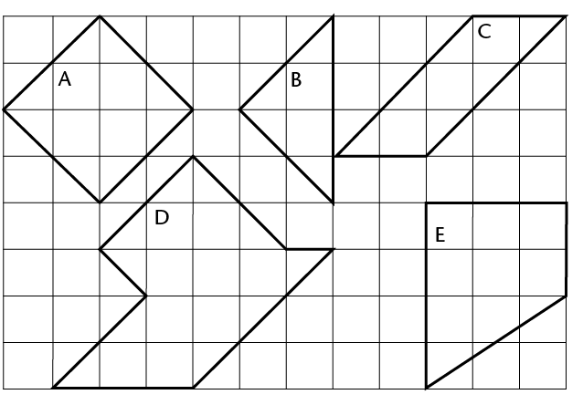
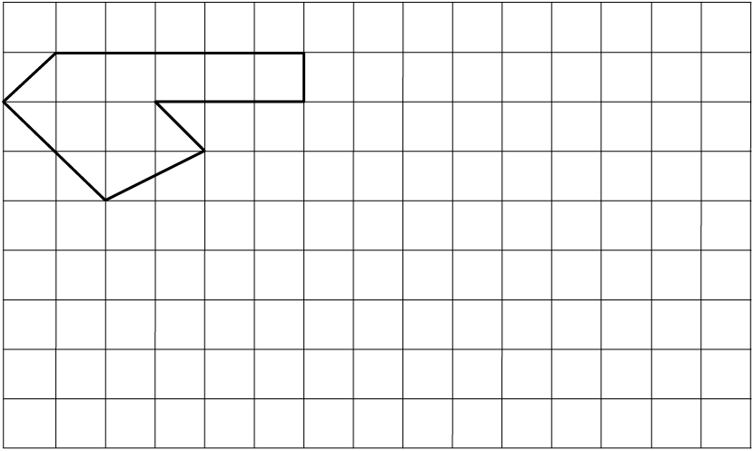
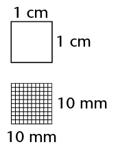

## Area and square units

The **area** of a shape is the
        size of the flat surface surrounded by the border (perimeter)
        of the shape.

Usually, area (A) is measured in square units,
        such as square millimetres (mm2), square centimetres
        (cm2) and square
        metres (m2).

### Square units to measure area

2. Write down the area of
               figures A to E below by counting the square units. (Remember to
               add halves or smaller parts of squares.)
   
   A is ______ square
                   units.
   B is ______ square
                   units.
   C is ______ square
                   units.
   D is ______square
                   units.
   E is ______ square
                   units.
4. Each square in the grid below measures 1 cm2 (1 cm \(\times\) 1 cm).
   2. What is the area of the
                      shape drawn on the grid?
   4. On the same grid, draw two shapes of
                      your own. The shapes should have the same area, but different
                      perimeters.
      

### Conversion of units

The figure below shows a
        square with sides of 1 cm.The area of the square is one square
        centimetre (1 cm2).

How many squares of 1 mm by 1 mm (1
        mm2) would fit into
        the 1 cm2
        square? ______ Complete: 1 cm2 = _______ mm2

**To change cm2 to
          mm:2**

1 cm=2 1 cm \(\times\) 1 cm

= 10 mm \(\times\) 10 mm

= 100 mm2

**Similarly, to change
          mm2 to cm2:**

1 mm2 = 1 mm \(\times\) 1 mm

= 0,1 cm \(\times\) 0,1 cm

= 0,01 cm2

We can use the same method to convert
        between other square units too. Complete:

| From
                  m 2 to cm 2 : \[ \begin{align} 1 \text {m}^2 &= 1 \text{ m} \times 1 \text{ m} \\
                &=\text{______ cm} \times \text{______ cm}\\
                &=\text{______ cm}^2 \end{align}\] | From
                  cm 2 to m 2 : \[ \begin{align} 1 \text {cm}^2 &= 1 \text{ cm} \times 1 \text{ cm} \\
                &=0.01 \text{ m} \times 0.01\text{ m}\\
                &=\text{______ m}^2 \end{align}\] |
| --- | --- |

<Callout type="note" title="Note">
So, to convert between
          m2, cm2 and mm2 you do the following:

- cm2 to mm2 \(\rightarrow\) multiply by 100
- m2 to cm2 \(\rightarrow\) multiply by 1000
- mm2 to cm2 \(\rightarrow\) divide by 100
- cm2 to m2 \(\rightarrow\) divide by 10000
</Callout>

Do the necessary calculations in your
        exercise book. Then fill in your answers.

2. 2. 15 m2 = ______ cm2
   4. 5 cm2 = ______ mm2
   6. 20 cm2 = ______ m2
   8. 20 mm2 = ______ cm2
4. 2. 25 m2 = ______ cm2
   4. 240 000 cm2 = ______ m2
   6. 460,5 mm2 = _______ cm2
   8. 0,4 m2 = ______ cm2
   10. 12 100 cm2 = ______ m2
   12. 2,295 cm2 = ______ mm2
