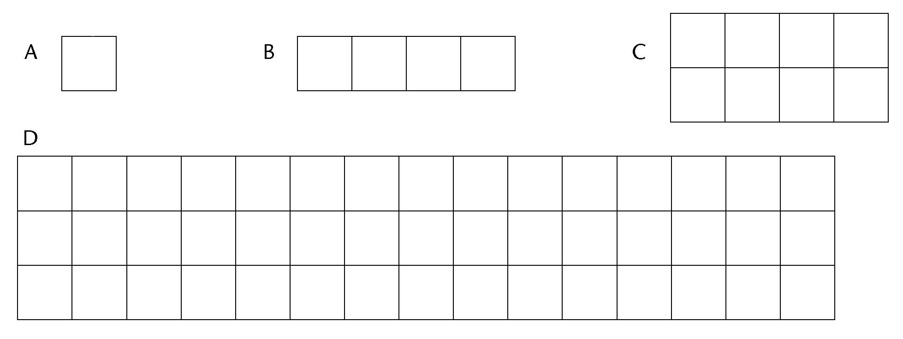
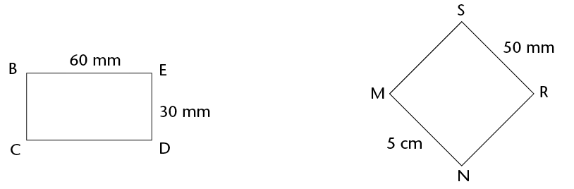
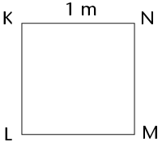
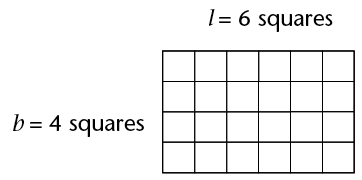
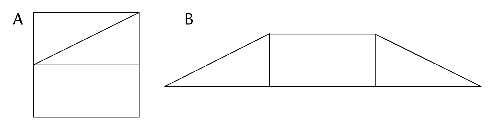
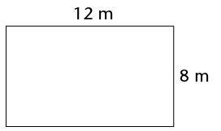
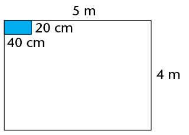
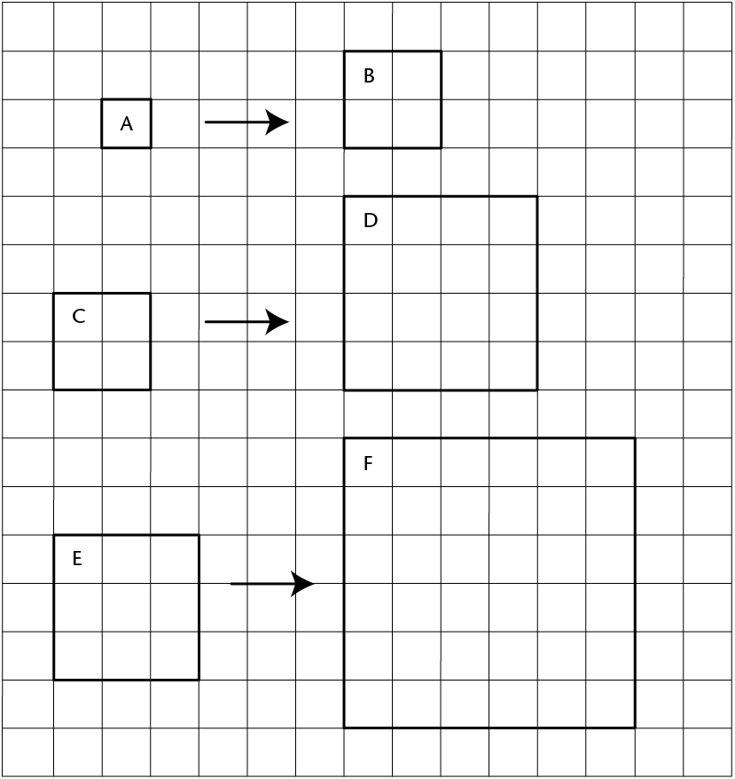

## Area of squares and rectangles

### Investigating the area of squares and rectangles

2. Each of the following
               four figures is divided into squares of equal size, namely 1 cm
               by 1 cm.
   
   2. Give the area of each
                      figure in square centimetres (cm2):
      Area of A:
      Area of B:
      Area of C:
      Area of D:
   4. Is there a shorter method to work out
                      the area of each figure? Explain.
4. Figure BCDE is a rectangle and
               MNRS is a square.
   
   2. How
                      many cm2 (1 cm
                      \(\times\) 1 cm) would fit into rectangle BCDE?
   4. How
                      many mm2 (1 mm \(\times\) 1 mm) would fit into rectangle BCDE?
   6. What is the area of square MNRS in cm2?
   8. What is the area of square
                      MNRS in mm2?
6. Figure KLMN is a square with
               sides of 1 m.
   
   2. How many squares with
                      sides of 1 cm would fit along the length of the square?
   4. How many squares with
                      sides of 1 cm would fit along the breadth of the square?
   6. How many squares
                      (cm2) would
                      therefore fit into the whole square?
   8. Complete: 1 m2 = ______ cm2

<Callout type="note" title="Note">
A quick way of calculating
          the number of squares that would fit into a rectangle is to
          multiply the number of squares that would fit along its
          length by the number of squares that would fit along its
          breadth.
</Callout>

### Formulae: area of rectangles and squares

In the rectangle on the
        below:
        \[ \begin{align} \text{Number of squares} &= \text{Squares along the length} \times \text{Squares along the breadth} \\
        &= 6 \times 4 \\
        &= 24 \end{align}\]

From this we can deduce the
        following:

<Callout type="note" title="Note">
\[ \begin{align} \textbf{Area of rectangle} &= \text{Length of rectangle} \times \text{Breadth of rectangle}\\
          A &= l \times b\end{align}\]
          where \(A\) is the area
          in square units, \(l\) is the length and \(b\) is the
          breadth)

\[ \begin{align} \textbf{Area of square} &= \text{Length of side} \times \text{Length of side}\\
          A &= l \times l \\ &=l^2 \end{align}
          \]
          where \(A\) is the area
          in square units, and \(l\) is the length of a side)
</Callout>

The units of the values used in the
        calculations must be the same. Remember:

- 1 m = 100
            cm and 1 cm = 10 mm
- 1
            cm2 = 1 cm \(\times\)
            1 cm = 10 mm \(\times\)
            10 mm = 100 mm2
- 1
            m2 = 1 m \(\times\)
            1
            m = 100 cm \(\times\)
            100 cm = 10 000 cm2
- 1
            mm2 = 1 mm \(\times\)
            1 mm = 0,1 cm \(\times\)
            0,1 cm = 0,01 cm2
- 1
            cm2 = 1 cm \(\times\)
            1 cm = 0,01 m \(\times\)
            0,01 m = 0,0001 m2

#### Examples

2. Calculate the area of
               a rectangle with a length of 50 mm and a breadth of 3 cm. Give
               the answer in cm2.
   *Solution:*
             \[ \begin{align} \text{Area of rectangle} & = l \times b & & &\\
             &= (50 \times 30) \text{ mm}^2& \text{ or } A &= (5 \times 3)\text{ cm}^2\\
             &= 1 500 \text{ mm}^2 & \text{ or } & = 15 \text{ cm}^2
             \end{align}
             \]
4. Calculate the area of a square
               bathroom tile with a side of 150 mm.
   *Solution:*
               \[ \begin{align} \text{Area of square tile} &= l \times l \\
               &=(150 \times 150) \text{ mm}^2\\
               &= 22500\text{ mm}^2\\
               \end{align}\]
   The area is therefore 22 500
               mm2 (or 225
               cm2).
6. Calculate the length of a
               rectangle if its area is 450 cm2 and its width is 150 mm.
   *Solution:*
               \[ \begin{align} \text{Area of rectangle} & = l \times b & & &\\
               450 &= l \times 15 & & &\\
               30 \times 15 &= l \times 15 & \text{ or } 450 \div 15& = l\\
               30 = l & & 30 &= l\\
               \end{align}
               \]
   The length is therefore 30 cm (or
               300 mm).

### Applying the formulae

2. Calculate the area of each of
               the following shapes:
   2. a rectangle with sides of 12 cm and 9
                      cm
   4. a square with sides of 110 mm (answer in
                      cm2)
   6. a rectangle with sides of 2,5 cm and 105
                      mm (answer in mm2)
   8. a rectangle with a length of 8 cm and a
                      perimeter of 24 cm
4. A rugby field has a length of
               100 m (goal post to goal post) and a breadth of 69 m.
   2. What is the area of the field (excluding
                      the area behind the goal posts)?
   4. What would it cost to plant new grass on
                      that area at a cost of R45/m2?
   6. Another unit for area is the hectare
                      (ha). It is mainly used for measuring land. The size of 1 ha is
                      the equivalent of \( 100 \text{m} \times 100 \text{m}\). Is a rugby field
                      greater
                      or smaller than 1 ha? Explain your answer.
6. Do the necessary
               calculations in your exercise book in order to complete the
               table. (All the measurements refer to rectangles.)
   |  | Length | Breadth | Area |
   | --- | --- | --- | --- |
   | (a) | m | 8 m | 120 m 2 |
   | (b) | 120 mm | mm | 60 cm 2 |
   | (c) | 3,5 m | 4,3 m | m 2 |
   | (d) | 2,3 cm | cm | 2,76 cm 2 |
   | (e) | 5,2 m | 460 cm | m 2 |
8. Figure A is a square
               with sides of 20 mm. It is cut as shown in A and the parts are
               combined to form figure B. Calculate the area of figure B.
   
10. Margie plants a vegetable
               patch measuring \(12 \text{m} \times 8 \text{m}\).
   
   2. What is the area of the vegetable
                      patch?
   4. She plants carrots on half of the patch,
                      and tomatoes and potatoes on a quarter of the patch each.
                      Calculate the area covered by each type of vegetable?
   6. How much will she pay to put
                      fencing around the patch? The fencing costs R38/m.
12. Mr Allie has to tile a
               kitchen floor measuring \(5 \text{m} \times 4 \text{m}\). The blue tiles he uses
               each measure \(40 \text{cm} \times 20 \text{cm}\).
   
   2. How many tiles does Mr Allie need?
   4. The tiles are sold in boxes containing
                      20 tiles. How many boxes should he buy?

### Doubling a side and its effect on area

When a side of a square is doubled,
        will the area of the square also be doubled?

The size of each square making up the
        grid below is \(1 \text{cm} \times 1 \text{cm}\).

2. 2. For each square drawn on the grid,
                      label the lengths of its sides.
   4. Write down the area of each square.
                      (Write the answer inside the square.)
4. Notice that the second
               square in each pair of squares has a side length that is double
               the side length of the first square.
6. Compare the areas of
               the squares in each pair; then complete the following: When the
               side of a square is doubled, its area
   
