## Area of triangles

### Heights and bases of a triangle

The **height (*h*)** of a triangle is a
        perpendicular line segment drawn from a vertex to its opposite
        side. The opposite side, which forms a right angle with the
        height, is called the **base (*b*)** of the triangle. Any triangle
        has three heights and three bases.

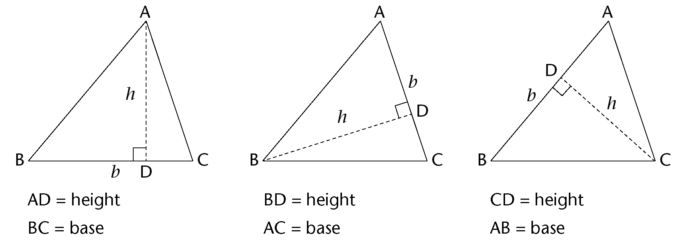

In a right-angled triangle, two sides
        are already at right angles:

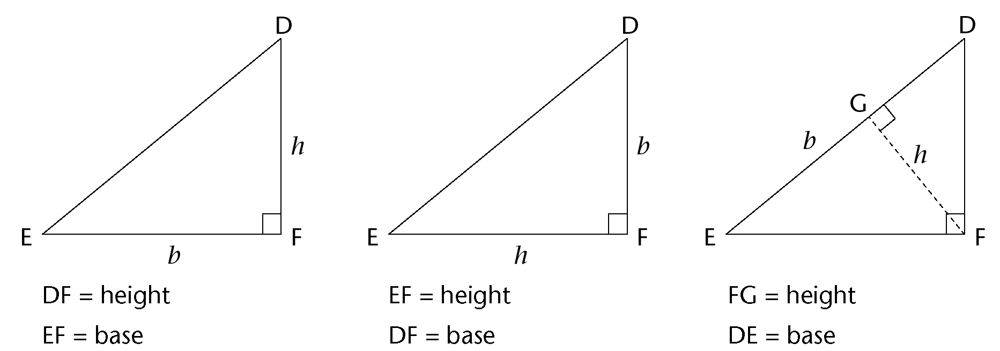

Sometimes a base must be extended
        outside of the triangle in order to draw the perpendicular
        height. This is shown in the first and third triangles below.
        Note that the extended part does not form part of the base's
        measurement:

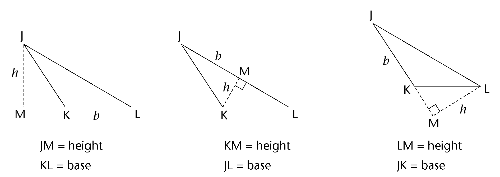

2. Draw any height in
               each of the following triangles. Label the height (*h*)
               and base (*b*) on each triangle.
4. Label another set of heights
               and bases on each triangle.
   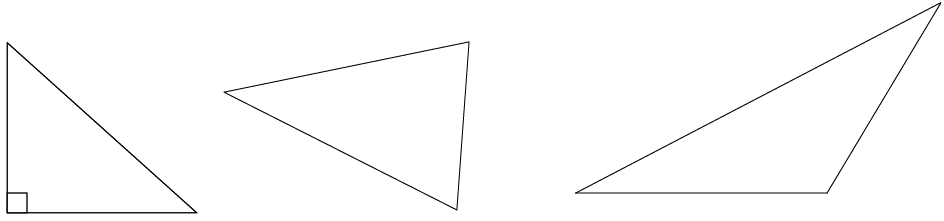

### Formula: area of a triangle

ABCD is a rectangle with length = 5
        cm and breadth = 3 cm. When A and C are joined, it creates two
        triangles that are equal in area: \(\triangle ABC\) and
        \(\triangle ADC\).

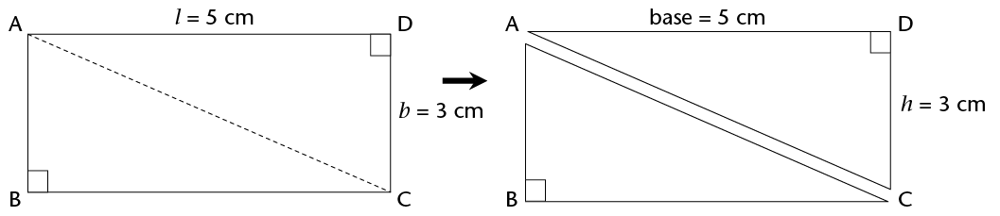

\(\text{Area of rectangle} = l \times
        b\)

\[ \begin{align} \text{Area of } \triangle ABC \text{ (or }
        \triangle ADC\text{)} &= \frac{1}{2} \text{(Area of rectangle)}\\
        &= \frac{1}{2}(l \times b)
        \end{align}
        \]

In rectangle ABCD, AD is its length
        and CD is its breadth.

But look at \(\triangle ADC\). Can you
        see that AD is a base and CD is its height?

So instead of saying:

Area of \(\triangle ADC\) or any other triangle \(= \frac{1}{2}(l \times b)\)

we say:

<Callout type="note" title="Note">
\[ \begin{align} \textbf{Are of a triangle} &= \frac{1}{2} \text{(base} \times \text{height)}\\
        &=\frac{1}{2}(b \times h)\\ \end{align}
        \]
</Callout>

<Callout type="note" title="Note">
In the formula for the area of
          a triangle, *b* means
          'base' and not 'breadth',
          and *h* means
          perpendicular height.
</Callout>

### Applying the area formula

2. Use the formula to
               calculate the areas of the following triangles: \(\triangle ABC\),
               \(\triangle EFG\), \(\triangle JKL\) and \(\triangle MNP\).
   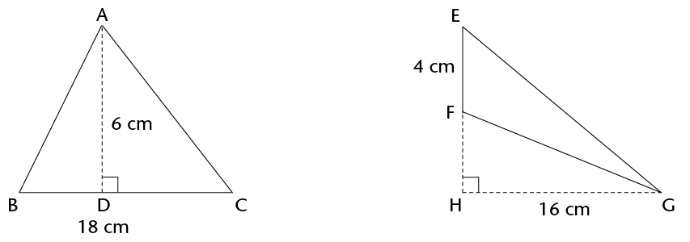
   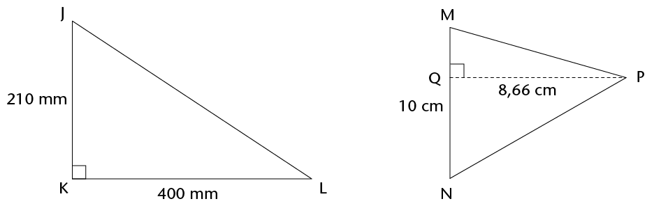
4. PQST is a rectangle in each
               case below. Calculate the area of \(\triangle PQR\) each time.
   2. 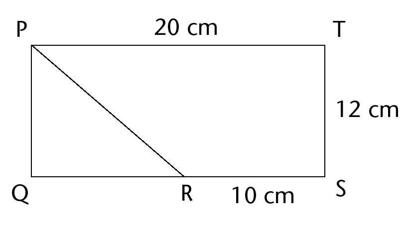
   4. 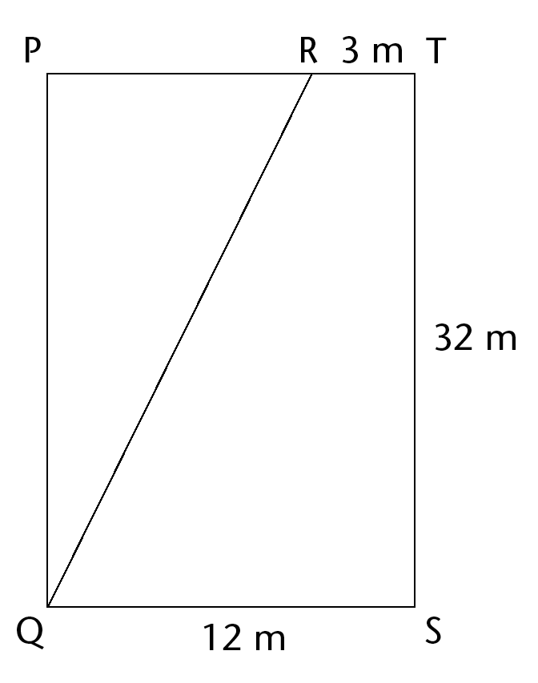
   6. R is the midpoint of QS.
      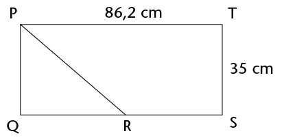
6. In \(\triangle ABC\), the
               area is 42 m2, and
               the perpendicular height is 16 m. Find the length of the
               base.

2. Calculate the perimeter
                 (*P*) and area
                 (*A*) of the
                 following figures:
   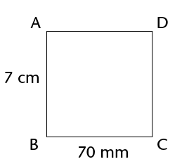
   P=_______
   A=________
   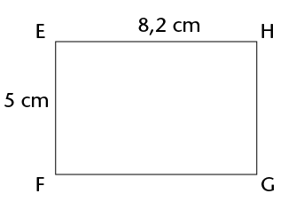
   P=_______
   A=________
   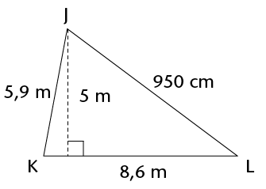
   P=_______
   A=________
4. Figure ABCD is a rectangle: AB = 3
                 cm, AD = 9 cm and TC = 4 cm.
   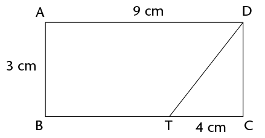
   2. Calculate the perimeter
                        of ABCD.
   4. Calculate the area of ABCD.
   6. Calculate the area of
                        \(\triangle DTC\).
   8. Calculate the area of ABTD.
