## Surface area of cubes and rectangular prisms

### Investigating surface area

2. Follow the instructions below
               to make a paper cube.
   **Step 1:**
               Cut off part of an A4 sheet so that you are left with a
               square.
   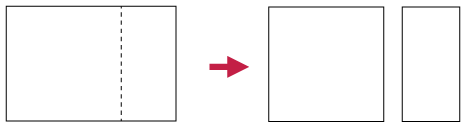
   **Step 2:**
               Cut the square into two equal halves.
   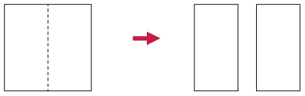
   **Step 3:**
               Fold each half square lengthwise down the middle to
               form two double-layered strips.
   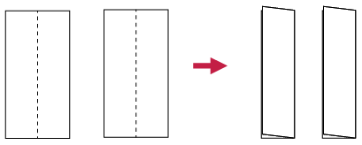
   **Step 4:**
               Fold each strip into four square sections, and put the
               two parts together to form a paper cube. Use sticky
               tape to keep it together.
   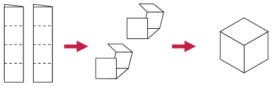
4. Number each face of the
               cube. How many faces does the cube have?
6. Measure the side length
               of one face of the cube.
8. Calculate the area of
               one face of the cube.
10. Add up the areas of all the
               faces of the cube.

<Callout type="note" title="Note">
The **surface area** of
          an object is the sum of the areas of all its faces (or outer
          surfaces).

As for other areas, we measure surface area in square
          units, for example mm2, cm2, m2.
</Callout>

A cube has six identical square
        faces. A die (plural: dice) is an example of a cube.

A rectangular prism also has six faces, but its
        faces can be squares and/or rectangles. A matchbox is an
        example of a rectangular prism.

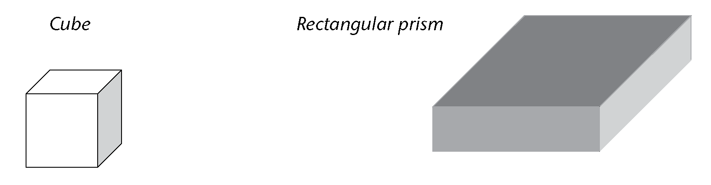

### Using nets of rectangular prisms and cubes

It is sometimes easier to see all the
        faces of a rectangular prism or cube if we look at its net. A
        **net** of a prism is the figure obtained when cutting the
        prism along some of its edges, unfolding it and laying it
        flat.

2. Take a sheet of paper
               and wrap it around a matchbox so that it covers the whole box
               without going over the same place twice. Cut off extra bits of
               paper as necessary so that you have only the paper that covers
               each face of the matchbox.
4. Flatten the paper and
               draw lines where the paper has been folded. Your sheet might
               look like one of the following nets (there are also other
               possibilities):
   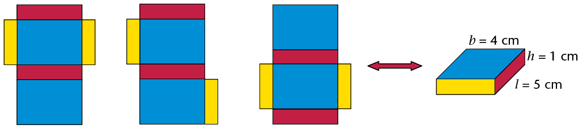
6. Notice that there are
               six rectangles in the net, each matching a rectangular face of
               the matchbox. Point to the three pairs of identical rectangles
               in each net.
   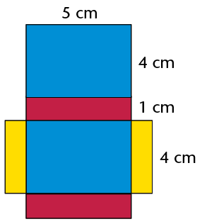
8. Use the measurements
               given to work out the surface area of the prism. (Add up the
               areas of each face.)
10. Explain to a classmate why you
               think the following formula is or is not correct:
   **Surface
                 area of a rectangular prism** \(= 2(l \times b) + 2(l \times h) + 2(b \times h)\)
12. Here are three different nets
               of the same cube.
   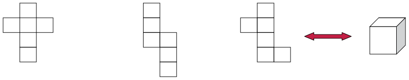
   2. Can you picture in your
                      mind how the squares can fold up to make a cube?
   4. If the length of an
                      edge of the cube is 1 cm, what is the area of one of its
                      faces?
      What then is the area of all
                      its six faces?
   6. Explain to a classmate why
                      you think the following formula is or is not correct: **Surface
                        area of a cube** \(=6(l\times l)=6l^2)\)
   8. If the length of an edge of the cube
                      above is 3 cm, what is the surface area of the cube?

### Working out surface areas

2. Work out the surface areas of
               the following rectangular prisms and cubes.
   2. 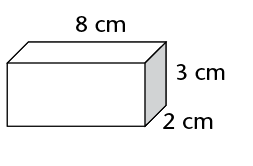
   4. 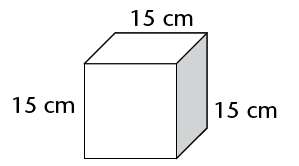
   6. 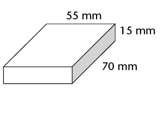
   8. 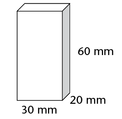
4. The following two boxes are
               rectangular prisms. The boxes must be painted.
   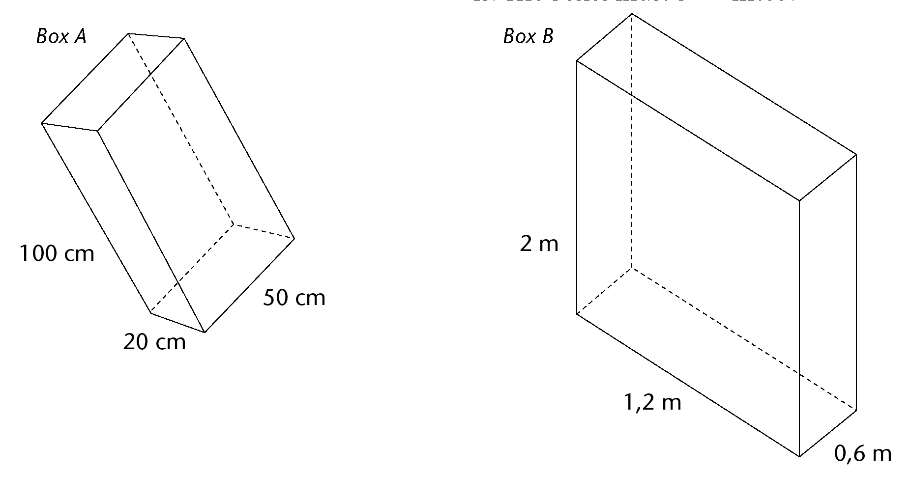
   2. Calculate the total surface area of box
                      A and of box B.
   4. What will it cost to paint both boxes if
                      the paint costs R1,34 per m2?
6. Two cartons, which are
               rectangular prisms, are glued together as shown. Calculate the
               surface area of this object. (Note which faces can be seen and
               which cannot.)
   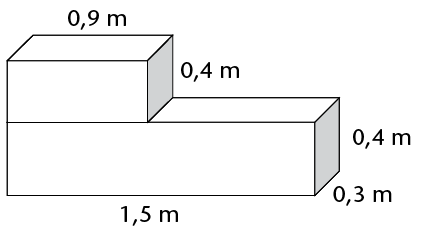
8. This
               large plastic wall measures \(3 \text{m} \times 0,5 \text{m} \times 1,5 \text{m}\). It
               has to be painted for the Uyavula Literacy Project. The wall
               has three holes in it, labelled A, B and C, as shown. The holes
               go right through the wall. The measurements of the holes are in
               mm.
   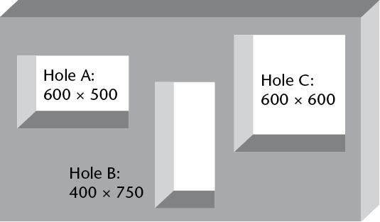
   2. Calculate the area of the front and back
                      surfaces that must be painted.
      <Callout type="note" title="Note">
      Remember from the previous
                        chapter:
      1 cm2 = 100 mm2
      1 m2= 10 000 cm2
      </Callout>
   4. Calculate the area of the two side
                      faces, as well as the top face.
   6. Calculate the total surface area of the
                      wall, excluding the bottom and the inner surfaces where the
                      holes are, because these will not be painted.
   8. What will it cost if the water-based
                      paint costs R2,00 per m2?
