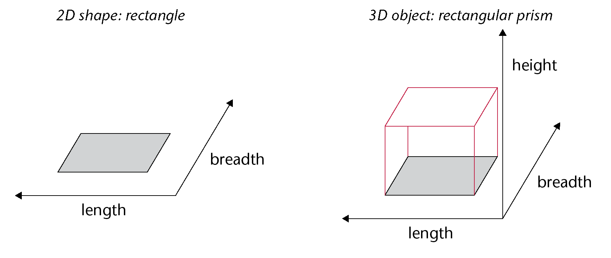
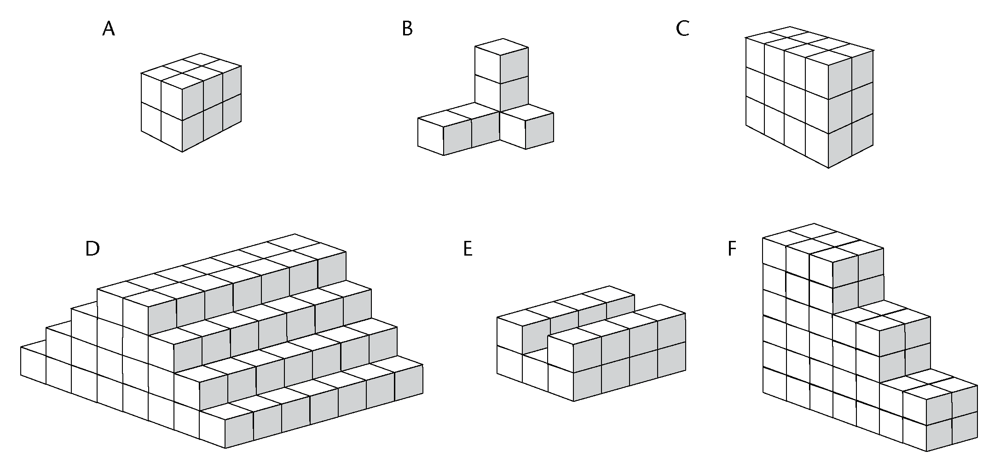
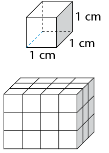
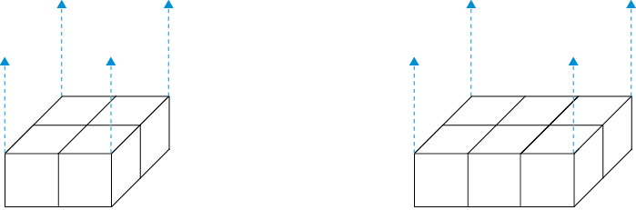
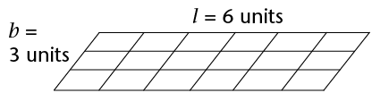
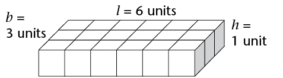
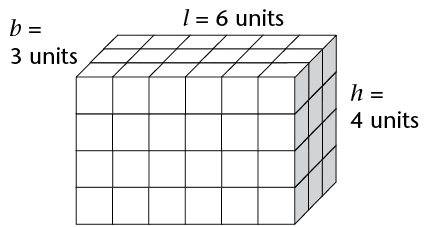
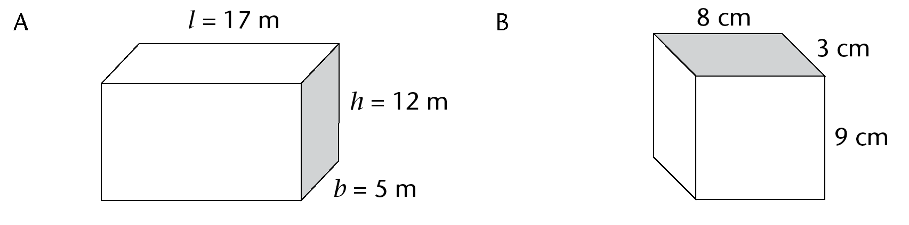
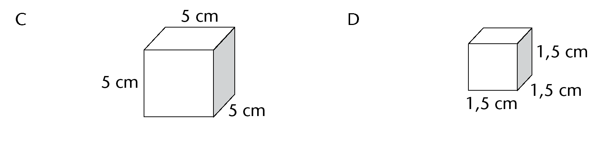

## Volume of rectangular prisms and cubes

2D shapes are flat and have only two
        dimensions, namely length (*l*) and breadth (*b*). 3D objects have three
        dimensions, namely length (*l*), breadth (*b*) and height (*h*). You can think of a
        dimension as a direction in space. Look at these examples:

3D objects
        therefore take up space in a way that 2D shapes do not. We can
        measure the amount of space that 3D objects take up.

<Callout type="note" title="Note">
Every object in the real world
          is 3D. Even a sheet of paper is a 3D object. Its height is
          about 0,1 mm.
</Callout>

### Cubes to measure amount of space

We can use cubes to measure the
        amount of space that an object takes up.

2. Identical toy building cubes
               were used to make the stacks shown below.
   
   2. Which stack takes up the
                      least space?
   4. Which stack takes up the
                      most space?
   6. Order the stacks from the one that takes
                      up the least space to the one that takes up the most space.
                      (Write the letters of the stacks.)
   <Callout type="note" title="Note">
   The space (in all
                 directions) occupied by a 3D object is called its
                 **volume**.
   Cubes are the units we use to measure volume.
                 A cube with edges of 1 cm (that is, \(1\text{ cm} \times 1\text{ cm} \times 1 \text{ cm})\)
                 has a volume of one cubic centimetre (1 cm3).
   </Callout>
4. The figure on the
               right shows a rectangular prism made from 36 cubes, each with
               an edge length of 1 cm. The prism thus has a volume of 36 cubic
               centimetres (36 cm 3)
   
   2. The stack is taken apart and all 36
                      cubes are stacked again to make a new rectangular prism with a
                      base of four cubes (see A below.) How many layers of cubes will
                      the new prism be? What is the height of the new prism?
      
   4. Repeat (a), but this time make a prism
                      with a base of six cubes (see B above).
   6. Which one of the rectangular prisms in
                      questions (a) and (b) takes up the most space in all
                      directions? (Which one has the greatest volume?)
   8. What will be the volume of the prism in
                      question (b) if there are 7 layers of cubes altogether?
   10. A prism is built with 48 cubes, each
                      with an edge length of 1 cm. The base consists of 8 layers. What is the height of
                      the prism?

### Formula to calculate volume

You can think about the volume of a
        rectangular prism in the following way:

**Step 1:**
        Measure the area of the bottom face (also called the base) of a
        rectangular prism. For the prism given here: \(A = l \times b = 6 \times 3 = 18\) square units.

**Step 2:** A
        layer of cubes, each 1 unit high, is placed on the flat base.
        The base now holds 18 cubes. It is \(6 \times 3 \times 1\) cubic
        units.

**Step 3:**
        Three more layers of cubes are added so that there are 4 layers
        altogether. The prism's height (*h*) is 4 units. The
        volume of the prism is:

\[ \begin{align} V &= (6 \times 3) \times 4 \\
        \text{or } V &= \text{Area of base} \times \text{number of layers}\\
        &=(l \times b) \times h \end{align} \]

Therefore:

<Callout type="note" title="Note">
\[ \begin{align} \textbf{Volume of a rectangular prism} & = \text{Area of base} \times \text{height} \\
          &= l \times b \times h \end{align} \]

\[ \begin{align} \textbf{Volume of a cube} & = l \times l \times l \text{ (edges are all the same length)} \\
          &= l^3 \end{align} \]
</Callout>

### Applying the formulae

2. Calculate the volume of these
               prisms and cubes.
   
   
4. Calculate the volume of prisms
               with the following measurements:
   2. *l* = 7 m, *b* = 6 m, *h*
                    = 6 m
   4. *l* = 55 cm, *b* = 10 cm, *h* = 20
                    cm
   6. Surface of base = 48 m2, *h* = 4 m
   8. Surface
                    of base = 16 mm2,
                    *h* = 12 mm
6. Calculate the volume of cubes
               with the following edge lengths:
   2. 7 cm
   4. 12 mm
8. Calculate the volume of the
               following square-based prisms:
   2. side of the base = 5 mm, *h* = 12
                    mm
   4. side of the base = 11 m, *h* = 800 cm
10. The volume of a prism
               is 375 m3. What is
               the height of the prism if its length is 8 m and its breadth is
               15 m?
