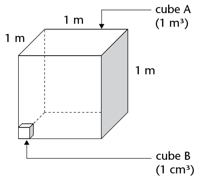
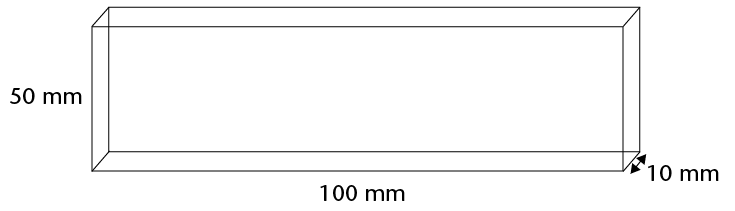
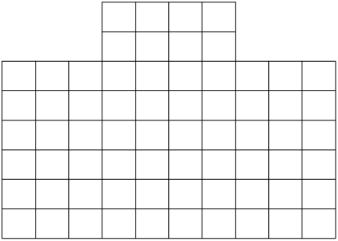

## Converting between cubic units

### Cubic units to measure volume

This drawing shows a cube (A) with an
        edge length of1 m. Also shown is a small cube (B) with an edge
        length of 1 cm.

How many small cubes can fit inside
        the large cube?

- 100 small
            cubes can fit along the length of the base of cube A (because
            there are 100 cm in 1 m).
- 100 small
            cubes can fit along the breadth of the base of cube A.
- 100 small
            cubes can fit along the height of cube A.

\[ \begin{align} \text{ Total number of 1 cm}^3 \text{ cubes in 1 m}^3 &= 100 \times 100 \times 100\\
        &= 1 000 000 \\
        \therefore 1 \text{ m}^3 &= 1000000 \text{ cm}^3 \end{align} \]

Work out how many mm3 are equal to 1 cm3:

\[ \begin{align} 1 \text{ cm}^3 & = 1 \text{ cm} \times 1 \text{ cm} \times 1 \text{ cm}\\
        &= \text{______ mm} \times \text{______ mm} \times \text{______ mm}\\
        &= \text{______ mm}^3 \end{align} \]

<Callout type="note" title="Note">
**Cubic units:**

1 m3 = 1 000 000 cm3

(multiply by 1 000 000 to
          change m3 to
          cm3)

1 cm3 = 0,000001 m3

(divide by 1 000 000 to
          change cm3 to
          m3)

1 cm3 = 1 000 mm3

(multiply by 1 000 to
          change cm3 to
          mm3)

1 mm3 = 0,001 cm3

(divide by 1 000 to change
          mm3 to
          cm3)
</Callout>

### Working with cubic units

2. Which unit, the cubic
               centimetre (cm3) or
               the cubic metre (m3), would be used to measure
               the volume of each of the following?
   2. a bar of soap
   4. a book
   6. a wooden rafter for a
                      roof
   8. sand on a truck
   10. a rectangular concrete
                      wall
   12. a die
   14. water in a swimming pool
   16. medicine in a syringe
4. Write the following volumes in
               cm3:
   2. 1 000 mm3
   4. 3 000 mm3
   6. 2 500 mm3
   8. 4 450 mm3
   10. 7
                      824 mm3
   12. 50
                      mm3
6. Write the following volumes in
               m3:
   2. 1 000 000 cm3
   4. 4 000 000 cm3
   6. 1 500 000 cm3
   8. 2 350 000 cm3
   10. 500 000 cm3
   12. 350 000 cm3
8. Write the following volumes in
               cm3:
   2. 2 000 mm3
   4. 4 120 mm3
   6. 1,5 m3
   8. 34 m3
   10. 50
                      000 mm3
   12. 2,23
                      m3
10. A rectangular hole has
               been dug for a children's swimming pool. It is 7 m long, 4 m
               wide and 1 m deep. What is the volume of earth that has been
               dug out?
12. Calculate the volume of wood
               in the plank shown below. Answer in cm3.
   
14. The drawing shows the
               base (viewed from below) of a stack built with 1 cm3cubes. The stack is 80 mm high
               everywhere.
   
   2. What is the volume of the stack?
   4. Complete the following:
      Volume of stack = area of base
16. Calculate the volume of each
               of the following rectangular prisms:
   2. length = 20 cm; breadth = 15 cm; height
                      = 10 cm
   4. length = 130 mm; breadth = 10 cm; height
                      = 5 mm
   6. length = 1 200 cm; breadth = 5,5 m;
                      height = 3 m
   8. length = 1,2 m; breadth = 2,25 m; height
                      = 4 m
   10. area of base = 300 cm2; height = 150 mm
   12. area of base = 12 m2; height = 2,25 m
