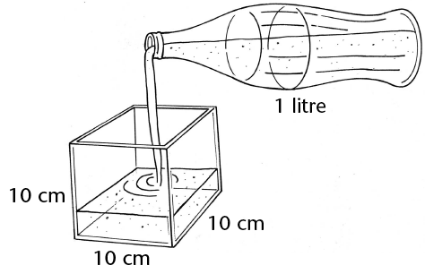
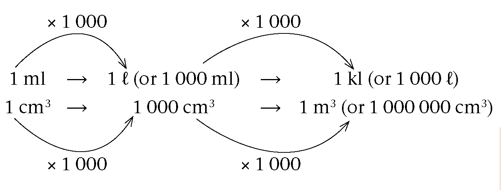
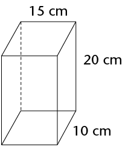
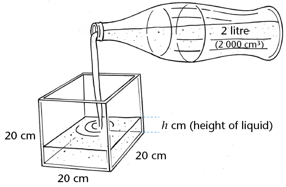

## Volume and capacity

The space inside a container is
        called the internal volume, or **capacity**, of the
        container. Capacity is often measured in units of millilitres
        (ml), litres (â„“) and kilolitres (kl).
        However, it can also be measured in cubic units.

### Equivalent units for volume and capacity

If the contents of a 1
        â„“ bottle are poured into a cube-shaped
        container with internal measurements of \(10 \text{cm} \times 10 \text{cm}
        \times 10 \text{cm}\), it will fill the container exactly. Thus:

\[ \begin{align} (10\text{ cm} \times 10 \text{ cm} \times 10 \text{ cm}) &= 1
        â„“\\
        \text{or } 1 000 \text{ cm}^3&= 1 â„“ \end{align} \]

\[ \begin{align} \text{ Since 1 â„“} &= 1 000 \text{ ml} &\\
        1 000 \text{ cm}^3 &= 1 000 \text{ ml} &\text{ [1 â„“} = 1 000 \text{ cm}^3]\\
        \therefore 1 \text{ cm}^3 &= 1 \text{ ml } &\text{[divide both sides by 1 000]}
        \end{align}\]

\[ \begin{align} \text{ Since 1 kl} &= 1 000 â„“ &\\
        &= 1000 \times (1000 \text{ cm}^3) & \text{ [1 â„“ = 1000 cm}^3\text{]} \\
        & = 1 000 000 \text{cm}^3 &\\
        & = 1 \text{ m}^3 & \text{[ 1 000 000 cm}^3 = 1 \text{ m}^3\text{]}
        \end{align}\]

This means that an object with a
        volume of 1 cm3
        will take up the same amount of space as 1 ml of water. Or an
        object with a volume of 1 m3 will take up the space of 1
        kl of water.

The following diagram shows the conversions in
        another way:

<Callout type="note" title="Note">
**Conversion** is the
          changing of something into something else. In this case, it
          refers to changes between equivalent units of
          measurement.
</Callout>

From the diagram on the previous
        page, you can see that:

- 1
            â„“ = 1 000 ml; 1 ml = 0,001
            â„“
- 1 kl = 1
            000 â„“; 1 â„“ = 0,001
            kl
- 1 ml = 1
            cm3
- 1
            â„“ = 1 000 cm3
- 1 kl = 1
            000 000 cm3 or 1
            m3

<Callout type="note" title="Note">
Remember these
          conversions:

1 ml = 1 cm3

1 kl = 1 m3
</Callout>

### Volume and capacity calculations

2. Write the following volumes in
               ml:
   2. 2 000 cm3
   4. 250 cm3
   6. 1 â„“
   8. 4 â„“
   10. 2,5
                      â„“
   12. 6,85
                      â„“
   14. 0,5
                      â„“
   16. 0,5
                      cm3
4. Write the following volumes in
               kl:
   2. 2 000
                      â„“
   4. 2 500
                      â„“
   6. 5 m3
   8. 6 500 m3
   10. 3 000 000 cm3
   12. 1 423 000 cm3
   14. 20
                      â„“
   16. 2,5
                      â„“
6. A glass can hold up to 250 ml
               of water. What is the capacity of the glass:
   2. in
                      ml?
   4. in
                      cm3?
8. A vase is shaped like
               a rectangular prism. Its inside measurements are \(15 \text{cm} \times
               10 \text{cm} \times 20 \text{cm}\). What is the capacity of the vase (in
               ml)?
   
10. A liquid is poured
               from a full 2 â„“ bottle into a glass tank
               with inside measurements of 20 cm by 20 cm by 20 cm.
   
   2. What is the volume of the liquid when it
                      is in the bottle?
   4. What is the capacity of the bottle?
   6. What is the volume of the liquid after
                      it is poured into the tank?
   8. What is the capacity of the tank?
   10. How high does the liquid go in the
                      tank?

In question 5 above, you should have
        found the following:

\[ \begin{align} \text{ Volume of liquid in tank} &= \text{Volume of liquid in bottle}\\
        20 \times 20 \times h \text{(liquid's height in tank)} &= 2 000 \text{ cm}^3 \\
        h & = \frac{2000}{(20 \times 20)}\\
        &= 5 \text{ cm} \end{align} \]

**Note:** The capacity of the tank
        is \(20 \text{cm} \times 20 \text{cm} \times 20 \text{cm} = 8 000 \text{cm}^3\) (8 â„“).

The
        volume of liquid in the bottle is 2 000 cm3 (2 â„“).

2. Do the following unit
                 conversions:
   2. 2 348 cm2 = ______ m2
   4. 5,104 m2 = ______ cm2
   6. 1 m3 = ______ kl
   8. 250 cm3 =______ ml = ______ â„“
   10. 0,5 kl = ______ â„“ = ______ ml
   12. 6,850 â„“ = ______ ml = ______ cm3
4. A rectangular prism measures \(8 \text{m}
                 \times 4 \text{m} \times 3 \text{m}\). Calculate:
   2. its surface area
   4. its
                      volume
6. A boy has 27 cubes, with
                 edges of 20 mm. He uses these cubes to build one big
                 cube.
   2. What is the volume of the cube if
                        he uses all 27 small cubes?
   4. What is the edge length of the
                        big cube?
   6. What is the surface area of the
                        big cube?
8. A glass tank has the following
                 inside measurements: length = 250 mm, breadth = 120 mm and
                 height = 100 mm. Calculate the capacity of the tank:
   2. in cubic centimetres
   4. in millilitres
   6. in litres
10. Calculate the capacity of each of
                 the following rectangular containers. The inside measurements
                 have been given.
   |  | Length | Breadth | Height | Capacity |
   | --- | --- | --- | --- | --- |
   | (a) | 15
                         mm | 8
                         mm | 5
                         mm | ______
                         cm 3 |
   | (b) | 2
                         m | 50
                         cm | 30
                         cm | ______
                         â„“ |
   | (c) | 3
                         m | 2
                         m | 1,5
                         m | ______ kl |
12. A water tank has a square base
                 with internal edge lengths of 150 mm. What is the height of the
                 tank when the maximum capacity of the tank is 11 250
                 cm3?
