## Revision

You should not use a calculator for
        any of the questions in this chapter, unless you are told to
        use one. Do show all your steps of working.

### Fractions

2. Calculate the following:
   2. \(3\frac{2}{5} + 2\frac{4}{5}\)
   4. \(4\frac{1}{3} - 3\frac{5}{6}\)
   6. \(\frac{13}{4} - \frac{4}{3}\) (give your answer as a mixed number)
   8. \(2\frac{1}{3} \times 1\frac{1}{14}\)
4. Three quarters of a number is
               63. What is the number?
6. Write down all the fractions
               in this list that are smaller than one eighth: \( \frac{2}{8}; \frac{1}{7}; \frac{1}{9}; \frac{2}{17}\)
8. The Stone Hill Primary
               U13A soccer team had a good season, winning five sixths of its
               matches. If the team played 12 matches that season, how many
               were *lost*?
10. For each sequence
               below, write down whether it is increasing, decreasing, or
               neither:
   2. \(\frac{1}{3}; \frac{1}{4}; \frac{1}{5}\)
   4. \(\frac{1}{3}; \frac{2}{6}; \frac{3}{9}\)
   6. \(\frac{1}{6}; \frac{2}{7}; \frac{3}{8}\)
   8. \(\frac{4}{3}; \frac{5}{4}; \frac{6}{5}\)
12. In a survey of 80
               Grade 7 learners, 60% felt that Justin Bieber was the best
               singer. How many learners think he is the best singer?
14. Moeketsi collected
               R450 of the total of R3 000 collected by his class for the ABC
               for Life charity. What percentage of the total did Moeketsi
               collect?
16. BestWear had a sale on
               all its dresses. What was the percentage reduction on a dress
               that used to cost R600, but on sale was going for R480?

### The decimal notation for fractions

2. Re-order the following numbers
               from smallest to largest:
   2. 0,04; \(\frac{4}{10}\); 14%; 0,4%
   4. 0,798; 0,789; 0,8; 0,79
4. What is the value of the 7 in
               4,5678? Write your answer as a common fraction.
6. Fill in the missing numbers in
               the boxes below.
   2. 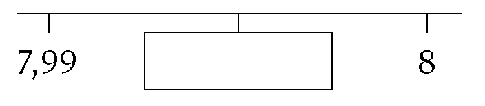
   4. \(9,123; 9,121; ☐; 9,117; ...\)
8. Join all the pairs of
               numbers that *multiply together to give 1*. The first has
               been done for you. Note that you will not use all the numbers
               on the right-hand side.
   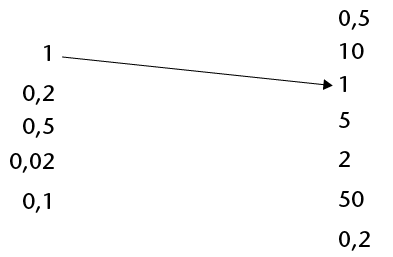
10. Calculate the following:
   2. \(5,673 - 3,597\)
   4. \(4,85 \times 1,2\)
   6. \(4,825 \div 5\)
12. A certain portion of
               the shapes below are shaded. Write each portion as a common
               fraction (in simplest form), decimal fraction and
               percentage.
   2. 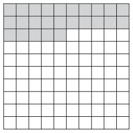
   4. 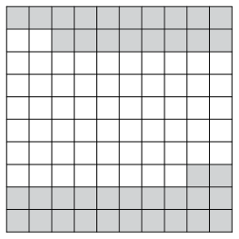

### Relationships between variables

2. 2. Here is a number
                      sequence: 1; 4; 10; 22; ______; ______
      The rule for creating the
                      number sequence is "times 2, add 2". Write down the next two
                      numbers in the number sequence.
   4. Here is another number
                      sequence: 100; 50; 25; ______
      Write down, in words, the rule for creating
                      this number sequence.
4. Use the given rule to
               calculate the missing values and/or determine the rule.
   2. 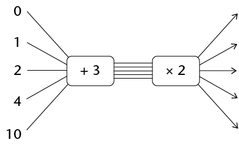
   4. 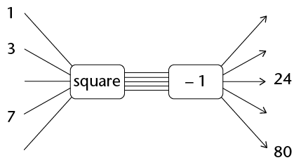
   6. 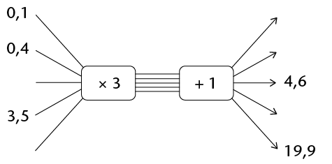
   8. 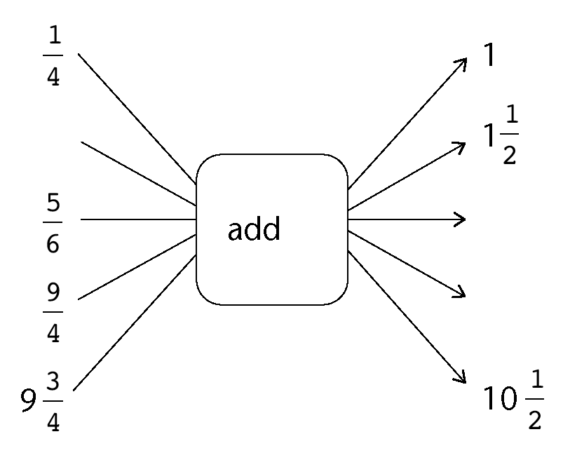
6. 2. There is a simple relationship
                      (multiply by ...) between the \(y\) values
                      and the \(x\) values in the table. Find it and then fill in
                      the missing values.
      | \(x\) | 0,1 | 0,3 | 0,6 | 2,5 | 3,2 |  |
      | --- | --- | --- | --- | --- | --- | --- |
      | \(y\) | 4 | 12 | 24 |  |  | 164 |
   4. Write in words the rule that describes
                      the relationship between the \(x\) values and the \(y\)
                      values.
8. 2. There is a simple relationship (add
                      ...) between the \(x\) values and the
                      \(y\) values in the table. Find the relationship and then
                      fill in the missing values.
      | \(x\) | \(\frac{1}{3}\) | \(\frac{5}{3}\) | \(\frac{7}{3}\) | \(9\frac{2}{3}\) | \(\frac{5}{6}\) |  | \(\frac{3}{4}\) |
      | --- | --- | --- | --- | --- | --- | --- | --- |
      | \(y\) | \(\frac{2}{3}\) | 2 | \(\frac{8}{3}\) |  |  | 15 | \(\frac{13}{12}\) |
   4. Write in words the rule by which the
                      missing \(x\) and \(y\) values can be
                      calculated.
10. The rule used to
               describe the relationship between the \(x\) values and
               \(y\) values in the table is "double the \(x\)and then
               subtract 2". Use the rule to find the missing values and fill
               them in.
   | \(x\) | 4 | 8 | 12 | 15 |  |  |
   | --- | --- | --- | --- | --- | --- | --- |
   | \(y\) | 6 | 14 |  |  | 42 | 100 |

### Perimeter and area of shapes

2. 2. A rectangle has an area of 48
                      cm2 and a length of
                      8 cm. How wide is it?
   4. A different rectangle has an area of 72
                      cm2, and is twice
                      as long as it is wide. Determine the dimensions of this
                      rectangle.
   6. A triangle has a base of 10 cm and an
                      area of 20 cm2.
                      What is the height of the triangle?
   8. What is the length of the side of a
                      square that has an area of 144 cm2?
4. An equilateral
               triangle with sides of 8,4 cm and a square have the same
               perimeter. Determine the length of the side of the square.
6. Calculate the area of the
               shaded figures.
   2. DEFG is a rectangle. Dimensions of the
                      sides are as indicated.
      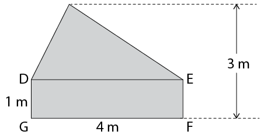
   4. ABCD is a rectangle. AB = 5 cm and FC =
                      2 cm. Give your answer in square millimetres. (You may use a
                      calculator in this question.)
      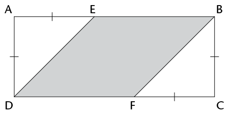
8. The garden of Mr and
               Mrs Mbuli is shown below, *not* to scale. There is a hedge
               all around the garden, except for the 2 metre wide gate (from A
               to B). The shaded area is grassed (the rest has trees, shrubs
               etc.).
   Garden Dream quoted the Mbulis R5 per square metre to mow their
               lawn and R10 per metre to trim their hedge. VAT is included in
               these prices. What was the total amount that Garden Dream
               quoted?
   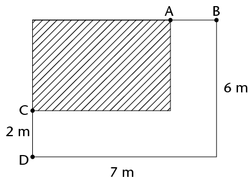

### Surface area and volume of objects

2. How many litres
               of water will a fish tank with inside measurements of \(1,2 \text{ m}
               \times 60\text{ cm} \times 70 \text{cm}\) hold, if it is filled to the
               brim?
4. A rectangular prism
               has a length of 4 cm, a width of 10 cm and a volume of 240
               cm3. What is the
               height of the prism?
6. A rectangular prism has a certain volume. Which of the
               following will double the volume of the prism? Tick the correct
               answer(s).
   ☐ Doubling all the dimensions
   ☐
               Doubling the length only
   ☐
               Doubling the length and the width, and halving the height
   ☐ Doubling the length and halving the width
               and keeping the height unchanged
8. Look at the diagram below of a
               rectangular prism made out of 16 cubes.
   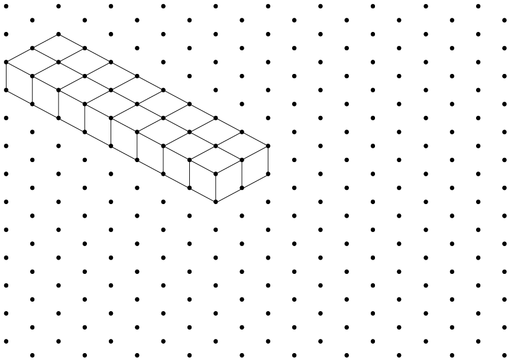
   Draw on the same grid two
               different rectangular prisms with the same volume as the one
               shown.
10. The total surface area of a
               cube is 150 cm2.
               Determine the volume of the cube.
12. The volume of a cube is 64
               cm3. Determine the
               total surface area of the cube.
14. In order to save water
               when flushing the toilet, Mrs Patel added a solid brick to the
               cistern. The internal dimensions of the cistern are \(30 \text{cm}
               \times 30 \text{cm} \times 10 \text{cm}\), and the brick together with other
               internal mechanisms have a volume of 1 000 cm3.
   2. Calculate how many litres of water the
                      cistern holds if the water fills up to 5 cm below the top of
                      the cistern.
   4. Suppose the Patel family flush the
                      toilet an average of 12 times a day. Use your calculator to
                      determine how many kilolitres of water they will use by this
                      means in one year.
16. Njabulo wishes to
               varnish the outside of a wooden chest that is in the shape of a
               rectangular prism. The bottom of the chest does not need to be
               varnished as it is on the ground. The chest is 1,5 m long, 50
               cm wide and 80 cm high. Determine, in square metres, the total
               surface area that will need to be varnished.
18. The image below
               shows the net of a rectangular prism drawn on a grid. If each
               block on the grid is a square with a side length of 1 unit,
               calculate:
   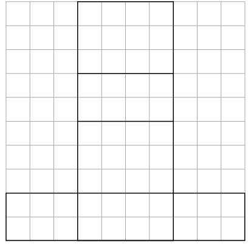
   2. The total surface area of the prism
   4. The volume of the prism
