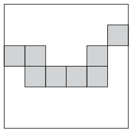
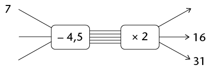
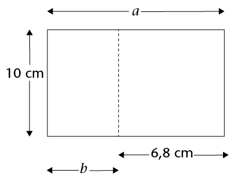
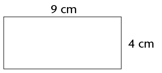
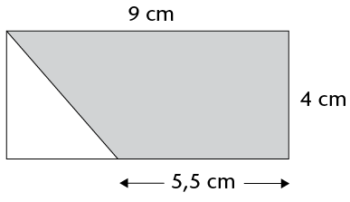
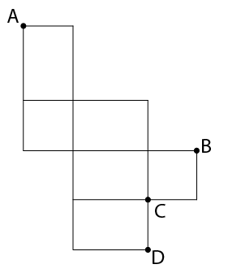

## Assessment

In this section, the numbers
        indicated in brackets at the end of a question indicate the
        number of marks that the question is worth. Use this
        information to help you determine how much working is
        needed.

The total number of marks allocated to the
        assessment is 60.

<Callout type="note" title="Note">
Do not use your calculator!
</Callout>

2. \(\frac{1}{4}\) is half of \(x\). What is the value of
               \(x\)?
4. The diagram alongside
               shows a square made up of blocks. Eight of these blocks have
               been shaded. Write, in its simplest form, the fraction of the
               square that is shaded.
   
6. Calculate the following:
   2. \(2\frac{2}{3} \times 1\frac{1}{2}\)
   4. \(\frac{13}{10} - \frac{5}{8}\)
8. Mrs Baker
               has baked a cake. She has some ladies around for tea and they
               eat half the cake. Her son John eats a quarter of the rest of
               the cake. What fraction of the cake is left?
10. The price
               of petrol has risen from R8 per litre to R12 per litre over the
               past 2 years. Determine the percentage increase in the price.
12. The Cupidos
               moved home. In the move, 5% of their crockery got broken. They
               have 57 pieces of crockery left (unbroken). How many pieces
               broke in the move?
14. \(\frac{15}{400} = 0.0375; \frac{17}{400} = 0.0425; \frac{19}{400} = 0.0475\)
   Using the above information, write down the decimal equivalents
               of the following fractions:
   2. \(\frac{21}{400}=\)
   4. \(\frac{22}{400}=\)
   6. \(\frac{13}{400}=\)
16. Multiply 56,76147
               by 100 and round off your answer to two decimal places.
18. Buti goes
               to the store and buys two cooldrinks at R7,50 each and three
               packets of chips at R5,95 each. If he pays with a R50 note, how
               much change should he get?
20. Class 7A
               at Grace Primary School collects some money for 3 charities. If
               the total they collect is R823,80, and the money is allocated
               equally to each charity, how much will each charity receive?
22. Use the given rule
               to calculate the missing values:
   
   2. There is a simple
                      relationship (add ...) between the values of
                      \(x\) and those of \(y\). Find the relationship and then
                      write down the missing values into the table.
      | \(x\) | 0,15 | 0,76 | 0,99 | 1,71 |  |
      | --- | --- | --- | --- | --- | --- |
      | \(y\) | 1,4 | 2,01 | 2,24 |  | 18,93 |
   4. Write in words the rule by
                      which the missing \(x\) and \(y\) values can be
                      calculated.
24. The total
               area of the rectangle shown is 112 cm2. Determine the lengths of
               \(a\) and \(b\).
   
26. Below is a
               rectangle, with dimensions as shown. A square has the same
               perimeteras the rectangle below. How long is the side of the
               square?
   
28. The
               diagram shows a rectangle divided into a triangle and a
               trapezium. Calculate the shaded area, giving your answer in
               mm2 .
   
30. The
               length and width of a rectangle is doubled.
   2. Tick the statement that is correct:
      ☐ The perimeter of the rectangle stays the
                      same.
      ☐ The
                      perimeter of the rectangle doubles.
      ☐ The perimeter of the rectangle
                      increases but it is not possible to say exactly by how
                      much.
   4. Tick the statement that is correct:
      ☐ The area of the rectangle stays the
                      same.
      ☐ The area of the rectangle doubles.
      ☐ The area of the rectangle triples.
      ☐ The area of the rectangle
                      increases to 4 times what it was before.
   6. Explain your answer to part
                      (b).
32. A
               rectangular prism has a volume of 24 cm3. In the table below, write
               four possible dimensions that the prism may have. One possible
               combination has already been added. Note: do not consider, for
               example, a prism with length 6 cm, and height and width 2 cm to
               be different.
   | Length | Width | Height |
   | --- | --- | --- |
   | 2 cm | 2 cm | 6 cm |
34. The inside
               of the boot of a car is in the shape of a rectangular prism,
               with length 1,2 m, width 70 cm and depth 40 cm. Determine the
               capacity of the boot *in litres*.
36. The volume of a
               cube is 27 cm3.
               Determine the surface area of the cube.
38. The length
               and breadth of a rectangular prism are both 4 cm, and its
               volume is 48 cm3.
               Determine the height of the prism.
40. Consider this net:
   
   2. What is the name of the solid created if
                      this net is folded?
   4. Which corner will A touch
                      when the solid is created: B, C or D?
